# 01. Go 操作 MySQL：从 database/sql 到 sqlx

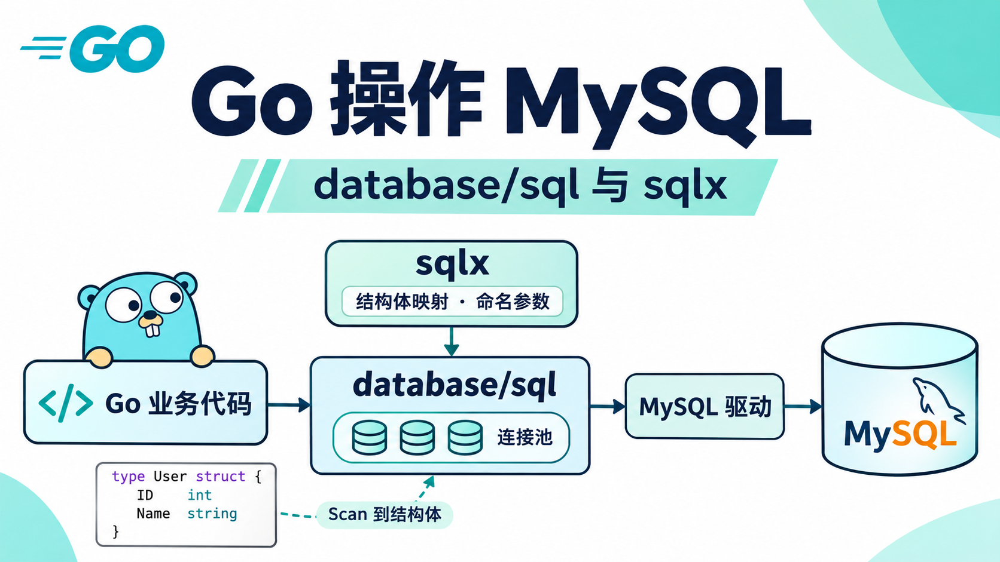

## 前言

在 Go 中操作 MySQL，通常会接触到三个名字：`database/sql`、MySQL 驱动和 sqlx。它们共同参与一次数据库访问，但承担着不同的职责。

本文先通过一张用户表，使用标准库 `database/sql` 完成连接、增删改查和事务操作，并结合实现过程理解连接池、参数绑定与结果扫描的工作原理；随后使用 sqlx 改写相同的数据操作，以此理解 sqlx 与标准库的关系，以及结构体映射、命名参数等功能是如何实现的。

配套代码分为两个独立项目：

| 项目 | 主要内容 |
| --- | --- |
| [01-database-sql-demo](https://github.com/zzxrepository/gocode-examples/tree/main/go/01-database-sql-demo) | 使用 `database/sql`，手动扫描查询结果 |
| [02-sqlx-demo](https://github.com/zzxrepository/gocode-examples/tree/main/go/02-sqlx-demo) | 使用 sqlx，完成结构体映射、命名参数和切片参数展开 |

两个项目使用相同的表结构，连接本机 MySQL，可以直接比较相同操作的实现方式。

## 1.1 database/sql、驱动与 sqlx 的关系

### 1.1.1 一次数据库访问经过哪些层

使用标准库时，一次数据库访问可以表示为：

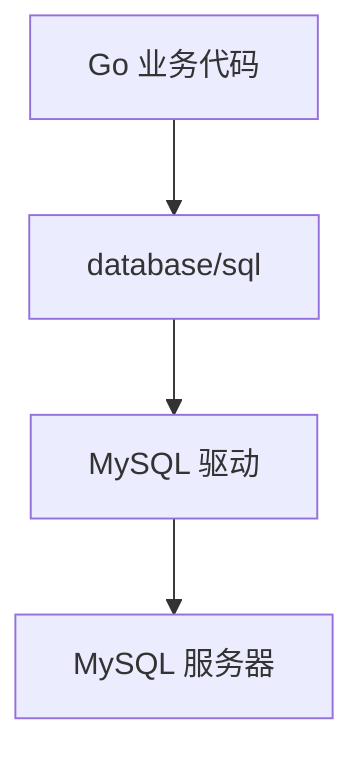

各层的职责如下：

| 层次 | 主要职责 |
| --- | --- |
| Go 业务代码 | 编写 SQL、组织参数、处理结果与错误 |
| `database/sql` | 提供统一 API，管理连接池、事务和结果集生命周期 |
| MySQL 驱动 | 建立网络连接，处理 MySQL 协议，发送命令并解析响应 |
| MySQL 服务器 | 执行 SQL，管理数据、索引、锁和事务 |

`database/sql` 提供了访问关系型数据库的公共接口，但它本身没有实现 MySQL 通信协议。因此，仅导入 `database/sql`，还不能连接 MySQL。

MySQL 驱动负责把标准库中的操作转换成 MySQL 能够识别的协议交互。

### 1.1.2 sqlx 增加了什么

引入 sqlx 后，调用关系变为：

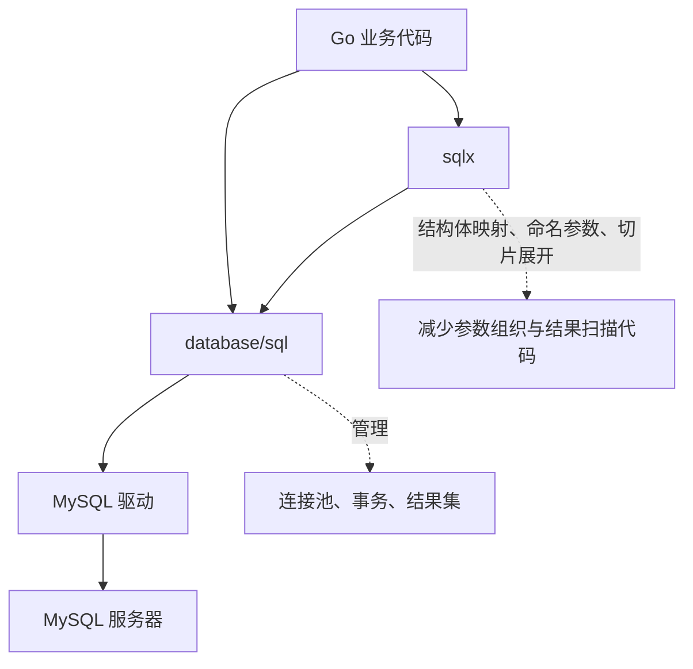

sqlx 在 `database/sql` 之上增加了一组辅助能力，主要包括：

- 根据字段名和 `db` 标签，将查询结果写入结构体。
- 使用 `GetContext`、`SelectContext` 简化单行和多行查询。
- 将命名参数转换成位置参数。
- 将切片展开为 `IN` 查询所需的多个占位符。

SQL 仍然需要由开发者编写，数据库连接仍然由标准库管理。

例如，下面两段代码执行的查询相同：

```go
// database/sql：显式指定每一列的接收地址。
err := db.QueryRowContext(ctx, query, id).Scan(
    &person.UserID,
    &person.Username,
    &person.Age,
    &person.Email,
)
```

```go
// sqlx：根据结果列名查找结构体字段，再完成扫描。
err := db.GetContext(ctx, &person, query, id)
```

两者的主要差别，发生在“如何组织参数”和“如何把结果写入 Go 变量”这两个环节。

## 1.2 准备数据库与示例模型

### 1.2.1 创建本机学习数据库

本文统一使用本机 MySQL：

```text
127.0.0.1:3306
```

使用自己的账号登录：

```bash
mysql -u root -p
```

创建学习数据库：

```sql
CREATE DATABASE IF NOT EXISTS go_mysql_demo
CHARACTER SET utf8mb4;
```

### 1.2.2 创建 person 表

```sql
USE go_mysql_demo;

CREATE TABLE IF NOT EXISTS person (
    user_id BIGINT NOT NULL AUTO_INCREMENT,
    username VARCHAR(64) NOT NULL,
    age INT NOT NULL,
    email VARCHAR(128) NULL,
    PRIMARY KEY (user_id),
    UNIQUE KEY uk_person_username (username)
) ENGINE=InnoDB DEFAULT CHARSET=utf8mb4;
```

表中只有四个字段：

| 字段 | 类型 | 说明 |
| --- | --- | --- |
| `user_id` | `BIGINT` | 自增主键 |
| `username` | `VARCHAR(64)` | 用户名，具有唯一约束 |
| `age` | `INT` | 年龄 |
| `email` | `VARCHAR(128)` | 邮箱，允许为 `NULL` |

用户名的唯一约束用于后面的事务实验：在同一个事务中插入两个相同用户名，第二次插入会失败，从而观察第一次插入是否被回滚。

准备两条初始数据：

```sql
INSERT IGNORE INTO person (username, age, email)
VALUES
    ('alice', 20, 'alice@example.com'),
    ('bob', 21, NULL);
```

这里为 bob 设置了 `NULL` 邮箱，用于观察 SQL `NULL` 与 Go 字符串的区别。

`INSERT IGNORE` 用于让这组固定演示数据可以重复初始化；遇到已存在的用户名时，不重置原有记录。

### 1.2.3 定义 Go 结构体

示例源码：[go/01-database-sql-demo/model.go](https://github.com/zzxrepository/gocode-examples/blob/main/go/01-database-sql-demo/model.go)。

```go
type Person struct {
	UserID   int64          `db:"user_id"`
	Username string         `db:"username"`
	Age      int            `db:"age"`
	Email    sql.NullString `db:"email"`
}
```

`db` 标签由 sqlx 读取。标准库中的手动 `Scan` 不读取这些标签，而是按照传入参数的顺序写入变量。

`Email` 没有直接使用 `string`，因为 SQL `NULL` 与空字符串具有不同含义：

| 数据库中的值 | Go 中的表示 |
| --- | --- |
| `NULL` | `sql.NullString{Valid: false}` |
| `''` | `sql.NullString{String: "", Valid: true}` |
| `'alice@example.com'` | `sql.NullString{String: "alice@example.com", Valid: true}` |

普通字符串只有一个字符串值，无法单独表达“这一列没有值”。

### 1.2.4 安装依赖

标准库示例需要 MySQL 驱动：

```bash
go get github.com/go-sql-driver/mysql@v1.10.0
```

sqlx 示例再增加：

```bash
go get github.com/jmoiron/sqlx@v1.4.0
```

下文涉及的实现说明基于 Go 1.26.5、MySQL 驱动 v1.10.0 和 sqlx v1.4.0。

## 1.3 建立数据库访问入口

### 1.3.1 组织连接配置

MySQL 驱动使用 DSN 描述连接信息。它包含用户名、密码、网络地址、数据库名和连接参数。

配套示例通过环境变量读取本机账号：

```bash
export MYSQL_USER='root'
export MYSQL_PASSWORD='替换为你的本机密码'
export MYSQL_DATABASE='go_mysql_demo'
```

连接地址固定为本机 `127.0.0.1:3306`。

可以使用驱动提供的配置类型生成 DSN：

示例源码：[go/01-database-sql-demo/mysql.go](https://github.com/zzxrepository/gocode-examples/blob/main/go/01-database-sql-demo/mysql.go#L39)。

```go
func localDSN(database string) string {
	cfg := mysql.NewConfig()
	cfg.User = os.Getenv("MYSQL_USER")
	if cfg.User == "" {
		cfg.User = "root"
	}
	cfg.Passwd = os.Getenv("MYSQL_PASSWORD")
	cfg.Net = "tcp"
	cfg.Addr = "127.0.0.1:3306"
	cfg.DBName = database
	cfg.Timeout = 3 * time.Second
	cfg.ReadTimeout = 5 * time.Second
	cfg.WriteTimeout = 5 * time.Second
	cfg.Params = map[string]string{"charset": "utf8mb4"}
	return cfg.FormatDSN()
}
```

这里的 `mysql` 来自：

```go
import mysql "github.com/go-sql-driver/mysql"
```

三个超时配置分别约束建立连接、网络读取和网络写入。它们属于驱动的连接配置。

后面传入查询方法的 `Context`，则用于控制一次操作的生命周期，例如等待连接、执行查询和读取结果。

### 1.3.2 创建句柄并验证连接

示例源码：[go/01-database-sql-demo/mysql.go](https://github.com/zzxrepository/gocode-examples/blob/main/go/01-database-sql-demo/mysql.go#L15)。

```go
func openDatabase(ctx context.Context, dsn string) (*sql.DB, error) {
	db, err := sql.Open("mysql", dsn)
	if err != nil {
		return nil, fmt.Errorf("open mysql: %w", err)
	}
	// 当前 MySQL 驱动的 OpenConnector 只解析 DSN；此时尚未拨号。
	stats := db.Stats()
	log.Printf("Open 后连接池: open=%d idle=%d in_use=%d", stats.OpenConnections, stats.Idle, stats.InUse)
	db.SetMaxOpenConns(20)
	db.SetMaxIdleConns(5)
	db.SetConnMaxIdleTime(5 * time.Minute)
	db.SetConnMaxLifetime(time.Hour)
	pingCtx, cancel := context.WithTimeout(ctx, 3*time.Second)
	defer cancel()
	if err := db.PingContext(pingCtx); err != nil {
		_ = db.Close()
		return nil, fmt.Errorf("ping mysql: %w", err)
	}
	stats = db.Stats()
	log.Printf("Ping 后连接池: open=%d idle=%d in_use=%d", stats.OpenConnections, stats.Idle, stats.InUse)
	return db, nil
}
```

调用时，数据库名也从环境变量读取：

```go
database := os.Getenv("MYSQL_DATABASE")
if database == "" {
    database = "go_mysql_demo"
}

db, err := openDatabase(ctx, localDSN(database))
if err != nil {
    return err
}
defer db.Close()
```

这里需要区分两个步骤：

1. `sql.Open` 创建数据库访问句柄。
2. `PingContext` 获取实际连接并检查与 MySQL 的通信。

对于本文使用的 MySQL 驱动，`Open` 成功并不代表服务器已经连接成功。

### 1.3.3 Open 如何找到驱动

标准库在 `database/sql/driver` 包中定义驱动接口。其中最基本的 `Driver` 接口约定了创建连接的方法：

源码位置：[Go driver/driver.go](https://github.com/golang/go/blob/go1.26.5/src/database/sql/driver/driver.go#L85)、[Go sql.go：Register](https://github.com/golang/go/blob/go1.26.5/src/database/sql/sql.go#L56)、[MySQL driver.go](https://github.com/go-sql-driver/mysql/blob/v1.10.0/driver.go#L94)。

```go
// database/sql/driver：接口定义。
type Driver interface {
    Open(name string) (Conn, error)
}
```

这里的 `Conn` 是同一包中的连接接口。具体数据库驱动实现这些接口，标准库便可以通过公共方法调用它们。

MySQL 驱动提供了具体类型 `MySQLDriver`，当前实现是一个没有字段的结构体，驱动能力由其方法提供。在驱动的 `driver.go` 中，包初始化函数会注册该对象，关键调用为：

```go
sql.Register(driverName, &MySQLDriver{})
```

默认的 `driverName` 是 `"mysql"`。标准库用下面的注册表保存各个驱动：

```go
var drivers = make(map[string]driver.Driver)
```

`Register` 的保存动作如下，省略空对象和重复名称检查：

```go
func Register(name string, driver driver.Driver) {
    driversMu.Lock()
    defer driversMu.Unlock()
    // 省略合法性检查。
    drivers[name] = driver
}
```

`drivers[name] = driver` 将传入的驱动接口值保存起来。注册完成后，可以把内容理解为：

| 键 | 接口值内部保存的具体对象 |
| --- | --- |
| `"mysql"` | `*mysql.MySQLDriver` 对象 |

接口值同时保留了具体类型与具体值，因此标准库取出对象以后，仍然可以调用它实现的方法。

这个对象提供的是 MySQL 驱动能力，此时还没有绑定某一个库的账号或地址。连接信息由调用 `sql.Open` 时传入的 DSN 决定。

如果只需要导入后的注册行为，可以使用匿名导入：

```go
import _ "github.com/go-sql-driver/mysql"
```

匿名导入会执行包初始化，只是不在当前文件引入可使用的包名。本文需要访问 `mysql.NewConfig` 和驱动错误类型，所以使用具名导入；两种方式都会执行初始化。

### 1.3.4 为什么 Open 后还没有建立连接

这里需要先认识连接器。标准库定义的 `driver.DriverContext` 提供 `OpenConnector` 方法；驱动实现该可选接口后，就可以先解析配置，后续再按配置创建连接：

```go
type DriverContext interface {
    OpenConnector(name string) (Connector, error)
}

type Connector interface {
    Connect(context.Context) (Conn, error)
    Driver() Driver
}
```

这两个接口位于 [Go driver/driver.go](https://github.com/golang/go/blob/go1.26.5/src/database/sql/driver/driver.go#L104)。`OpenConnector` 返回连接器，`Connect` 才创建实际连接；`Driver()` 用于返回对应的驱动对象。

MySQL 驱动的 [OpenConnector 实现](https://github.com/go-sql-driver/mysql/blob/v1.10.0/driver.go#L112) 如下：

```go
func (d MySQLDriver) OpenConnector(dsn string) (driver.Connector, error) {
    cfg, err := ParseDSN(dsn)
    if err != nil {
        return nil, err
    }
    return newConnector(cfg), nil
}
```

`cfg` 是解析得到的 `*mysql.Config`。驱动内部的连接器保存这份配置，所以以后需要新连接时，可以使用相同配置再次调用 `Connect`，不必每次重新解析 DSN。

| 对象 | 职责 |
| --- | --- |
| `MySQLDriver` | 提供 MySQL 驱动能力，被注册表保存 |
| MySQL `connector` | 保存连接配置，按配置创建连接 |
| `*sql.DB` | 保存连接器，管理连接的分配与回收 |
| MySQL `mysqlConn` | 代表一条实际 MySQL 会话，内部保存网络连接 |

沿着调用过程来看，主要步骤是：

1. `sql.Open` 查找已注册的驱动。
2. 调用驱动的 `OpenConnector`。
3. MySQL 驱动解析 DSN，创建连接器。
4. 标准库创建 `*sql.DB`，初始化连接池相关状态。
5. 返回数据库句柄。

标准库 [sql.Open 的实现](https://github.com/golang/go/blob/go1.26.5/src/database/sql/sql.go#L863) 会对注册对象做类型断言，判断它是否实现 `driver.DriverContext`。MySQL 驱动实现了该接口，所以取得连接器后进入 `OpenDB`。

下面是 [OpenDB 源码](https://github.com/golang/go/blob/go1.26.5/src/database/sql/sql.go#L832) 中创建管理对象的关键部分，省略其他初始化字段：

```go
db := &DB{
    connector: c,
    // 省略后台请求通道、取消函数等初始化字段。
}
```

`DB.connector` 保存传入的连接器，此处没有调用 `c.Connect`。`OpenDB` 还会启动后台连接创建协程；该协程等待建连请求，不会因启动就立即拨号。

需要区分两个同名方法：`sql.Open` 返回连接池句柄，而 `driver.Driver.Open` 返回单条驱动连接；本文的 MySQL 驱动使用连接器路径创建连接。

此时，程序已经具备了“以后如何建立连接”的信息，但尚未执行实际网络连接。

真正需要连接时，标准库才调用连接器的 `Connect`，由驱动建立 TCP 连接，完成握手和身份验证。

在默认网络拨号路径中，[connector.Connect](https://github.com/go-sql-driver/mysql/blob/v1.10.0/connector.go#L67) 创建 `mysqlConn`，再通过 `net.Dialer` 建立连接，结果保存到 `mc.netConn`。完成握手、认证和必要的会话初始化后，它才把连接作为 `driver.Conn` 返回。

标准库又把这个驱动连接包装成内部 `driverConn`，记录创建时间、归还时间和使用状态，用于连接池管理。因此，`driver.Conn` 是接口，`mysqlConn` 是驱动的实际连接对象，`driverConn` 是标准库管理连接的包装对象。

首次调用 `PingContext` 时，可以用下面的时序图理解：

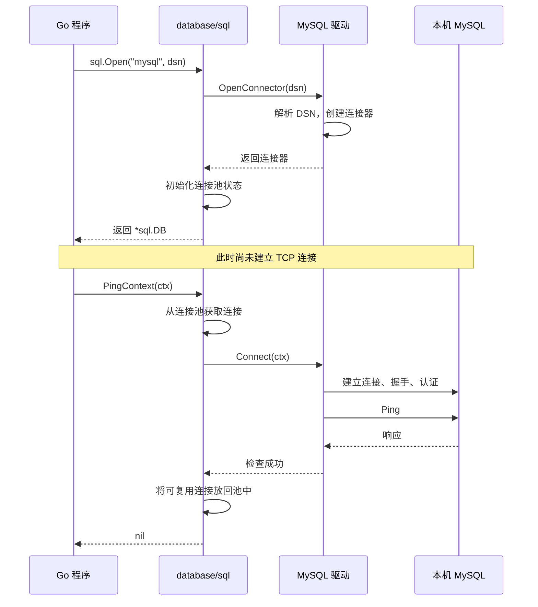

因此，示例程序能够观察到：

```text
Open 后连接池: open=0 idle=0 in_use=0
Ping 后连接池: open=1 idle=1 in_use=0
```

`Ping` 结束后，连接成为空闲连接，可以供后续查询复用。

## 1.4 理解 sql.DB 与连接池

### 1.4.1 一个 DB 可以管理多条连接

`*sql.DB` 可以被多个 goroutine 共享使用。它管理连接的创建、复用、等待和回收。

先看 [标准库 DB 结构体](https://github.com/golang/go/blob/go1.26.5/src/database/sql/sql.go#L507) 中与连接池相关的字段，省略其余字段：

```go
type DB struct {
    connector    driver.Connector // 新建连接所需的连接器
    freeConn     []*driverConn    // 当前空闲连接
    connRequests connRequestSet   // 正在等待连接的请求
    numOpen      int              // 已打开及正在建立的连接数量
    maxOpen      int              // 最大连接数
    maxIdleCount int              // 最大空闲连接数
    maxLifetime  time.Duration    // 最长可复用生命周期
    maxIdleTime  time.Duration    // 最长空闲时间
    // 省略互斥锁等其他字段。
}
```

`freeConn` 保存的是内部 `driverConn` 对象。它的 `ci` 字段才是驱动提供的 `driver.Conn`，同时还保存 `createdAt`、`returnedAt` 和 `inUse` 等管理信息。

连接借出时会从空闲列表中取走，并标记为使用中，但仍计入 `numOpen`。因此，空闲列表并不包含所有已打开连接。

当业务调用查询方法时，标准库大致按照以下过程获取连接：

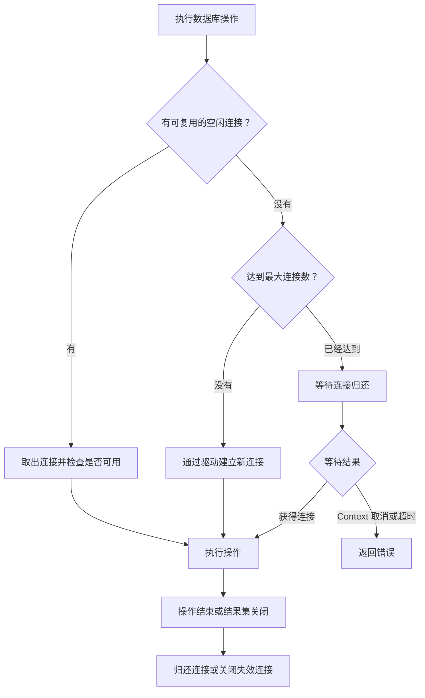

图中省略了失效连接处理和内部重试，但保留了连接池最重要的行为：复用、创建、等待和归还。

对应源码主要是 [DB.conn](https://github.com/golang/go/blob/go1.26.5/src/database/sql/sql.go#L1316) 与 [putConn](https://github.com/golang/go/blob/go1.26.5/src/database/sql/sql.go#L1481)。新建连接前先增加 `numOpen`，可以让其他并发调用看到正在使用的连接名额；创建失败再修正计数。

归还的可用连接，有等待请求时可以直接交给等待方；没有等待请求且空闲容量允许时，才加入 `freeConn`。失效或无法继续保留的连接则会关闭。

因此，数据库句柄通常在应用启动时创建，在应用退出时关闭。每次请求都调用 `sql.Open`，会创建多个独立连接池，削弱连接复用的效果。

### 1.4.2 四个常用连接池配置

```go
db.SetMaxOpenConns(20)
db.SetMaxIdleConns(5)
db.SetConnMaxIdleTime(5 * time.Minute)
db.SetConnMaxLifetime(time.Hour)
```

| 配置 | 含义 |
| --- | --- |
| `SetMaxOpenConns` | 限制连接池的最大打开连接数 |
| `SetMaxIdleConns` | 限制保留的空闲连接数量 |
| `SetConnMaxIdleTime` | 限制连接连续空闲的时间 |
| `SetConnMaxLifetime` | 限制连接从创建开始的可复用时长 |

`MaxIdleConns` 不会预先创建指定数量的连接。例如，设置为 5，表示最多保留 5 条空闲连接。

空闲时间和生命周期限制也不会在到期瞬间强行中断正在执行的 SQL。标准库会在连接检查、归还和清理等过程中淘汰到期连接。

这些数值需要结合数据库容量、应用实例数量、查询耗时与并发情况确定。本文的配置用于演示，不代表所有项目都应采用相同数值。

这些设置可以对应回刚才的管理字段：总量上限影响能否继续建连，空闲上限影响归还后是否保留；生命周期依据 `createdAt` 等信息判断，空闲时间依据 `returnedAt` 等信息判断。配置与清理逻辑可参阅 [Go sql.go](https://github.com/golang/go/blob/go1.26.5/src/database/sql/sql.go#L995)。

### 1.4.3 为什么拿不到连接也会超时

假设连接池最多只有一条连接：

```go
db.SetMaxOpenConns(1)
```

如果这条连接正在被一个未关闭的结果集占用，新的查询就需要等待。

此时，即使 SQL 本身只是：

```sql
SELECT 1;
```

也可能因为等待连接而超时。

因此，数据库操作返回 `context.DeadlineExceeded`，并不一定表示 MySQL 执行 SQL 太慢，也可能是在连接池中等待过久。

[DB.conn 的等待分支](https://github.com/golang/go/blob/go1.26.5/src/database/sql/sql.go#L1358) 会为本次请求创建带缓冲的通道，加入 `connRequests`，并增加 `waitCount`。随后通过 `select` 等待结果。以下源码节选省略了撤销请求、统计及连接有效性检查：

```go
select {
case <-ctx.Done():
    // 省略撤销等待请求、处理并发归还和统计的代码。
    return nil, ctx.Err()
case ret, ok := <-req:
    // 省略通道关闭、连接有效性和会话状态的检查。
    return ret.conn, ret.err
}
```

`req` 等待分配给本次请求的连接；`ctx.Done()` 则允许本次等待提前结束。此时还没有取得连接，SQL 也就没有发送给 MySQL。

可以通过 `db.Stats()` 观察：

| 字段 | 含义 |
| --- | --- |
| `OpenConnections` | 当前打开的连接数量 |
| `InUse` | 正在使用的连接数量 |
| `Idle` | 空闲连接数量 |
| `WaitCount` | 等待连接的累计次数 |
| `WaitDuration` | 等待连接的累计时长 |

`OpenConnections` 的统计来自 `numOpen`，建连中的名额也可能计入其中。因此，应结合空闲数、使用数与等待统计判断连接池状态。

连接的取得与归还已经明确，接下来可以沿一次具体写入，继续观察 SQL 参数与执行结果。

## 1.5 使用 database/sql 完成增删改查

数据库连接和表结构准备完成后，先明确每种操作使用哪个方法：

| 操作 | 主要方法 | 如何取得结果 |
| --- | --- | --- |
| 插入 | `ExecContext` | 从 `sql.Result` 读取新增主键 |
| 查询单行 | `QueryRowContext` | 用 `Scan` 接收一行，并检查错误 |
| 查询多行 | `QueryContext` | 遍历 `Rows`，逐行 `Scan` |
| 更新 | `ExecContext` | 检查错误与影响行数 |
| 删除 | `ExecContext` | 检查错误与影响行数 |

以下各节先给出操作函数及调用方式，再说明结果处理和实现原理。调用片段放在已经取得 `db`、`ctx` 的业务函数中；插入返回的 `id` 会继续用于查询、更新和删除。

### 1.5.1 插入数据

<span id="_1-5-1-插入数据-sql-模板与参数分别传入"></span>

#### 1.5.1.1 使用 ExecContext 插入一条记录

`INSERT` 决定写入哪张表、哪些列；`ExecContext` 执行 SQL，并返回 `sql.Result`。先将插入过程封装为函数：

示例源码：[go/01-database-sql-demo/person.go](https://github.com/zzxrepository/gocode-examples/blob/main/go/01-database-sql-demo/person.go#L9)。

```go
func insertPerson(ctx context.Context, db *sql.DB, person Person) (int64, error) {
	result, err := db.ExecContext(ctx,
		"INSERT INTO person (username, age, email) VALUES (?, ?, ?)",
		person.Username, person.Age, person.Email)
	if err != nil {
		return 0, fmt.Errorf("insert person: %w", err)
	}
	id, err := result.LastInsertId()
	if err != nil {
		return 0, fmt.Errorf("read inserted id: %w", err)
	}
	return id, nil
}
```

调用时创建一个 `Person`，将它交给插入函数：

```go
person := Person{
    Username: fmt.Sprintf("charlie_%d", time.Now().UnixNano()),
    Age:      22,
    Email: sql.NullString{
        String: "charlie@example.com",
        Valid:  true,
    },
}

id, err := insertPerson(ctx, db, person)
if err != nil {
    return err
}
fmt.Println("新用户 ID：", id)
```

用户名增加时间后缀，便于重复运行；数据库生成的 ID 通过返回值交给后续操作。`Email.Valid` 为 `true` 时写入对应字符串，为 `false` 时写入 SQL `NULL`。

这次调用包含两个部分：

```go
"INSERT INTO person (username, age, email) VALUES (?, ?, ?)"
```

是 SQL 模板；

```go
person.Username, person.Age, person.Email
```

是参数值。

三个参数按照顺序与三个 `?` 对应。

#### 1.5.1.2 读取新增主键与执行结果

`ExecContext` 适合执行不返回查询结果集的语句，例如本文中的 `INSERT`、`UPDATE` 和 `DELETE`。它返回的 `sql.Result` 提供执行结果信息，包括：

- `LastInsertId`：本文 MySQL 自增主键插入后生成的 ID。
- `RowsAffected`：语句影响的行数。

`LastInsertId` 是否受支持与数据库、驱动有关，不能把 MySQL 中的行为直接推广到所有数据库。

`Result` 中的信息来自 MySQL 的执行响应。驱动在 [packets.go 的 handleOkPacket](https://github.com/go-sql-driver/mysql/blob/v1.10.0/packets.go#L670) 中解析影响行数、自增 ID 等字段，再通过 [mysqlResult](https://github.com/go-sql-driver/mysql/blob/v1.10.0/result.go#L32) 实现结果接口。

所以，`LastInsertId()` 读取的是本次执行返回的信息，不需要补发查询，也不是查询表中当前最大的 ID。`ExecContext` 完成后已经结束本次连接占用，业务仍然可以读取返回的结果信息。

<span id="_1-5-2-参数是如何传到-mysql-的"></span>

#### 1.5.1.3 参数是如何传到 MySQL 的

业务代码传入的参数是 Go 值。标准库和驱动会将它们转换成数据库驱动能够处理的参数形式，再按照驱动采用的协议路径发送给 MySQL。

标准库先通过驱动的参数检查能力及通用转换规则处理 Go 参数。实现了 `driver.Valuer` 的值，可以在这个过程中转成数据库参数；普通切片或结构体不会自动拆成任意多个参数。

标准库取得连接后，会优先检查驱动是否提供 `ExecerContext` 等直接执行能力。MySQL 驱动实现了该接口，但在本文没有开启 `interpolateParams` 的配置下，带参数时会返回 `driver.ErrSkip`。以下是 [MySQL connection.go](https://github.com/go-sql-driver/mysql/blob/v1.10.0/connection.go#L433) 中的相关分支，省略前后逻辑：

```go
if len(args) != 0 {
    if !mc.cfg.InterpolateParams {
        return nil, driver.ErrSkip
    }
    // 省略参数插值分支。
}
```

`ErrSkip` 是驱动与标准库约定的执行路径信号，表示本次不走直接执行。标准库的 [execDC](https://github.com/golang/go/blob/go1.26.5/src/database/sql/sql.go#L1696) 识别后，继续准备、执行并关闭本次语句。

准备语句时，SQL 模板先发给 MySQL，服务器返回语句标识及参数信息；执行时再携带标识和参数发送执行命令。整个过程如下：

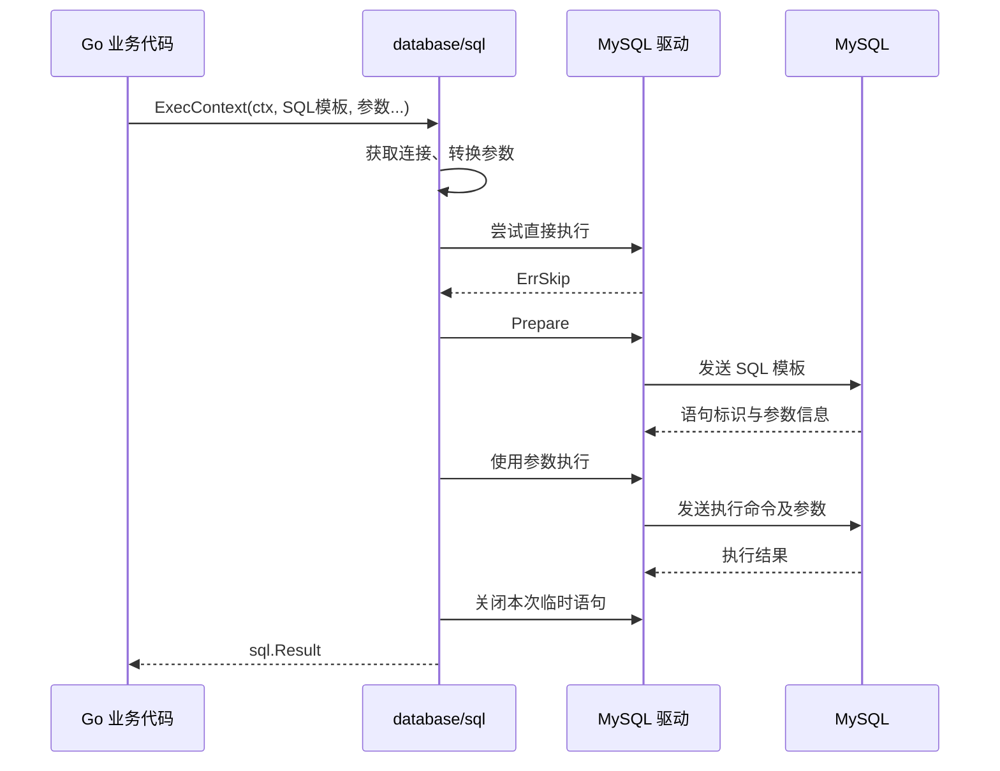

这是本文依赖版本和连接配置下的执行过程。驱动可以提供其他执行路径，不能把“每次都执行同样的协议步骤”当成所有数据库的统一规则。

对于业务代码，关键是保持 SQL 模板与参数值分别传入。

下面这种写法会把输入直接放进 SQL 结构中：

```go
query := "SELECT user_id FROM person WHERE username = '" + username + "'"
```

应改为：

```go
query := "SELECT user_id FROM person WHERE username = ?"
row := db.QueryRowContext(ctx, query, username)
```

占位符用于传递值，不能代替表名、列名或 `ASC`、`DESC` 等 SQL 关键字。需要动态排序时，可以把允许的排序方式映射成预先确定的 SQL 片段。

### 1.5.2 查询单行

<span id="_1-5-3-查询单行-queryrowcontext-与-scan"></span>

#### 1.5.2.1 使用 QueryRowContext 与 Scan

先执行查询，再按照查询列的顺序接收数据。下面按主键查询刚才创建的用户：

示例源码：[go/01-database-sql-demo/person.go](https://github.com/zzxrepository/gocode-examples/blob/main/go/01-database-sql-demo/person.go#L23)。

```go
func findPerson(ctx context.Context, db *sql.DB, id int64) (Person, error) {
	var person Person
	err := db.QueryRowContext(ctx,
		"SELECT user_id, username, age, email FROM person WHERE user_id = ?", id,
	).Scan(&person.UserID, &person.Username, &person.Age, &person.Email)
	if err != nil {
		return Person{}, fmt.Errorf("find person %d: %w", id, err)
	}
	return person, nil
}
```

调用函数并读取结果：

```go
found, err := findPerson(ctx, db, id)
if err != nil {
    return err
}
fmt.Printf("id=%d username=%s age=%d\n",
    found.UserID, found.Username, found.Age)
```

这里的 `id` 来自插入操作，不需要假定数据库生成的编号一定是 1。

`Scan` 根据查询结果中的列顺序，依次写入传入的目标地址：

| 查询结果列 | 接收地址 |
| --- | --- |
| 第 1 列 `user_id` | `&person.UserID` |
| 第 2 列 `username` | `&person.Username` |
| 第 3 列 `age` | `&person.Age` |
| 第 4 列 `email` | `&person.Email` |

这里传入指针，是因为 `Scan` 需要修改这些变量。

标准库不会根据变量名或结构体标签自动推断对应关系。如果调整了 SQL 中的列顺序，也需要同步调整 `Scan` 参数顺序。

<span id="_1-5-5-如何判断没有查到记录"></span>

#### 1.5.2.2 处理没有查到记录的情况

如果没有匹配行，`Scan` 返回 `sql.ErrNoRows`：

```go
person, err := findPerson(ctx, db, id)

switch {
case errors.Is(err, sql.ErrNoRows):
    // 没有匹配的用户。
case err != nil:
    // 查询、通信或扫描失败。
default:
    // 查询成功，使用 person。
}
```

前面的函数使用 `%w` 包装了错误，因此调用方仍然可以通过 `errors.Is` 判断原始错误。

还需要注意，`QueryRowContext` 读取第一行，并不会检查结果集中是否只有一行。本文使用主键条件，由主键约束保证最多匹配一条记录。

<span id="_1-5-4-queryrowcontext-为什么没有直接返回-error"></span>

#### 1.5.2.3 QueryRowContext 为什么没有直接返回 error

`QueryRowContext` 返回的是 `*sql.Row`：

```go
row := db.QueryRowContext(ctx, query, id)
```

可以直接看 [QueryRowContext 与 Row 的源码](https://github.com/golang/go/blob/go1.26.5/src/database/sql/sql.go#L1841)：

```go
func (db *DB) QueryRowContext(ctx context.Context, query string, args ...any) *Row {
    rows, err := db.QueryContext(ctx, query, args...)
    return &Row{rows: rows, err: err}
}

type Row struct {
    err  error
    rows *Rows
}
```

`Row` 包装了底层结果集或查询错误。它把查询过程中产生的错误保存在 `Row` 中，再由 `Scan` 返回。

需要准确区分：

- 查询调用已经发生。
- 错误的返回被推迟到了 `Scan`。

不能据此理解为“SQL 一定要等到 `Scan` 才开始执行”。标准库的 `QueryRowContext` 会调用 `QueryContext`，然后把结果集和错误一起保存到 `Row` 中。

因此，单行查询通常直接写成：

```go
err := db.QueryRowContext(ctx, query, id).Scan(&value)
```

即使不关心某些查询结果，也不能把返回的 `Row` 放在那里不处理。`Scan` 同时承担读取结果和结束这次单行查询的工作。

[Row.Scan](https://github.com/golang/go/blob/go1.26.5/src/database/sql/sql.go#L3486) 会先检查保存的错误，再推进到第一行。没有第一行且无其他读取错误时返回 `ErrNoRows`；有第一行时调用底层 `Rows.Scan`，并结束结果集。因此，单行 API 没有显式 `Next`，不代表底层省略了这一过程。

<span id="_1-5-6-scan-如何处理类型与-null"></span>

#### 1.5.2.4 Scan 如何处理类型与 NULL

MySQL 驱动先把数据库结果转换成驱动层的值，`Scan` 再把这些值转换并写入目标变量。

标准库 `Rows` 内部的 `lastcols` 保存当前行驱动值，扫描函数按列将这些值交给目标地址。以下节选自 [scanLocked](https://github.com/golang/go/blob/go1.26.5/src/database/sql/sql.go#L3383)，省略数量校验与错误返回：

```go
for i, sv := range rs.lastcols {
    err := convertAssignRows(dest[i], sv, rs)
    // 省略转换失败时的错误返回。
}
```

`sv` 是当前列值，`dest[i]` 是对应目标指针。转换函数处理常见类型赋值、字节切片与字符串转换、数字解析等。类型不兼容或数字越界时，SQL 可以查询成功，但扫描仍然失败。

目标变量可能是普通类型指针：

```go
var age int
```

也可能是实现了 `sql.Scanner` 的类型。

`Scanner` 接口让目标类型提供自己的转换规则。它的关键方法是 `Scan(src any) error`；在 [convertAssignRows](https://github.com/golang/go/blob/go1.26.5/src/database/sql/convert.go#L393) 中，可以看到：

```go
if scanner, ok := dest.(Scanner); ok {
    return scanner.Scan(src)
}
```

传入 `&person.Email` 时，`*sql.NullString` 满足这个接口。[NullString.Scan 的实现](https://github.com/golang/go/blob/go1.26.5/src/database/sql/sql.go#L200) 为：

```go
func (ns *NullString) Scan(value any) error {
    if value == nil {
        ns.String, ns.Valid = "", false
        return nil
    }
    ns.Valid = true
    return convertAssign(&ns.String, value)
}
```

驱动用 `nil` 表达 SQL `NULL`，因此它会进入第一个分支；非 `NULL` 值则交给字符串转换。

`sql.NullString` 就实现了该接口。扫描到 `NULL` 时，它将 `Valid` 设置为 `false`；扫描到非 `NULL` 值时，保存字符串并将 `Valid` 设置为 `true`。

```go
if person.Email.Valid {
    fmt.Println(person.Email.String)
} else {
    fmt.Println("未设置邮箱")
}
```

写入参数时，它又通过 `driver.Valuer` 表达数据库值：

- `Valid == false` 时，提供 `nil`，写入 SQL `NULL`。
- `Valid == true` 时，提供对应字符串。

因此，同一个类型同时参与了“数据库结果转为 Go 值”和“Go 值转为数据库参数”两个方向的转换。

`driver.Valuer` 则约定反方向的 `Value()` 方法，返回驱动能够处理的值。[NullString.Value](https://github.com/golang/go/blob/go1.26.5/src/database/sql/sql.go#L210) 根据 `Valid` 返回字符串或 `nil`。字段自身保存有效标记，两个接口分别负责写入参数和读取结果时的转换。

### 1.5.3 查询多行

<span id="_1-5-7-查询多行-next、scan、close-与-err"></span>

#### 1.5.3.1 使用 QueryContext 遍历结果

示例源码：[go/01-database-sql-demo/person.go](https://github.com/zzxrepository/gocode-examples/blob/main/go/01-database-sql-demo/person.go#L34)。

```go
func listPeople(ctx context.Context, db *sql.DB) ([]Person, error) {
	rows, err := db.QueryContext(ctx,
		"SELECT user_id, username, age, email FROM person ORDER BY user_id")
	if err != nil {
		return nil, fmt.Errorf("query people: %w", err)
	}
	defer rows.Close()
	people := make([]Person, 0)
	for rows.Next() {
		var person Person
		if err := rows.Scan(&person.UserID, &person.Username, &person.Age, &person.Email); err != nil {
			return nil, fmt.Errorf("scan person: %w", err)
		}
		people = append(people, person)
	}
	if err := rows.Err(); err != nil {
		return nil, fmt.Errorf("iterate people: %w", err)
	}
	return people, nil
}
```

这段代码中的几个步骤分别解决不同问题：

| 操作 | 作用 |
| --- | --- |
| `QueryContext` | 执行查询，获得结果集 |
| `Next` | 推进到下一行 |
| `Scan` | 将当前行写入目标变量 |
| `Close` | 关闭结果集，结束对相关资源的使用 |
| `Err` | 检查遍历是否因错误而结束 |

`Next` 返回 `false` 有两种主要可能：已经读完，或者读取过程发生错误。因此，循环结束后还需要检查 `rows.Err()`。

调用时，取得切片后再处理每一条记录：

```go
people, err := listPeople(ctx, db)
if err != nil {
    return err
}
for _, person := range people {
    fmt.Printf("%d %s %d\n", person.UserID, person.Username, person.Age)
}
```

如果没有匹配行，循环不会进入，函数正常返回空切片；多行查询不以 `sql.ErrNoRows` 表示空结果。

<span id="_1-5-8-结果集为什么会影响连接池"></span>

#### 1.5.3.2 结果集为什么会影响连接池

先看 [Rows 的相关字段](https://github.com/golang/go/blob/go1.26.5/src/database/sql/sql.go#L2929)，省略其余状态：

```go
type Rows struct {
    dc          *driverConn
    releaseConn func(error)
    rowsi       driver.Rows
    lastcols    []driver.Value
    // 省略其余字段。
}
```

`dc` 保存查询使用的连接，`rowsi` 是驱动返回的结果集，`lastcols` 保存当前行，`releaseConn` 用于本次读取结束时释放连接占用。

`Next` 通过驱动结果集的 `Next` 方法填充当前行；`Scan` 再转换并写入目标变量；关闭结果集时，标准库清理驱动结果集并调用释放逻辑。因此，这几个方法分别对应行读取、变量赋值与资源结束。

普通查询取得连接后，这条连接需要继续服务于结果集的读取。在结果集结束前，它通常无法供另一条查询复用。

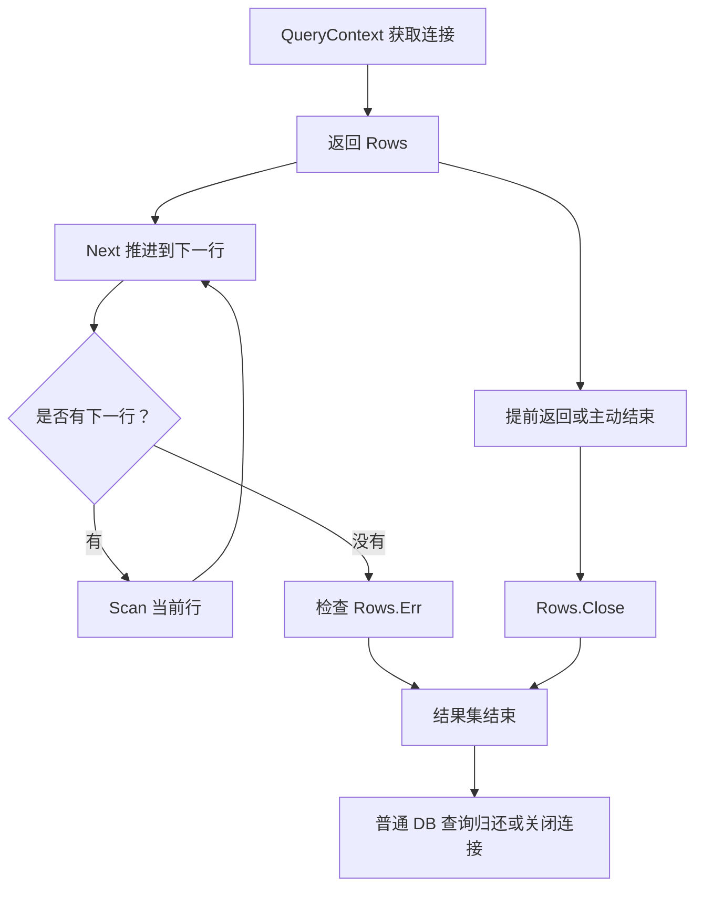

完整读到结果集结束时，标准库会进行相应关闭处理。代码仍然应当在查询成功后立即安排：

```go
defer rows.Close()
```

这样，在扫描失败、业务提前返回等路径中，也能结束结果集。

对于事务内查询，关闭 `Rows` 只结束当前结果集；事务占用的连接仍要等到事务提交或回滚后才能归还。

### 1.5.4 更新数据

<span id="_1-5-9-更新与删除"></span>

#### 1.5.4.1 使用 ExecContext 更新指定记录

示例源码：[go/01-database-sql-demo/person.go](https://github.com/zzxrepository/gocode-examples/blob/main/go/01-database-sql-demo/person.go#L55)。

```go
func updateAge(ctx context.Context, db *sql.DB, id int64, age int) (int64, error) {
	result, err := db.ExecContext(ctx,
		"UPDATE person SET age = ? WHERE user_id = ?", age, id)
	if err != nil {
		return 0, fmt.Errorf("update person: %w", err)
	}
	affected, err := result.RowsAffected()
	if err != nil {
		return 0, fmt.Errorf("read update result: %w", err)
	}
	return affected, nil
}
```

SQL 中第一个参数是新年龄，第二个参数是筛选用户的 ID。调用后重新查询，可以看到保存的新值：

```go
affected, err := updateAge(ctx, db, id, 23)
if err != nil {
    return err
}
fmt.Println("更新影响行数：", affected)

updated, err := findPerson(ctx, db, id)
if err != nil {
    return err
}
fmt.Println("更新后年龄：", updated.Age) // 23
```

`WHERE user_id = ?` 决定更新范围；不带 `WHERE` 的这类更新会作用于整张表，标准库不会自动阻止。

#### 1.5.4.2 如何解释更新影响行数

更新没有匹配记录时，通常不会返回 `sql.ErrNoRows`，需要查看 `RowsAffected`。

对于本文使用的 MySQL 默认配置，更新行数反映实际发生变化的行数。将某条记录的年龄从 22 改为 23，可能返回 1；再次将 23 更新为 23，则可能返回 0。

所以，更新影响行数为 0，不能直接推出“记录不存在”。驱动的 `clientFoundRows` 配置也会改变这一统计行为。

### 1.5.5 删除数据

#### 1.5.5.1 使用 ExecContext 删除指定记录

示例源码：[go/01-database-sql-demo/person.go](https://github.com/zzxrepository/gocode-examples/blob/main/go/01-database-sql-demo/person.go#L68)。

```go
func deletePerson(ctx context.Context, db *sql.DB, id int64) (int64, error) {
	result, err := db.ExecContext(ctx, "DELETE FROM person WHERE user_id = ?", id)
	if err != nil {
		return 0, fmt.Errorf("delete person: %w", err)
	}
	affected, err := result.RowsAffected()
	if err != nil {
		return 0, fmt.Errorf("read delete result: %w", err)
	}
	return affected, nil
}
```

调用删除函数，并再次查询验证结果：

```go
deleted, err := deletePerson(ctx, db, id)
if err != nil {
    return err
}
fmt.Println("删除影响行数：", deleted)

_, err = findPerson(ctx, db, id)
switch {
case errors.Is(err, sql.ErrNoRows):
    fmt.Println("该用户已不存在")
case err != nil:
    return err
default:
    return errors.New("删除后仍查询到该用户")
}
```

这里真正移除了数据库记录。删除条件只接收本次创建的用户 ID，不影响初始化时的 alice 和 bob。

#### 1.5.5.2 删除后如何判断结果

对于本文按主键执行的 `DELETE`，影响行数为 1 表示删除了一条记录，为 0 表示本次没有删除匹配记录。再次删除同一个 ID，通常正常返回 0，而不会返回 `sql.ErrNoRows`。

`sql.ErrNoRows` 来自后续单行查询的 `Scan`，并不是删除方法的返回约定。

### 1.5.6 需要重复执行同一 SQL 时

<span id="_1-5-10-需要重复执行同一-sql-时"></span>

#### 1.5.6.1 准备并使用可复用语句

如果同一条 SQL 需要多次执行，可以显式创建可复用的语句：

```go
stmt, err := db.PrepareContext(
    ctx,
    "SELECT username FROM person WHERE user_id = ?",
)
if err != nil {
    return err
}
defer stmt.Close()
```

随后使用不同参数调用：

```go
var username string

err = stmt.QueryRowContext(ctx, id).Scan(&username)
if err != nil {
    return err
}
```

#### 1.5.6.2 语句如何配合连接池使用

通过 `*sql.DB` 创建的 `*sql.Stmt` 可以配合连接池使用。语句对象会根据实际使用的连接，在相应连接上准备底层语句；它并不意味着所有调用都固定占用同一条连接。

是否显式复用语句，可以根据重复执行的场景和实际测量决定。参数化查询本身不要求业务代码每次都显式调用 `PrepareContext`。

这可以结合 [标准库 Stmt](https://github.com/golang/go/blob/go1.26.5/src/database/sql/sql.go#L2603) 与 [MySQL mysqlStmt](https://github.com/go-sql-driver/mysql/blob/v1.10.0/statement.go#L19) 理解：前者管理 SQL 及其在不同连接上已准备的语句记录，后者保存所属连接、服务器返回的语句 ID 和参数数量等。

语句 ID 属于具体 MySQL 连接，因此业务 `Stmt` 取得另一条连接后，需要判断该连接上是否已有可用语句，必要时再次准备。通过事务创建的语句则随事务使用固定连接。

这些例子都需要显式维护参数和接收地址。接下来保持相同 SQL，观察 sqlx 如何减少这部分代码。

## 1.6 使用 sqlx 包装已有连接池

前面已经获得一个可用的 `*sql.DB`。引入 sqlx 后，可以直接包装它：

```go
db := sqlx.NewDb(baseDB, "mysql")
```

此时：

```go
fmt.Println(db.DB == baseDB) // true
```

[sqlx.DB 与 NewDb 的源码](https://github.com/jmoiron/sqlx/blob/v1.4.0/sqlx.go#L243) 如下：

```go
type DB struct {
    *sql.DB
    driverName string
    unsafe     bool
    Mapper     *reflectx.Mapper
}

func NewDb(db *sql.DB, driverName string) *DB {
    return &DB{DB: db, driverName: driverName, Mapper: mapper()}
}
```

嵌入字段保存传入的数据库句柄；`driverName` 用于选择占位符形式；`Mapper` 负责结构体名称映射；`unsafe` 控制是否允许结果列缺少对应字段，默认会检查映射。

构造函数没有重新调用 `Open`，而是保存原指针。sqlx 的数据库对象嵌入了 `*sql.DB`，因此原来的方法仍然可以调用：

```go
db.ExecContext(...)
db.QueryContext(...)
db.PingContext(...)
db.SetMaxOpenConns(...)
```

`NewDb` 增加了 sqlx 所需的驱动名称和字段映射信息，使用的仍然是传入的数据库句柄。

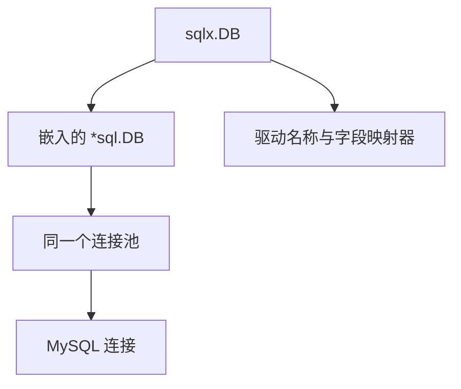

因此，原来设置的连接数、空闲时间和连接生命周期配置继续生效。

配套示例统一由最初创建句柄的位置负责关闭数据库。包装成 sqlx 对象后，不需要再为同一个底层句柄安排另一套关闭逻辑。

## 1.7 使用 GetContext 查询单行

<span id="_1-7-1-改写标准库查询"></span>

### 1.7.1 查询结构体并处理结果

标准库版本需要显式传入四个字段地址。sqlx 版本可以写为：

示例源码：[go/02-sqlx-demo/person.go](https://github.com/zzxrepository/gocode-examples/blob/main/go/02-sqlx-demo/person.go#L23)。

```go
func findPerson(ctx context.Context, db *sqlx.DB, id int64) (Person, error) {
	var person Person
	err := db.GetContext(ctx, &person,
		"SELECT user_id, username, age, email FROM person WHERE user_id = ?", id)
	if err != nil {
		return Person{}, fmt.Errorf("find person %d: %w", id, err)
	}
	return person, nil
}
```

这里依然需要传入 `&person`，因为 sqlx 最终需要修改这个结构体中的字段。

调用方式与标准库版本保持一致：

```go
person, err := findPerson(ctx, db, id)
switch {
case errors.Is(err, sql.ErrNoRows):
    fmt.Println("用户不存在")
case err != nil:
    return err
default:
    fmt.Printf("%s: %d\n", person.Username, person.Age)
}
```

SQL、ID 参数和错误判断没有变化，变化的是函数内部的结果接收方式。

没有匹配记录时，仍然可以判断：

```go
errors.Is(err, sql.ErrNoRows)
```

`GetContext` 同样读取第一行，不会自动验证查询是否只返回一行。

<span id="_1-7-4-为什么推荐显式写-db-标签"></span>

### 1.7.2 使用 db 标签明确字段映射

默认名称映射会将字段名转成小写，但不会自动把所有驼峰名称转换成下划线形式。

例如：

```go
UserID
```

默认转换结果是：

```text
userid
```

它与数据库列名：

```text
user_id
```

并不相同。

因此，建议明确声明：

```go
UserID int64 `db:"user_id"`
```

查询中的列名也可以使用别名与标签对应：

```sql
SELECT user_id AS id, username
FROM person;
```

相应目标类型可以写为：

```go
type PersonSummary struct {
    ID       int64  `db:"id"`
    Username string `db:"username"`
}
```

默认情况下，如果结果中出现无法映射的列，sqlx 会报告错误。这能帮助发现 SQL 与目标结构体不一致的问题。

<span id="_1-7-5-getcontext-也可以接收标量"></span>

### 1.7.3 查询单个值

如果查询只返回一个值，不一定需要创建结构体：

```go
var count int

err := db.GetContext(
    ctx,
    &count,
    "SELECT COUNT(*) FROM person",
)
if err != nil {
    return err
}
fmt.Println("用户总数：", count)
```

此时，目标是一个标量地址，sqlx 可以直接完成单列扫描。

### 1.7.4 结构体映射与反射原理

<span id="_1-7-2-sqlx-如何知道结果应该写到哪里"></span>

#### 1.7.4.1 sqlx 如何确定接收字段

查询返回的列名为：

```text
user_id, username, age, email
```

结构体中存在相应标签：

```go
UserID   int64          `db:"user_id"`
Username string         `db:"username"`
Age      int            `db:"age"`
Email    sql.NullString `db:"email"`
```

sqlx 主要完成以下工作：

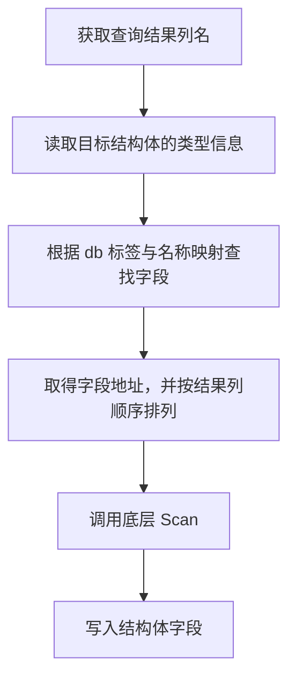

对于这个结构体，最终准备的接收地址相当于：

```go
[]any{
    &person.UserID,
    &person.Username,
    &person.Age,
    &person.Email,
}
```

因此，sqlx 自动化的是“查找字段并组织接收地址”这一步。具体值的扫描与转换，仍然由底层扫描机制完成。

这也是 `sql.NullString` 在 sqlx 中继续有效的原因。

从 [GetContext 的实现](https://github.com/jmoiron/sqlx/blob/v1.4.0/sqlx_context.go#L82) 看，查询先进入 `QueryRowxContext`，返回 sqlx 自己的 `Row`，随后由 `scanAny` 处理目标。这个包装对象保存底层 `*sql.Rows`、查询错误与 Mapper。

[scanAny](https://github.com/jmoiron/sqlx/blob/v1.4.0/sqlx.go#L740) 先检查目标指针，再判断它可以直接扫描，还是需要按结构体字段映射。`Person` 进入字段映射分支；实现了 `Scanner` 的 `sql.NullString` 则可以作为单列接收类型。

<span id="_1-7-3-反射在这里做了什么"></span>

#### 1.7.4.2 反射如何取得当前对象的字段地址

反射中有两类信息：

| 信息 | 在当前查询中的作用 |
| --- | --- |
| `reflect.Type` | 描述 `Person` 有哪些字段、字段位置和标签 |
| `reflect.Value` | 定位这次传入的 `person` 变量及其可写字段 |

例如，对 `&person` 调用 `reflect.ValueOf` 得到指针的反射值；再调用 `Elem()`，得到其指向的结构体反射值。

这和之前手动扫描的目标一致：需要的是当前对象各字段的地址，而不只是知道字段的类型。

`Mapper` 读取类型信息，按 `db` 标签和默认名称规则建立映射。对于 `Person`，可以得到：

源码位置：[sqlx reflectx/reflect.go：TraversalsByName](https://github.com/jmoiron/sqlx/blob/v1.4.0/reflectx/reflect.go#L167)。

| 映射名称 | Go 字段 | 字段路径 |
| --- | --- | --- |
| `user_id` | `UserID` | `[0]` |
| `username` | `Username` | `[1]` |
| `age` | `Age` | `[2]` |
| `email` | `Email` | `[3]` |

路径保存为 `[]int`，因为结构体可能嵌套：例如 `[1, 0]` 表示先访问第 2 个字段，再访问其中第 1 个字段。本文的结构体没有嵌套，所以每条路径只有一个下标。

数据库返回的列名决定本次接收地址的顺序。假设查询调整为：

```sql
SELECT age, user_id, username, email FROM person WHERE user_id = ?;
```

`Mapper.TraversalsByName` 按列名查到的路径就是：

```go
[][]int{{2}, {0}, {1}, {3}}
```

`TraversalsByName` 可以理解为“按给定名称列表查找字段访问路径”。它的输出还不是地址，接下来需要结合具体变量取得每个字段。

下面是只针对当前 `Person`、当前列顺序的原理演示：

源码位置：[sqlx sqlx.go：fieldsByTraversal](https://github.com/jmoiron/sqlx/blob/v1.4.0/sqlx.go#L1026)、[sqlx reflectx/reflect.go：FieldByIndexes](https://github.com/jmoiron/sqlx/blob/v1.4.0/reflectx/reflect.go#L205)。

```go
func reflectionTargets(person *Person) []any {
    fields := [][]int{{2}, {0}, {1}, {3}}
    v := reflect.ValueOf(person).Elem()
    values := make([]any, len(fields))

    for i, path := range fields {
        f := v.Field(path[0])
        values[i] = f.Addr().Interface()
    }
    return values
}
```

几个调用分别完成：

- `Elem()`：从指针取得被指向的结构体。
- `Field(i)`：取得结构体中指定位置的字段。
- `Addr()`：取得该字段地址的反射值。
- `Interface()`：将反射值中的字段指针取出，装入 `any`。

结果相当于：

```go
[]any{&person.Age, &person.UserID, &person.Username, &person.Email}
```

sqlx 的通用实现使用 `fieldsByTraversal` 与 `reflectx.FieldByIndexes`，可以沿多级路径定位字段。其取地址的关键语句也是 `f.Addr().Interface()`。

整理好 `values` 后，sqlx 调用扫描方法。列值的类型转换和 `sql.NullString.Scan` 等逻辑，仍然回到前面讲过的标准库扫描机制。

所以，列顺序调整后仍能正确赋值，是因为 sqlx 用列名重新组织了地址顺序。它最终仍需要让第 1 列对应第 1 个接收地址。

#### 1.7.4.3 为什么类型映射可以缓存

sqlx 使用 `reflectx.Mapper` 管理映射缓存。相关结构可以概括为：

源码位置：[sqlx reflectx/reflect.go：Mapper 与 TypeMap](https://github.com/jmoiron/sqlx/blob/v1.4.0/reflectx/reflect.go#L62)。

```go
// Mapper 中的相关字段，省略其余字段。
type Mapper struct {
    cache map[reflect.Type]*StructMap
    mutex sync.Mutex
    // 省略其余字段。
}
```

这里的 `StructMap` 是某个结构体类型的解析结果。它的名称表 `Names` 可以找到 `FieldInfo`，而 `FieldInfo.Index` 保存刚才讨论的字段路径。

`TypeMap` 的关键代码如下，省略加锁与解锁语句：

```go
mapping, ok := m.cache[t]
if !ok {
    mapping = getMapping(t, m.tagName, m.mapFunc, m.tagMapFunc)
    m.cache[t] = mapping
}
return mapping
```

`getMapping` 负责解析字段、标签与名称规则；结果以结构体类型为键保存。完整实现使用互斥锁保护缓存访问。

同一种 `Person` 类型，字段标签和访问路径可以重复使用。但两个具体变量 `a`、`b` 的字段地址不同，每次扫描都要针对当前目标重新取得地址。

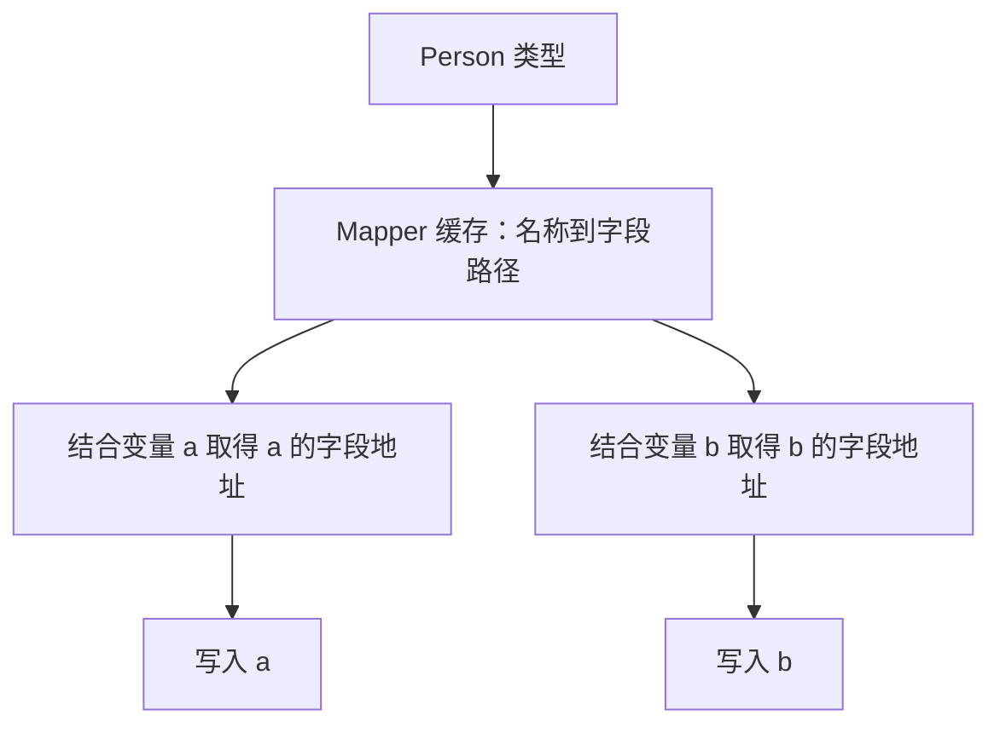

缓存锁保护的是类型映射的生成与访问，不能据此认为多个 goroutine 同时写同一个业务结构体就自动安全。

## 1.8 使用 SelectContext 查询多行

### 1.8.1 查询列表并使用返回结果

示例源码：[go/02-sqlx-demo/person.go](https://github.com/zzxrepository/gocode-examples/blob/main/go/02-sqlx-demo/person.go#L33)。

```go
func listPeople(ctx context.Context, db *sqlx.DB) ([]Person, error) {
	people := make([]Person, 0)
	err := db.SelectContext(ctx, &people,
		"SELECT user_id, username, age, email FROM person ORDER BY user_id")
	if err != nil {
		return nil, fmt.Errorf("list people: %w", err)
	}
	return people, nil
}
```

与标准库版本相比，这里不再显式编写：

```go
for rows.Next() {
    // 创建结构体。
    // Scan。
    // append。
}
```

sqlx 会查询结果、遍历每行、建立元素并写入切片，同时负责该次查询的结果集关闭。

调用后得到 `[]Person`，可以直接遍历：

```go
people, err := listPeople(ctx, db)
if err != nil {
    return err
}
for _, person := range people {
    fmt.Printf("%s: %d\n", person.Username, person.Age)
}
```

### 1.8.2 没有结果时会怎样

多行查询没有匹配记录时，`SelectContext` 通常正常返回，结果切片长度为 0。

这与单行查询不同：

| 查询方式 | 没有匹配记录时 |
| --- | --- |
| `GetContext` | 返回 `sql.ErrNoRows` |
| `SelectContext` | 正常返回，结果长度为 0 |

本文预先使用 `make([]Person, 0)`，空结果可以表示为空切片。

当前实现会先把目标切片长度设置为 0，再用本次查询结果填充。因此，`SelectContext` 会重新填充目标切片，而不是默认继续追加到原有数据之后。

### 1.8.3 SelectContext 会收集完整结果

`SelectContext` 会把查询结果全部写入目标切片。结果越多，需要保留的 Go 对象也越多。

对于需要逐条处理的结果，可以使用 `QueryxContext`，避免在业务代码中保存整个结果切片。

### 1.8.4 切片是如何被填充的

<span id="_1-8-1-为什么传入切片指针"></span>

#### 1.8.4.1 为什么传入切片指针

切片包含底层数组指针、长度和容量。

查询过程中，sqlx 需要追加元素，可能重新分配底层数组，并更新切片长度。因此，需要传入切片变量的地址：

```go
&people
```

这样函数才能把更新后的切片状态写回调用方。

在 [scanAll](https://github.com/jmoiron/sqlx/blob/v1.4.0/sqlx.go#L899) 中，`base` 是元素类型 `Person`，`direct` 是调用方切片的可写反射值。对于 `[]Person`，结构体扫描的循环主干如下，省略错误返回与指针元素分支：

```go
for rows.Next() {
    vp = reflect.New(base)
    v = reflect.Indirect(vp)
    err = fieldsByTraversal(v, fields, values, true)
    // 省略地址准备失败时的错误返回。
    err = rows.Scan(values...)
    // 省略扫描失败时的错误返回。
    direct.Set(reflect.Append(direct, v))
}
```

`reflect.New` 创建当前行的接收元素，随后准备字段地址、扫描并追加。最后一行将追加后的切片写回 `direct`，因此需要调用方传入切片变量的地址。

#### 1.8.4.2 谁负责遍历与关闭结果集

这可以直接对应到 [SelectContext](https://github.com/jmoiron/sqlx/blob/v1.4.0/sqlx_context.go#L55)：它调用 `QueryxContext` 获取结果集，安排 `defer rows.Close()`，再调用 `scanAll` 收集各行。

## 1.9 使用 QueryxContext 逐行处理

### 1.9.1 使用 QueryxContext 与 StructScan

示例源码：[go/02-sqlx-demo/person.go](https://github.com/zzxrepository/gocode-examples/blob/main/go/02-sqlx-demo/person.go#L114)。

```go
func walkPeople(ctx context.Context, db *sqlx.DB, visit func(Person) error) error {
	rows, err := db.QueryxContext(ctx, "SELECT user_id, username, age, email FROM person ORDER BY user_id")
	if err != nil {
		return fmt.Errorf("query people: %w", err)
	}
	defer rows.Close()
	for rows.Next() {
		var person Person
		if err := rows.StructScan(&person); err != nil {
			return fmt.Errorf("scan person: %w", err)
		}
		if err := visit(person); err != nil {
			return err
		}
	}
	return rows.Err()
}
```

`QueryxContext` 保留了标准库逐行遍历的形式，同时增加 `StructScan`，用于把当前行映射到结构体。

调用时传入每行的处理函数：

```go
err := walkPeople(ctx, db, func(person Person) error {
    fmt.Printf("%s: %d\n", person.Username, person.Age)
    return nil
})
```

### 1.9.2 StructScan 如何复用字段映射

[sqlx.Rows](https://github.com/jmoiron/sqlx/blob/v1.4.0/sqlx.go#L577) 嵌入底层 `*sql.Rows`，同时保存 Mapper 以及本次扫描使用的状态。相关字段包括：

```go
started bool
fields  [][]int
values  []interface{}
```

这是结构体字段节选：`started` 标记是否已经完成首次准备，`fields` 保存当前列顺序对应的字段路径，`values` 复用接收列表的空间。首次 `StructScan` 准备它们，后续行使用相同路径，再针对当前目标刷新字段地址。

Mapper 缓存的是类型映射，这里缓存的是本次结果集的列对应关系。由于路径以首次扫描目标建立，同一个 `Rows` 实例不应切换不同结构体类型调用 `StructScan`。

### 1.9.3 提前退出与连接占用

如果处理某一行时提前返回，`defer rows.Close()` 仍然会执行。

逐行处理期间，结果集仍然占用连接。因此，不宜在每一行的回调中执行长时间阻塞的操作。若处理过程较慢，可以结合分页查询，将数据库读取与后续处理分批完成。

<span id="_1-10-使用命名参数插入数据"></span>

## 1.10 使用 sqlx 完成插入、更新与删除

查询时使用了 sqlx 的结构体扫描；写入时则可以选择命名参数，或者继续使用继承自标准库的方法。

### 1.10.1 使用命名参数插入数据

<span id="_1-10-1-namedexeccontext-的写法"></span>

#### 1.10.1.1 NamedExecContext 的用法

示例源码：[go/02-sqlx-demo/person.go](https://github.com/zzxrepository/gocode-examples/blob/main/go/02-sqlx-demo/person.go#L10)。

```go
func insertPerson(ctx context.Context, db *sqlx.DB, person Person) (int64, error) {
	result, err := db.NamedExecContext(ctx,
		"INSERT INTO person (username, age, email) VALUES (:username, :age, :email)", person)
	if err != nil {
		return 0, fmt.Errorf("insert person: %w", err)
	}
	id, err := result.LastInsertId()
	if err != nil {
		return 0, fmt.Errorf("read inserted id: %w", err)
	}
	return id, nil
}
```

SQL 中使用参数名称：

```text
:username
:age
:email
```

sqlx 根据这些名称，从结构体中读取对应字段。

调用 `insertPerson` 时仍然传入普通 `Person`，并取得新主键：

```go
id, err := insertPerson(ctx, db, Person{
    Username: fmt.Sprintf("named_%d", time.Now().UnixNano()),
    Age:      22,
    Email:    sql.NullString{String: "named@example.com", Valid: true},
})
if err != nil {
    return err
}
fmt.Println("新用户 ID：", id)
```

`:username`、`:age`、`:email` 对应结构体的 `db` 标签；SQL 中不再需要由调用方手动排列这三个字段值。

<span id="_1-10-2-命名参数如何变成普通参数"></span>

#### 1.10.1.2 命名参数如何变成普通参数

对于 MySQL，sqlx 会把上面的语句转换为：

```sql
INSERT INTO person (username, age, email)
VALUES (?, ?, ?)
```

同时组织参数切片：

```go
[]any{
    person.Username,
    person.Age,
    person.Email,
}
```

然后调用底层执行方法。

所以，`:username` 是 sqlx 提供的参数组织方式。MySQL 驱动接收到的是转换后的位置参数。

命名参数在字段较多时更容易阅读，也减少了手动维护参数顺序的工作。

具体过程见 [named.go 的 bindStruct 与 bindArgs](https://github.com/jmoiron/sqlx/blob/v1.4.0/named.go#L173)：先解析命名 SQL，得到转换后的语句和按出现顺序排列的参数名称，再通过 Mapper 查找结构体字段路径，读取字段值加入参数切片。

因此，参数顺序由名称在 SQL 中的出现顺序决定，与结构体字段声明顺序无关。这里取的是字段值；扫描结果时取的是字段地址。它们使用相同的映射信息，分别完成数据流的两个方向。

最后，[NamedExecContext](https://github.com/jmoiron/sqlx/blob/v1.4.0/named_context.go#L127) 调用普通 `ExecContext`。参数转换、驱动执行及结果读取继续沿用标准库的过程。

<span id="_1-10-3-更新与删除仍然可以使用原方法"></span>

### 1.10.2 更新数据

sqlx 的 `*sqlx.DB` 嵌入 `*sql.DB`，因此可以继续调用 `ExecContext`。配套项目中的 `updateAge` 与标准库版本使用相同 SQL，参数中的 `db` 类型改为 `*sqlx.DB`。

示例源码：[go/02-sqlx-demo/person.go：updateAge](https://github.com/zzxrepository/gocode-examples/blob/main/go/02-sqlx-demo/person.go#L43)。

```go
result, err := db.ExecContext(
    ctx,
    "UPDATE person SET age = ? WHERE user_id = ?",
    23,
    id,
)
if err != nil {
    return err
}
affected, err := result.RowsAffected()
if err != nil {
    return err
}
fmt.Println("更新影响行数：", affected)
```

也可以直接复用配套项目封装好的 `updateAge(ctx, db, id, 23)`，然后通过 `findPerson` 读取更新结果。影响行数的含义与标准库版本相同，同值更新可能返回 0。

### 1.10.3 删除数据

示例源码：[go/02-sqlx-demo/person.go：deletePerson](https://github.com/zzxrepository/gocode-examples/blob/main/go/02-sqlx-demo/person.go#L56)。

```go
result, err := db.ExecContext(
    ctx,
    "DELETE FROM person WHERE user_id = ?",
    id,
)
if err != nil {
    return err
}
affected, err := result.RowsAffected()
if err != nil {
    return err
}
fmt.Println("删除影响行数：", affected)
```

也可以调用配套项目的 `deletePerson(ctx, db, id)`。删除后再通过 `findPerson` 查询，应使用 `errors.Is(err, sql.ErrNoRows)` 判断记录是否还存在。

更新和删除不需要接收结构体结果，因此使用 `ExecContext` 已经很直接；字段较多时，也可以用 `NamedExecContext` 组织参数。sqlx 不会自动生成 `UPDATE` 或 `DELETE`，操作范围仍然由 SQL 中的 `WHERE` 决定。

## 1.11 使用 sqlx.In 处理切片参数

<span id="_1-11-2-展开占位符与参数"></span>

### 1.11.1 按一组 ID 查询用户

需要按多个 ID 查询时，先使用 `sqlx.In` 展开参数，再通过 `SelectContext` 执行查询：

示例源码：[go/02-sqlx-demo/person.go](https://github.com/zzxrepository/gocode-examples/blob/main/go/02-sqlx-demo/person.go#L87)。

```go
func findPeopleByIDs(ctx context.Context, db *sqlx.DB, ids []int64) ([]Person, error) {
	if len(ids) == 0 {
		return []Person{}, nil
	}
	query, args, err := sqlx.In(
		"SELECT user_id, username, age, email FROM person WHERE user_id IN (?) ORDER BY user_id", ids)
	if err != nil {
		return nil, fmt.Errorf("expand ids: %w", err)
	}
	query = db.Rebind(query)
	people := make([]Person, 0)
	if err := db.SelectContext(ctx, &people, query, args...); err != nil {
		return nil, fmt.Errorf("query people by ids: %w", err)
	}
	return people, nil
}
```

下面用查询到的 alice 和 bob 组织 ID，避免依赖固定的自增编号：

```go
alice, err := findByUsername(ctx, db, "alice")
if err != nil {
    return err
}
bob, err := findByUsername(ctx, db, "bob")
if err != nil {
    return err
}
people, err := findPeopleByIDs(ctx, db, []int64{alice.UserID, bob.UserID})
if err != nil {
    return err
}
fmt.Println("匹配用户数：", len(people))
```

<span id="_1-11-1-为什么不能直接传入切片"></span>

### 1.11.2 为什么不能直接传入切片

假设需要按多个 ID 查询：

```go
ids := []int64{3, 8, 12}
```

下面这种写法不会自动生成三个占位符：

```go
db.SelectContext(
    ctx,
    &people,
    "SELECT user_id, username, age, email FROM person WHERE user_id IN (?)",
    ids,
)
```

一个 `?` 对应一个参数位置，普通数据库参数绑定不会把任意 Go 切片自动展开成多个 SQL 参数。

### 1.11.3 占位符展开与 Rebind 的原理

对于三个 ID，`sqlx.In` 得到的结果相当于：

```sql
WHERE user_id IN (?, ?, ?)
```

```go
[]any{int64(3), int64(8), int64(12)}
```

`sqlx.In` 只完成 SQL 与参数的转换，不执行数据库查询。

`Rebind` 根据驱动调整占位符形式。MySQL 使用 `?`，这里通常保持不变；它并不负责把整个 SQL 转换成另一种数据库方言。

空切片需要先处理，否则既无法形成有意义的 `IN` 条件，也会触发切片展开错误。本文将空 ID 集合定义为返回空结果。

[sqlx.In 的实现](https://github.com/jmoiron/sqlx/blob/v1.4.0/bind.go#L142) 会识别待展开的切片，依据元素数量增加占位符，并将元素依次放进新的参数列表。`args...` 再把这些元素逐个传给查询方法；如果只传 `args`，则会把整个切片当作一个参数。

[Rebind](https://github.com/jmoiron/sqlx/blob/v1.4.0/bind.go#L60) 使用数据库对象保存的驱动名称选择占位符风格。这也是 `sqlx.NewDb(baseDB, "mysql")` 需要驱动名称的用途之一。

## 1.12 使用事务保证多条操作共同完成

### 1.12.1 事务解决什么问题

假设一次业务操作需要插入两个用户：

1. 插入第一个用户。
2. 插入第二个用户。

如果第二次插入失败，而第一次已经单独提交，数据库就会留下部分结果。

使用事务后，可以把这两条语句放在同一个事务中：

- 全部成功，提交。
- 中途失败，回滚。

事务的 ACID 特性包括：

| 特性 | 含义 |
| --- | --- |
| 原子性 | 一个事务中的修改整体完成或整体撤销 |
| 一致性 | 事务执行应维护约束及业务要求的一致状态 |
| 隔离性 | 并发事务之间按隔离级别控制相互影响 |
| 持久性 | 已提交修改按照数据库的持久化机制保存 |

本文使用 InnoDB 表，通过重复用户名触发错误，观察原子性。

<span id="_1-12-2-标准库事务实现"></span>

### 1.12.2 标准库事务的用法

示例源码：[go/01-database-sql-demo/person.go](https://github.com/zzxrepository/gocode-examples/blob/main/go/01-database-sql-demo/person.go#L80)。

```go
func createPeople(ctx context.Context, db *sql.DB, people []Person) error {
	tx, err := db.BeginTx(ctx, nil)
	if err != nil {
		return fmt.Errorf("begin transaction: %w", err)
	}
	defer tx.Rollback()
	for _, person := range people {
		if _, err := tx.ExecContext(ctx,
			"INSERT INTO person (username, age, email) VALUES (?, ?, ?)",
			person.Username, person.Age, person.Email); err != nil {
			return fmt.Errorf("insert %s: %w", person.Username, err)
		}
	}
	if err := tx.Commit(); err != nil {
		return fmt.Errorf("commit transaction: %w", err)
	}
	return nil
}
```

执行流程如下：

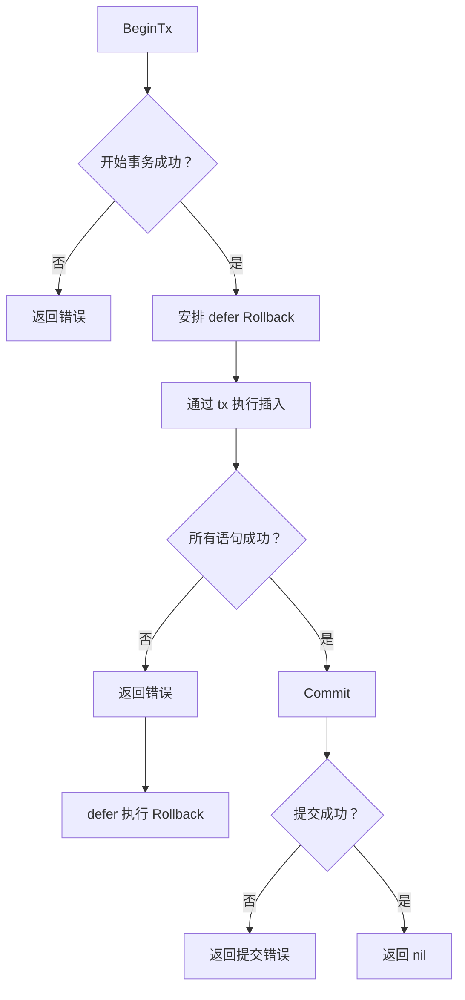

`defer tx.Rollback()` 用来处理提交前的提前返回。

如果 `Commit` 已经成功，事务已经结束，随后执行的 `Rollback` 会返回事务已结束的错误，不会撤销已经提交的数据。这里不使用这个兜底调用的返回值。

<span id="_1-12-4-sqlx-中的事务"></span>

### 1.12.3 sqlx 事务的用法

sqlx 使用：

```go
tx, err := db.BeginTxx(ctx, nil)
```

获得 `*sqlx.Tx`。

其余流程保持一致：

```go
defer tx.Rollback()

// 使用 tx.ExecContext、tx.GetContext 等执行操作。

if err := tx.Commit(); err != nil {
    return err
}
```

`*sqlx.Tx` 包装了标准库事务，并增加 sqlx 的参数和扫描辅助方法。事务仍然使用底层事务保留的连接。

配套 sqlx 示例中的批量插入，除参数类型和开始事务的方法外，与标准库版本采用相同流程。

[BeginTxx 的实现](https://github.com/jmoiron/sqlx/blob/v1.4.0/sqlx_context.go#L204) 先调用 `db.DB.BeginTx(ctx, opts)`，再把得到的标准库事务放入 `sqlx.Tx`，附带驱动名称和 Mapper。因此它没有创建另一套事务连接池，而是在现有事务上增加映射与参数辅助方法。

<span id="_1-12-5-通过唯一约束观察回滚"></span>

### 1.12.4 通过唯一约束观察回滚

传入两个相同用户名：

```go
people := []Person{
    {Username: "same_user", Age: 25},
    {Username: "same_user", Age: 26},
}
```

第一次插入成功，第二次插入违反用户名唯一约束，MySQL 返回重复键错误。

因为尚未提交，函数返回后执行回滚，第一次插入也不会保留。

可以通过错误类型判断具体错误：

```go
var duplicate *mysql.MySQLError

if errors.As(err, &duplicate) && duplicate.Number == 1062 {
    // MySQL 重复键错误。
}
```

回滚后，再查询这个本次新建的用户名，应得到 `sql.ErrNoRows`。

配套程序为每次实验生成不同的用户名，避免已有记录干扰验证。

自增编号在失败或回滚过程中也可能被消耗，因此不要把“编号连续”作为事务成功或回滚成功的判断依据。

<span id="_1-12-3-事务为什么必须使用-tx"></span>

### 1.12.5 事务连接与资源释放原理

事务状态属于数据库连接上的会话状态。标准库开始事务后，会保留一条连接供这个事务使用。

这条连接的归属可以从 [Tx 的字段](https://github.com/golang/go/blob/go1.26.5/src/database/sql/sql.go#L2166) 中看出来，以下省略其他字段：

```go
type Tx struct {
    db          *DB
    dc          *driverConn
    txi         driver.Tx
    releaseConn func(error)
    done        atomic.Bool
    // 省略其余字段。
}
```

`dc` 保存本事务保留的连接，`txi` 是驱动事务对象，`releaseConn` 用于结束后释放连接，`done` 控制事务只结束一次。MySQL 驱动的 [mysqlTx](https://github.com/go-sql-driver/mysql/blob/v1.10.0/transaction.go#L11) 也保存着对应 `*mysqlConn`，提交和回滚通过这个会话发送给服务器。

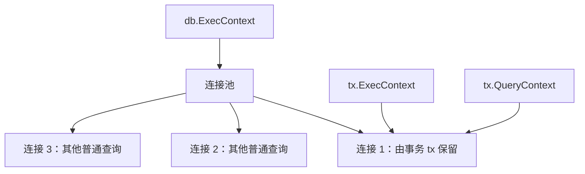

因此：

```go
tx.ExecContext(...)
```

会使用事务保留的连接。

而：

```go
db.ExecContext(...)
```

会重新向连接池申请连接，不会自动参与当前事务。

这不仅影响事务正确性，也可能导致等待问题。例如连接池最多只有一条连接，事务已经保留了这条连接，此时又调用外层 `db.ExecContext`，后者就只能等待，直到超时或有可用连接。

事务开始后，属于该事务的操作应统一通过 `tx` 执行。

[Tx.grabConn](https://github.com/golang/go/blob/go1.26.5/src/database/sql/sql.go#L2245) 直接返回事务保存的 `dc`；普通 `DB` 操作则走连接池分配。事务内关闭结果集只结束当前读取，不会立即交出事务保留的连接。

提交或回滚结束后，[Tx.close](https://github.com/golang/go/blob/go1.26.5/src/database/sql/sql.go#L2235) 调用保存的 `releaseConn`，再清空连接和驱动事务引用。`Commit` 自身的错误仍须返回，不能将兜底的 `Rollback` 理解为任何提交失败都已确认撤销。

## 1.13 运行配套示例

### 1.13.1 初始化数据

在任意一个示例目录中执行：

```bash
make init
```

程序会创建 `person` 表，并补充 alice、bob 两条初始记录。

两个项目使用相同的表结构和数据库，可以共用这份学习数据。

### 1.13.2 运行标准库示例

进入 [go/01-database-sql-demo](https://github.com/zzxrepository/gocode-examples/tree/main/go/01-database-sql-demo)：

```text
01-database-sql-demo
```

执行：

```bash
make run
```

程序依次演示：

1. 创建句柄并观察 `Open`、`Ping` 后的连接池状态。
2. 插入一个带动态后缀的用户。
3. 使用返回的 ID 查询用户。
4. 更新年龄并重新读取。
5. 查询 bob，观察 `Email.Valid == false`。
6. 查询多行。
7. 触发重复键错误并验证事务回滚。
8. 删除本次创建的用户，再次查询得到 `sql.ErrNoRows`。

关键输出包括：

```text
Open 后连接池: open=0 idle=0 in_use=0
Ping 后连接池: open=1 idle=1 in_use=0
更新后年龄: 23
NULL 扫描: bob.email.Valid=false
事务回滚: 第一条插入未保留
删除后查询: sql.ErrNoRows
```

实际输出还包含动态用户名、自增 ID 和查询数量，这些值会随数据库当前状态变化。

### 1.13.3 运行 sqlx 示例

进入 [go/02-sqlx-demo](https://github.com/zzxrepository/gocode-examples/tree/main/go/02-sqlx-demo)：

```text
02-sqlx-demo
```

执行：

```bash
make run
```

除了相同的数据操作，还会输出：

```text
sqlx 与标准库共享连接池: true
IN 查询: 2 条
```

并通过 `QueryxContext`、`StructScan` 逐行处理查询结果。

观察两套实现时，可以重点比较：

| 操作 | database/sql | sqlx |
| --- | --- | --- |
| 插入 | `ExecContext` 加位置参数 | 示例使用 `NamedExecContext` |
| 单行查询 | `QueryRowContext` 加 `Scan` | `GetContext` |
| 多行查询 | `Next`、`Scan`、`append` | `SelectContext` |
| 逐行结构体映射 | 手动传入字段地址 | `QueryxContext` 加 `StructScan` |
| 切片条件 | 手动展开占位符与参数 | `sqlx.In` |
| 更新、删除 | `ExecContext` | 可以继续使用 `ExecContext` |
| 事务 | `BeginTx` | `BeginTxx` |

### 1.13.4 执行测试

普通测试：

```bash
make test
```

启用本机 MySQL 集成测试：

```bash
MYSQL_INTEGRATION=1 make test
```

集成测试沿用 `MYSQL_USER`、`MYSQL_PASSWORD`，连接本机 3306，并创建独立的临时测试数据库，结束后删除。

测试覆盖：

- `Open` 不立即建立网络连接。
- 插入、查询、更新和删除。
- SQL `NULL` 与空字符串的区别。
- 同值更新的影响行数。
- 没有匹配记录时的错误。
- 单连接池等待和 Context 超时。
- 事务提交与失败回滚。
- sqlx 的切片参数查询。
- 逐行处理提前返回后释放结果集。

测试账号需要具有创建和删除测试数据库的权限，测试不会清空配置中的学习数据库。

配套测试源码：[标准库 person_integration_test.go](https://github.com/zzxrepository/gocode-examples/blob/main/go/01-database-sql-demo/person_integration_test.go)、[sqlx person_integration_test.go](https://github.com/zzxrepository/gocode-examples/blob/main/go/02-sqlx-demo/person_integration_test.go)。

## 1.14 如何选择 database/sql 与 sqlx

完成相同操作后，可以从两个方面理解它们的区别。

首先，连接池、事务和基础扫描能力来自 `database/sql`。这些机制决定了连接何时建立、查询为什么等待、结果集何时释放，以及多条语句如何参与同一事务。

其次，sqlx 主要减少参数组织和结果映射代码。它根据列名找到结构体字段，根据命名参数组织参数列表，并帮助展开切片条件。

当查询结果简单，或者需要明确控制每个字段的接收方式时，直接使用 `database/sql` 已经足够。

当项目中存在大量结构体查询，重复编写字段地址和遍历收集代码时，sqlx 可以减少这部分工作，同时继续保留手写 SQL 的方式。

## 总结

`database/sql` 提供数据库访问的公共接口与连接池管理能力，MySQL 驱动负责协议通信，sqlx 则补充结构体映射与参数组织工具。理解这三层的分工，才能把 API 调用与实际执行过程对应起来。

使用时应重点掌握几个环节：通过 `PingContext` 验证连接，按顺序或列名完成结果映射，及时结束结果集，通过 `tx` 执行事务内操作，并使用 `Context` 控制等待与执行时间。引入 sqlx 后，这些基础机制继续生效。

## 参考文档

1. [Go 官方文档：Opening a database handle](https://go.dev/doc/database/open-handle)——数据库句柄、连接配置与连接检查。
2. [Go 官方文档：Managing connections](https://go.dev/doc/database/manage-connections)——连接池与连接生命周期配置。
3. [Go 官方文档：Querying for data](https://go.dev/doc/database/querying)——单行、多行查询与结果扫描。
4. [Go 官方文档：Executing transactions](https://go.dev/doc/database/execute-transactions)——事务开始、提交、回滚及使用要求。
5. [Go 官方文档：Avoiding SQL injection risk](https://go.dev/doc/database/sql-injection)——SQL 模板与参数分离。
6. [Go 1.26.5：database/sql 源码](https://github.com/golang/go/blob/go1.26.5/src/database/sql/sql.go)、[driver/driver.go](https://github.com/golang/go/blob/go1.26.5/src/database/sql/driver/driver.go)、[convert.go](https://github.com/golang/go/blob/go1.26.5/src/database/sql/convert.go)——`Open`、连接池、`QueryRowContext`、结果集与事务实现。
7. [MySQL 驱动 v1.10.0：使用说明](https://github.com/go-sql-driver/mysql/blob/v1.10.0/README.md)——DSN、超时、参数插值与影响行数配置。
8. [MySQL 驱动 v1.10.0：driver.go](https://github.com/go-sql-driver/mysql/blob/v1.10.0/driver.go)、[connector.go](https://github.com/go-sql-driver/mysql/blob/v1.10.0/connector.go)、[connection.go](https://github.com/go-sql-driver/mysql/blob/v1.10.0/connection.go)——驱动注册、连接建立与语句执行。
9. [sqlx 使用指南](https://jmoiron.github.io/sqlx/)——结构体映射、查询辅助方法与参数绑定。
10. [sqlx v1.4.0：sqlx.go](https://github.com/jmoiron/sqlx/blob/v1.4.0/sqlx.go)、[sqlx_context.go](https://github.com/jmoiron/sqlx/blob/v1.4.0/sqlx_context.go)——数据库包装、`GetContext`、`SelectContext` 与扫描实现。
11. [sqlx v1.4.0：reflectx/reflect.go](https://github.com/jmoiron/sqlx/blob/v1.4.0/reflectx/reflect.go)——结构体字段映射与缓存。
12. [sqlx v1.4.0：named.go](https://github.com/jmoiron/sqlx/blob/v1.4.0/named.go)、[named_context.go](https://github.com/jmoiron/sqlx/blob/v1.4.0/named_context.go)、[bind.go](https://github.com/jmoiron/sqlx/blob/v1.4.0/bind.go)——命名参数、`sqlx.In` 与占位符转换。
13. [博客园：Go 数据库操作入门参考](https://www.cnblogs.com/you-men/p/13906612.html)。
14. [Tizi365：Go sqlx 入门参考](https://www.tizi365.com/archives/100.html)。
15. [配套示例 GitHub 仓库：gocode-examples](https://github.com/zzxrepository/gocode-examples)。
