# 02. Go 数据库操作：GORM

## 前言

使用 `database/sql` 和 sqlx 完成数据库操作时，都需要手写 SQL。sqlx 在标准库的基础上增加了结构体扫描、命名参数等功能，减少了一部分重复代码。

当项目中的数据模型逐渐增多时，还会出现一些相似的工作：根据结构体组织插入语句、拼接查询条件、维护创建时间和更新时间，以及查询模型之间的关联数据。

GORM 将这些工作进一步封装，允许我们通过结构体和方法调用描述数据操作，再由它生成并执行 SQL。

本文先通过本地 MySQL 建立数据库连接，认识 GORM 的操作句柄与数据模型，以此理解结构体如何参与 SQL 的生成；随后依次介绍创建、查询、分页、更新、删除、事务和关联查询，并结合源码说明关键操作的执行过程。

本文统一使用 GORM 的传统 API。官方目前也提供泛型 API，两种 API 的调用方式和错误处理方式有所不同，本文不混用两套写法。相关入口见 [GORM 官方中文指南](https://gorm.io/zh_CN/docs/index.html)。

配套项目：[go/03-gorm-demo](https://github.com/zzxrepository/gocode-examples/tree/ce4ce672155053376c74ddb19bb61f1e94a6e88b/go/03-gorm-demo)。示例连接本机 MySQL，完整演示本文的数据操作；每次运行创建独立的演示记录，结束时按本次主键清理。

## 2.1 安装与连接数据库

### 2.1.1 安装依赖

本文以以下版本作为源码讲解的依据：

```bash
go get gorm.io/gorm@v1.31.1
go get gorm.io/driver/mysql@v1.6.0
```

这里安装了两个包：

| 包 | 主要职责 |
| --- | --- |
| `gorm.io/gorm` | 模型解析、查询条件组织、CRUD、事务和关联处理 |
| `gorm.io/driver/mysql` | 提供 GORM 使用的 MySQL 方言和初始化逻辑 |

虽然第二个包的路径中包含 `driver`，但它与 `github.com/go-sql-driver/mysql` 并不是同一个包。

两者的职责不同：

- `gorm.io/driver/mysql` 让 GORM 知道如何生成适用于 MySQL 的 SQL。
- `github.com/go-sql-driver/mysql` 实现标准库的数据库驱动接口，负责连接 MySQL、完成认证、发送请求和读取响应。

它们之间的关系可以表示为：

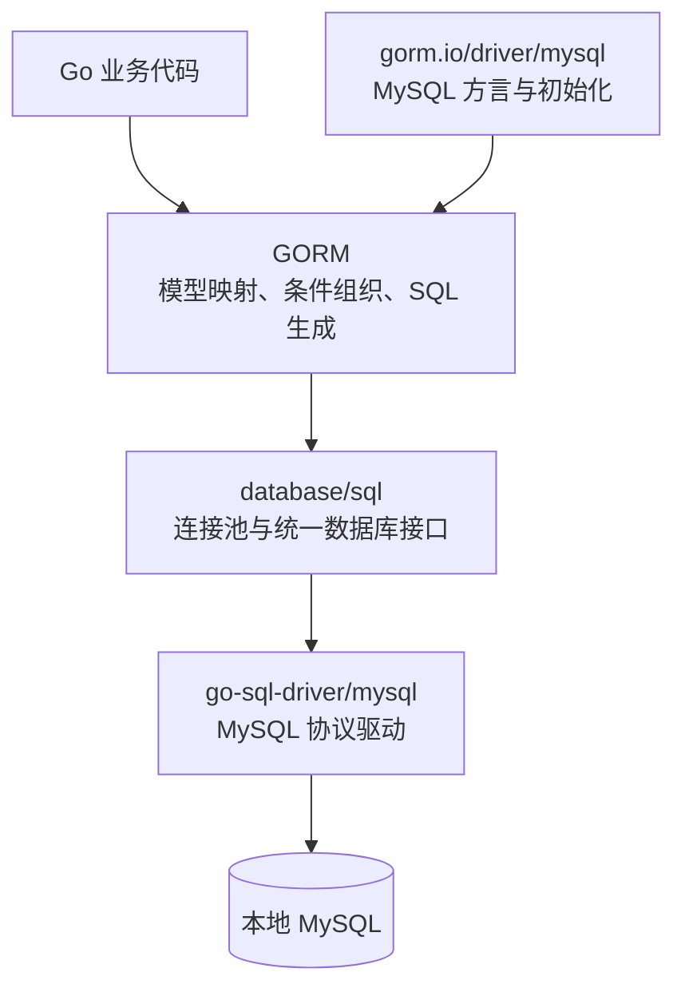

因此，GORM 仍然建立在 `database/sql` 之上。连接池、Context 和事务连接等基础机制，在这里仍然适用。

### 2.1.2 连接本地 MySQL

完整示例：[OpenDB 与本机连接配置（mysql.go）](https://github.com/zzxrepository/gocode-examples/blob/ce4ce672155053376c74ddb19bb61f1e94a6e88b/go/03-gorm-demo/mysql.go)。

先在本地 MySQL 中创建数据库：

```sql
CREATE DATABASE gorm_demo
    CHARACTER SET utf8mb4;
```

然后通过环境变量提供连接信息，将其中的用户名和密码替换为本机配置：

```bash
export MYSQL_DSN='root:你的密码@tcp(127.0.0.1:3306)/gorm_demo?charset=utf8mb4&parseTime=true&loc=Local&timeout=3s&readTimeout=5s&writeTimeout=5s'
```

其中几个参数的作用如下：

| 参数 | 作用 |
| --- | --- |
| `charset=utf8mb4` | 指定连接使用的字符集 |
| `parseTime=true` | 将 MySQL 的 `DATE`、`DATETIME` 等字段解析为 `time.Time` |
| `loc=Local` | 指定解析时间值时使用的 Go 时区 |
| `timeout=3s` | 限制建立网络连接的时间 |
| `readTimeout=5s` | 设置驱动读取网络数据的超时 |
| `writeTimeout=5s` | 设置驱动写入网络数据的超时 |

`loc=Local` 设置的是 Go 驱动解析时间时使用的时区，不会直接修改 MySQL 会话的 `time_zone`。

可以将初始化过程封装为：

```go
func OpenDB(dsn string) (*gorm.DB, error) {
    if dsn == "" {
        return nil, errors.New("MYSQL_DSN 未配置")
    }

    db, err := gorm.Open(mysql.Open(dsn), &gorm.Config{})
    if err != nil {
        return nil, fmt.Errorf("初始化 GORM：%w", err)
    }

    sqlDB, err := db.DB()
    if err != nil {
        return nil, fmt.Errorf("获取底层连接池：%w", err)
    }

    // 参数作用于底层连接池，不会预先创建这些数量的连接。
    sqlDB.SetMaxOpenConns(20)
    sqlDB.SetMaxIdleConns(5)
    sqlDB.SetConnMaxIdleTime(5 * time.Minute)
    sqlDB.SetConnMaxLifetime(time.Hour)

    return db, nil
}
```

这段代码需要导入：

```go
import (
    "errors"
    "fmt"
    "time"

    "gorm.io/driver/mysql"
    "gorm.io/gorm"
)
```

应用启动时读取环境变量并初始化，下面的片段还需要导入 `os`：

```go
db, err := OpenDB(os.Getenv("MYSQL_DSN"))
if err != nil {
    return err
}

sqlDB, err := db.DB()
if err != nil {
    return err
}
defer sqlDB.Close()
```

这里的 `defer` 应放在应用入口所属的函数中，让连接池在应用退出时关闭。不要在 `OpenDB` 内部关闭连接池，否则返回的 `db` 将无法继续使用。

连接池配置只是演示值，实际配置需要结合数据库连接上限、应用实例数量和并发量确定。

下面的操作片段使用已经初始化的 `db`，放在能够返回 `error` 的业务函数中；涉及超时或事务时，`ctx` 由调用方传入。需要独立运行某个片段时，应补齐其中使用的模型、变量及标准库导入。

### 2.1.3 先分清三个对象

下面这一行代码包含两次 `Open`：

```go
db, err := gorm.Open(mysql.Open(dsn), &gorm.Config{})
```

它们执行的工作不同。

**第一个对象是 MySQL 方言对象。**

```go
dialector := mysql.Open(dsn)
```

这里的 `mysql` 来自 `gorm.io/driver/mysql`。这次调用主要创建一个保存 DSN 等信息的方言对象，并不会在这一步直接连接 MySQL。

方言对象实现了 GORM 的 `Dialector` 接口，负责提供数据库相关的行为，例如：

- 如何初始化底层连接池。
- 如何引用表名和列名。
- 如何生成特定数据库支持的 SQL。
- 如何将模型字段转换为数据库字段类型。

**第二个对象是 GORM 操作句柄。**

```go
db, err := gorm.Open(dialector, &gorm.Config{})
```

`gorm.Open` 返回 `*gorm.DB`。它保存 GORM 配置，并作为后续模型操作、查询条件构造和 SQL 执行的入口。

**第三个对象是标准库连接池。**

```go
sqlDB, err := db.DB()
```

这里返回的 `*sql.DB`，就是标准库数据库句柄。

在本文普通初始化方式下，`db.DB()` 取得的是 GORM 已经持有的连接池，并不会因此重新创建一个连接池。

可以先记住它们各自回答的问题：

| 对象 | 回答的问题 |
| --- | --- |
| MySQL `Dialector` | 应该按照哪一种数据库的规则工作？ |
| `*gorm.DB` | 本次准备对什么模型执行什么操作？ |
| `*sql.DB` | 如何取得、复用和归还数据库连接？ |

对应源码：

- [GORM 的 DB、Open 和 DB()：gorm.go](https://github.com/go-gorm/gorm/blob/v1.31.1/gorm.go)
- [MySQL 方言的 Open 和 Initialize：mysql.go](https://github.com/go-gorm/mysql/blob/v1.6.0/mysql.go)

### 2.1.4 gorm.Open 会不会建立连接

标准库的：

```go
sql.Open("mysql", dsn)
```

主要创建数据库句柄，通常不会立即建立网络连接。

但是，不能直接把这个结论套用到：

```go
gorm.Open(mysql.Open(dsn), &gorm.Config{})
```

按照本文使用的版本和默认配置，初始化过程中有两处可能访问数据库：

1. MySQL 方言初始化时执行 `SELECT VERSION()`，根据服务器版本调整兼容行为。
2. GORM 初始化完成后，默认调用底层连接池的 `Ping()`，检查数据库是否可用。

整个过程可以简化为：

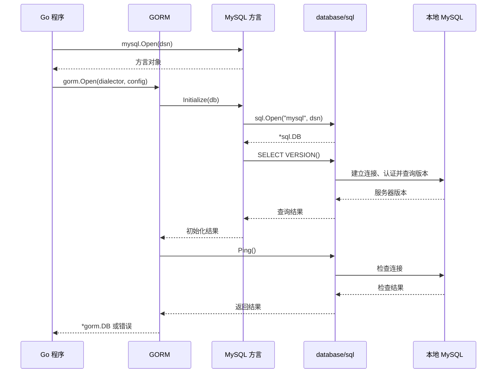

因此，**在本文默认配置下，gorm.Open 返回成功，意味着初始化阶段已经成功访问过数据库。**

这不表示数据库会一直可用。后续运行过程中仍然可能出现断网、连接失效或数据库重启，所以每次数据库操作仍然需要处理错误。

另外两个配置也需要区分：

| 配置 | 控制的行为 |
| --- | --- |
| `gorm.Config.DisableAutomaticPing` | 是否关闭 GORM 初始化后的自动 Ping |
| `mysql.Config.SkipInitializeWithVersion` | 是否跳过 MySQL 版本探测 |

只关闭自动 Ping，不代表初始化过程一定不会访问数据库，因为版本查询仍可能建立连接。

相关说明见 [GORM 配置文档](https://gorm.io/zh_CN/docs/gorm_config.html)与 [MySQL 初始化源码](https://github.com/go-gorm/mysql/blob/v1.6.0/mysql.go)。

### 2.1.5 为什么通常只初始化一次

`*gorm.DB` 背后持有标准库连接池。应用启动时初始化一次，之后各个业务模块共享这个操作入口即可。

每个请求都调用一次 `gorm.Open`，会创建多个独立连接池，导致连接分散，也增加数据库连接数量。

这里还需要区分两种“共享”：

- 共享初始化得到的根 `db`，是正常用法。
- 共享一条已经追加了查询条件的查询链，需要注意条件是否会继续累积。

查询链的复用方式见 2.6.3。

## 2.2 定义模型

连接建立后，接下来需要告诉 GORM：我们准备操作什么样的数据。

### 2.2.1 使用结构体描述数据

完整示例：[完整模型定义（model.go）](https://github.com/zzxrepository/gocode-examples/blob/ce4ce672155053376c74ddb19bb61f1e94a6e88b/go/03-gorm-demo/model.go)。

GORM 中的模型通常就是一个普通 Go 结构体：

```go
type User struct {
    ID        uint           `gorm:"primaryKey"`
    Name      string         `gorm:"size:64;not null"`
    Email     string         `gorm:"size:128;not null;uniqueIndex"`
    Age       int            `gorm:"not null"`
    Active    bool           `gorm:"not null"`
    CreatedAt time.Time
    UpdatedAt time.Time
    DeletedAt gorm.DeletedAt `gorm:"index"`
}
```

默认情况下：

| Go 中的定义 | GORM 默认行为 |
| --- | --- |
| `User` | 对应 `users` 表 |
| `ID` | 作为主键 |
| `CreatedAt` | 对应 `created_at`，创建时自动赋值 |
| `UpdatedAt` | 对应 `updated_at`，常规更新时自动维护 |
| `DeletedAt` | 对应 `deleted_at`，参与软删除处理 |

这些行为来自 GORM 的约定，Go 语言本身并不会赋予这些字段特殊含义。

常用标签如下：

| 标签 | 作用 |
| --- | --- |
| `primaryKey` | 指定主键 |
| `size:64` | 指定字段大小，供数据库类型映射等过程使用 |
| `not null` | 声明非空约束 |
| `index` | 声明普通索引 |
| `uniqueIndex` | 声明唯一索引 |
| `column:user_name` | 显式指定列名 |

需要注意，`not null` 并不表示字符串不能为空。例如，空字符串 `""` 不是 SQL 的 `NULL`。

用户名不能为空、邮箱格式是否合法等规则，仍然需要由业务代码进行校验。

如果字段需要区分“没有值”和“值为空字符串”，可以使用指针或标准库的可空类型：

```go
type Profile struct {
    ID       uint
    Nickname *string
}
```

这里：

- `nil` 可以表示数据库中的 `NULL`。
- 指向 `""` 的指针表示一个明确存在的空字符串。

GORM 也提供 `gorm.Model`，包含 `ID`、`CreatedAt`、`UpdatedAt` 和 `DeletedAt`。本文显式声明字段，便于观察每个字段的作用。

模型、字段类型和可空值的详细规则可以参考[官方模型定义文档](https://gorm.io/zh_CN/docs/models.html)。

### 2.2.2 结构体如何变成表和列的信息

执行下面的查询时：

```go
db.First(&user)
```

GORM 至少需要知道：

- `user` 对应哪张表。
- 哪个字段是主键。
- `CreatedAt` 对应哪个数据库列。
- 查询结果应该写进哪个字段。
- 是否需要添加软删除过滤条件。

这些信息不是从变量名 `user` 中得到的，而是通过结构体类型和字段标签解析出来的。

GORM 使用反射读取模型类型，并组织成内部的 `schema.Schema`。

这里的 `Schema` 可以理解为**某个模型的映射说明**，其中保存表名、字段、列名、主键和关联关系等信息。

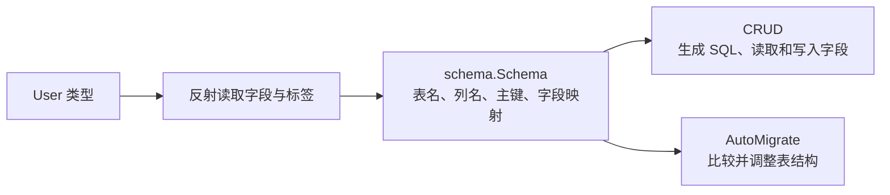

解析结果会进入缓存，后续使用相同模型类型时，可以复用这些类型信息。

但缓存模型信息，并不意味着后续完全不再使用反射。面对具体的 `user` 对象时，GORM 仍然需要读取字段值，或者把查询结果写回对应字段。

例如：

- 类型信息告诉 GORM：`Age` 对应 `age` 列。
- 具体对象告诉 GORM：这一次 `Age` 的值是 `20`。
- 查询返回后，GORM 再把数据库中的年龄写回当前对象。

对应源码：

- [模型解析与 Schema 缓存：schema/schema.go](https://github.com/go-gorm/gorm/blob/v1.31.1/schema/schema.go)
- [字段解析与字段读写：schema/field.go](https://github.com/go-gorm/gorm/blob/v1.31.1/schema/field.go)

## 2.3 自动迁移

### 2.3.1 使用 AutoMigrate

完整示例：[数据表迁移（schema.go）](https://github.com/zzxrepository/gocode-examples/blob/ce4ce672155053376c74ddb19bb61f1e94a6e88b/go/03-gorm-demo/schema.go)。

定义结构体，并不会自动让数据库中出现对应的数据表。

在学习和本地开发阶段，可以使用：

```go
if err := db.AutoMigrate(&User{}); err != nil {
    return fmt.Errorf("迁移 users 表：%w", err)
}
```

GORM 会读取模型信息，检查数据库现有结构，并执行必要的建表或改表操作。

`AutoMigrate` 可以创建缺失的表、列、索引和约束，也可能根据模型调整已有列的某些属性。它不会因为结构体删除了一个字段，就自动删除数据库中的对应列。详细行为见[官方迁移文档](https://gorm.io/zh_CN/docs/migration.html)。

### 2.3.2 模型标签和数据库约束的关系

模型中的：

```go
Email string `gorm:"size:128;not null;uniqueIndex"`
```

声明了 GORM 应当如何理解这个字段。只有数据库实际存在唯一索引，MySQL 才会拒绝重复邮箱。

因此，需要区分：

1. Go 代码中的模型声明。
2. 数据库当前已经存在的表结构。
3. 将两者协调起来的迁移过程。

普通的 `Create` 和 `Find` 不会自动替你修复数据库表结构。

从实现上看，迁移器同样会使用模型 Schema，但它执行的是建表、改列、建索引等 DDL，而不是业务中的 CRUD。

相关实现位于 [GORM 迁移器源码：migrator/migrator.go](https://github.com/go-gorm/gorm/blob/v1.31.1/migrator/migrator.go)。

本地学习可以使用 `AutoMigrate`。生产环境中涉及历史数据和复杂结构变更时，通常应使用可审查、可追踪的版本化迁移脚本。

## 2.4 创建记录

### 2.4.1 创建一条记录

完整示例：[单条、批量创建与主键回填（demo.go）](https://github.com/zzxrepository/gocode-examples/blob/ce4ce672155053376c74ddb19bb61f1e94a6e88b/go/03-gorm-demo/demo.go)。

```go
user := User{
    Name:   "张三",
    Email:  "zhangsan@example.com",
    Age:    20,
    Active: true,
}

result := db.Create(&user)
if result.Error != nil {
    return fmt.Errorf("创建用户：%w", result.Error)
}

fmt.Println("用户 ID：", user.ID)
fmt.Println("影响行数：", result.RowsAffected)
```

这里有两个值得关注的地方：

- 传给 `Create` 的是 `&user`。
- 创建完成后，可以从 `user.ID` 取得数据库生成的主键。

传入指针，使 GORM 能够把主键和自动维护的时间字段写回原对象。

示例中的邮箱有唯一约束，重复执行同一条插入会产生重复键错误。需要重复实验时，可以更换邮箱，或先清理本次实验数据。

对于本文默认的 MySQL 自增主键场景，处理过程大致如下。图中省略了默认写事务的开始和结束：

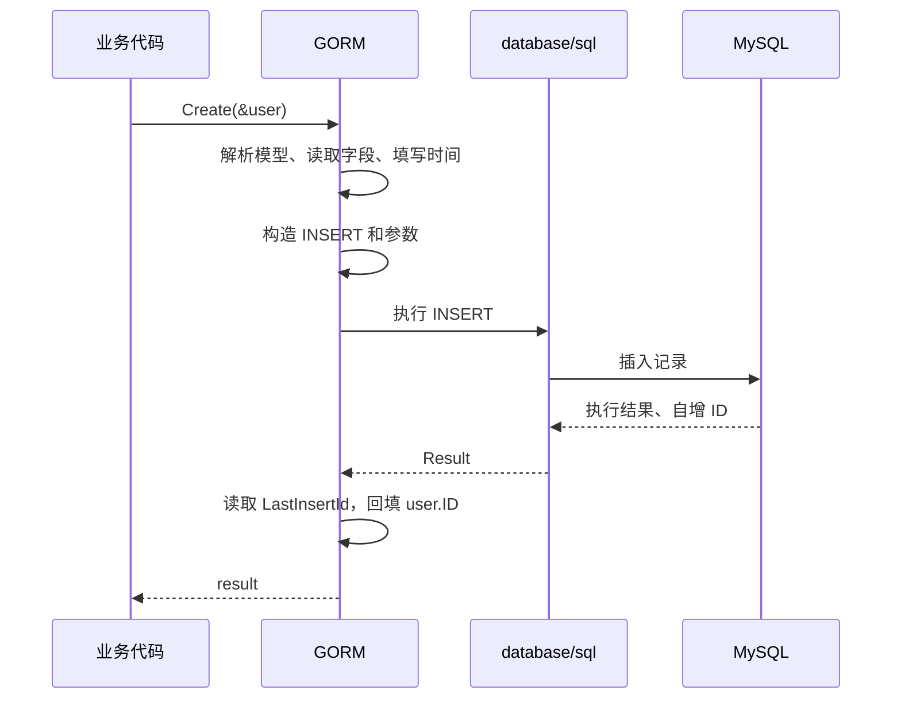

GORM 使用驱动提供的执行结果完成普通自增主键回填，不需要再查询一次“最后插入的用户”。

相关逻辑可以阅读[创建回调源码：callbacks/create.go](https://github.com/go-gorm/gorm/blob/v1.31.1/callbacks/create.go)。

### 2.4.2 result 是什么

传统 API 中：

```go
result := db.Create(&user)
```

返回的 `result` 仍然是 `*gorm.DB`，其中保存了这次操作的状态。

常用字段有：

```go
result.Error
result.RowsAffected
```

因此：

```go
if err := db.Create(&user).Error; err != nil {
    return err
}
```

只是把“调用操作”和“读取操作错误”写在了同一行。

### 2.4.3 批量创建

```go
users := []User{
    {
        Name:   "李四",
        Email:  "lisi@example.com",
        Age:    22,
        Active: true,
    },
    {
        Name:   "王五",
        Email:  "wangwu@example.com",
        Age:    24,
        Active: true,
    },
}

if err := db.Create(&users).Error; err != nil {
    return fmt.Errorf("批量创建用户：%w", err)
}
```

传入切片后，GORM 可以组织批量插入。

当数据量较大、需要限制每批记录数时，可以使用：

```go
if err := db.CreateInBatches(&users, 100).Error; err != nil {
    return err
}
```

这是另一种批量插入方式，不要紧接着对刚插入的相同邮箱再次执行。批次大小会影响 SQL 长度、参数数量和单次操作开销，应结合实际数据规模确定。详细用法见[官方创建文档](https://gorm.io/zh_CN/docs/create.html)。

## 2.5 查询记录

### 2.5.1 查询单条记录

完整示例：[查询操作与结果使用（demo_crud.go）](https://github.com/zzxrepository/gocode-examples/blob/ce4ce672155053376c74ddb19bb61f1e94a6e88b/go/03-gorm-demo/demo_crud.go)。

根据邮箱查询用户：

```go
var user User

err := db.
    Where("email = ?", "zhangsan@example.com").
    First(&user).
    Error

switch {
case errors.Is(err, gorm.ErrRecordNotFound):
    return errors.New("用户不存在")
case err != nil:
    return fmt.Errorf("查询用户：%w", err)
}
fmt.Printf("用户：%s，年龄：%d\n", user.Name, user.Age)
```

对于本文的 `User` 模型，生成的 SQL 可以简化理解为：

```sql
SELECT *
FROM users
WHERE email = ?
  AND deleted_at IS NULL
ORDER BY id
LIMIT 1;
```

文中的 SQL 示例主要用于说明语义，会省略部分字段、标识符引号和时间参数。

几个单条查询方法的区别如下：

| 方法 | 默认行为 |
| --- | --- |
| `First` | 按主键升序取得一条记录 |
| `Last` | 按主键降序取得一条记录 |
| `Take` | 取得一条记录，不额外指定主键排序 |

这些方法在没有找到记录时，会返回 `gorm.ErrRecordNotFound`。相关规则见[官方查询文档](https://gorm.io/zh_CN/docs/query.html)。

根据主键查询也可以写为：

```go
var user User

if err := db.First(&user, uint(10)).Error; err != nil {
    return err
}
```

来自 HTTP 路径或查询参数的 ID，应先解析为明确的整数类型，再传入查询。

另外，每次独立查询宜使用新的接收变量。接收结构体中已有的非零主键，可能参与后续查询条件构造。

### 2.5.2 查询多条记录

```go
var users []User

err := db.
    Where("age >= ? AND active = ?", 18, true).
    Order("id DESC").
    Find(&users).
    Error

if err != nil {
    return fmt.Errorf("查询用户列表：%w", err)
}
for _, user := range users {
    fmt.Println(user.ID, user.Name)
}
```

没有匹配数据时，`Find` 查询切片通常得到空结果，不会返回 `gorm.ErrRecordNotFound`。

这两种行为表达的是不同的预期：

- `First`：希望取得一条记录，需要知道记录是否存在。
- `Find` 查询切片：希望取得一组记录，零条也是合法结果。

### 2.5.3 结构体条件为什么忽略零值

下面的条件会读取结构体中的非零字段：

```go
db.Where(&User{
    Name: "张三",
    Age:  20,
}).Find(&users)
```

但下面的写法不会默认生成 `age = 0 AND active = false`：

```go
db.Where(&User{
    Age:    0,
    Active: false,
}).Find(&users)
```

原因是 GORM 在构造结构体条件时，会检查字段是否为零值。

对于 `User{Age: 0, Active: false}`，仅看这个结构体，无法区分：

- 调用方没有填写这两个字段。
- 调用方明确希望查询年龄为零、状态为假的记录。

传统 API 的结构体条件采用“默认忽略零值”的规则。

需要明确保留零值时，可以使用 Map：

```go
if err := db.
    Where(map[string]any{
        "age":    0,
        "active": false,
    }).
    Find(&users).
    Error; err != nil {
    return err
}
```

也可以直接写出条件：

```go
if err := db.
    Where("age = ? AND active = ?", 0, false).
    Find(&users).
    Error; err != nil {
    return err
}
```

相关处理位于 [Statement.BuildCondition：statement.go](https://github.com/go-gorm/gorm/blob/v1.31.1/statement.go)，字段的值和零值状态则由 Schema 中的字段读取逻辑提供。

这里讨论的是**结构体查询条件**，不能据此推断所有 GORM 操作都会忽略零值。前两段代码用于比较条件行为，实际业务中同样应检查 `.Error`。

### 2.5.4 查询条件和结果保存在哪里

理解链式查询之前，需要认识 GORM 中另一个对象：`Statement`。

它保存一次操作所需的信息，例如：

| 信息 | 示例 |
| --- | --- |
| 模型 | `User` |
| 查询条件 | `age >= 18` |
| 排序和分页 | `id DESC`、`LIMIT 20` |
| 结果接收对象 | `&users` |
| Context | 当前请求的 `ctx` |
| 最终 SQL 和参数 | SQL 字符串、参数切片 |

因此，`*gorm.DB` 与 `Statement` 可以理解为：

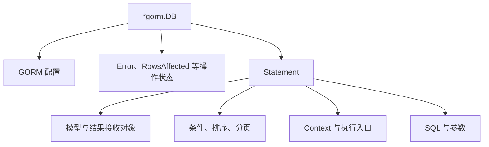

`Statement` 是 GORM 内部用于描述操作的对象，**不是标准库中的 *sql.Stmt 预编译语句**。

具体定义可以阅读：

- [gorm.DB 定义：gorm.go](https://github.com/go-gorm/gorm/blob/v1.31.1/gorm.go)
- [Statement 定义：statement.go](https://github.com/go-gorm/gorm/blob/v1.31.1/statement.go)

## 2.6 链式查询与分页

### 2.6.1 哪些调用只构造条件

下面的代码可以拆成两个阶段：

```go
query := db.
    Where("active = ?", true).
    Order("id DESC").
    Limit(20)

var users []User

if err := query.Find(&users).Error; err != nil {
    return err
}
```

第一阶段的 `Where`、`Order` 和 `Limit` 主要向 `Statement` 中添加信息。

第二阶段的 `Find` 指定结果接收对象，并触发查询执行。

以 `Where` 为例，源码中的主要逻辑是：

源码位置：[chainable_api.go：Where](https://github.com/go-gorm/gorm/blob/v1.31.1/chainable_api.go)。

```go
func (db *DB) Where(
    query interface{},
    args ...interface{},
) (tx *DB) {
    tx = db.getInstance()

    if conds := tx.Statement.BuildCondition(query, args...); len(conds) > 0 {
        tx.Statement.AddClause(clause.Where{Exprs: conds})
    }

    return
}
```

这里没有发送 SQL，而是在执行三件事：

1. 取得本次调用使用的操作句柄。
2. 将输入转换为条件表达式。
3. 把条件加入 `Statement`。

### 2.6.2 Find 如何执行查询

`Find` 会设置结果接收对象，然后调用查询回调链。下面节选其最后两行：

源码位置：[finisher_api.go：Find](https://github.com/go-gorm/gorm/blob/v1.31.1/finisher_api.go)。

```go
tx.Statement.Dest = dest
return tx.callbacks.Query().Execute(tx)
```

这里的“回调链”是 GORM 内部按顺序执行的一组处理函数，用来完成模型解析、SQL 构造、查询和结果扫描等工作。

查询执行的主要过程为：

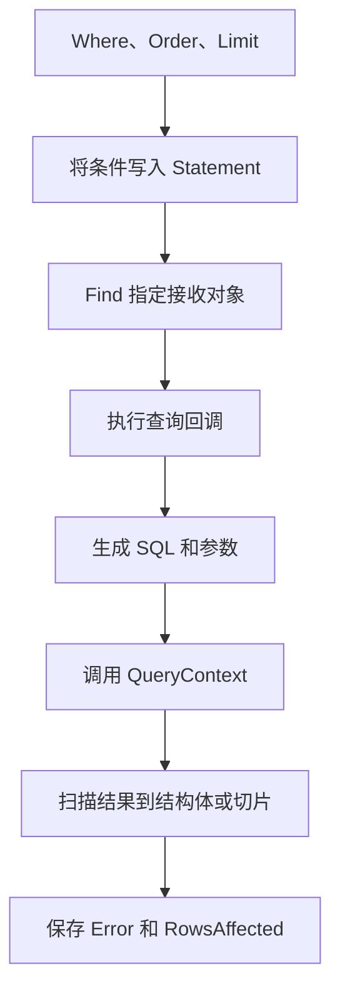

在查询回调源码中，可以看到数据库执行入口：

源码位置：[callbacks/query.go：Query](https://github.com/go-gorm/gorm/blob/v1.31.1/callbacks/query.go)。

```go
rows, err := db.Statement.ConnPool.QueryContext(
    db.Statement.Context,
    db.Statement.SQL.String(),
    db.Statement.Vars...,
)
```

其中：

- `Context` 用于传递超时和取消。
- `SQL.String()` 是生成的 SQL。
- `Vars` 保存参数值。
- `ConnPool` 在普通查询中通常对应底层连接池，在事务中则会指向事务执行对象。

查询返回后，GORM 负责扫描结果，并关闭内部取得的结果集。结果扫描的实现可以阅读 [scan.go](https://github.com/go-gorm/gorm/blob/v1.31.1/scan.go)。

### 2.6.3 查询条件为什么可能累积

完整示例：[基础条件的安全复用（demo_crud.go）](https://github.com/zzxrepository/gocode-examples/blob/ce4ce672155053376c74ddb19bb61f1e94a6e88b/go/03-gorm-demo/demo_crud.go)。

不能把 GORM 的链式调用理解为“每调用一个方法，就一定创建一个完全独立的对象”。

[getInstance](https://github.com/go-gorm/gorm/blob/v1.31.1/gorm.go) 会根据当前句柄的状态，决定创建新 `Statement`、克隆已有 `Statement`，或者继续使用当前对象。

因此，下面这种复用方式可能出现条件累积：

```go
query := db.Where("active = ?", true)

query.Where("age >= ?", 18).Find(&adults)
query.Where("age < ?", 18).Find(&minors)
```

这段代码用于演示误用，`adults`、`minors` 均为 `[]User`。第二次查询可能继续携带第一次追加的年龄条件。

需要复用基础条件时，可以建立新的会话起点：

```go
query := db.
    Where("active = ?", true).
    Session(&gorm.Session{})

var adults, minors []User
if err := query.
    Where("age >= ?", 18).
    Find(&adults).
    Error; err != nil {
    return err
}

if err := query.
    Where("age < ?", 18).
    Find(&minors).
    Error; err != nil {
    return err
}
```

这里的 `Session(&gorm.Session{})` 会保留基础条件，使后续操作能够分别派生各自的语句状态。它并不表示重新建立 MySQL 网络连接。

这也是为什么可以共享初始化得到的根 `db`，却不能随意共享一条不断追加条件的查询链。相关说明见[官方链式方法文档](https://gorm.io/zh_CN/docs/method_chaining.html)。

### 2.6.4 分页查询

完整示例：[ListUsers 分页实现（user.go）](https://github.com/zzxrepository/gocode-examples/blob/ce4ce672155053376c74ddb19bb61f1e94a6e88b/go/03-gorm-demo/user.go)。

下面查询启用状态的用户，并返回总数：

```go
func ListUsers(
    ctx context.Context,
    db *gorm.DB,
    page int,
    pageSize int,
) ([]User, int64, error) {
    if page < 1 {
        page = 1
    }
    if pageSize < 1 || pageSize > 100 {
        pageSize = 20
    }

    base := db.
        WithContext(ctx).
        Model(&User{}).
        Where("active = ?", true).
        Session(&gorm.Session{})

    var total int64
    if err := base.Count(&total).Error; err != nil {
        return nil, 0, fmt.Errorf("统计用户数量：%w", err)
    }

    var users []User
    if err := base.
        Order("id DESC").
        Limit(pageSize).
        Offset((page - 1) * pageSize).
        Find(&users).
        Error; err != nil {
        return nil, 0, fmt.Errorf("查询用户分页：%w", err)
    }

    return users, total, nil
}
```

这里会执行两次查询：

```sql
SELECT COUNT(*)
FROM users
WHERE active = ?
  AND deleted_at IS NULL;
```

```sql
SELECT *
FROM users
WHERE active = ?
  AND deleted_at IS NULL
ORDER BY id DESC
LIMIT ? OFFSET ?;
```

需要注意：

- 分页应有明确且稳定的排序。
- 总数查询和列表查询是两条 SQL，并发写入时，两者可能观察到不同的数据状态。
- 很大的 `OFFSET` 仍可能带来较高扫描成本。数据量较大时，可以考虑基于主键等有序字段的游标分页。

## 2.7 更新记录

### 2.7.1 更新单个字段

完整示例：[单字段、结构体、Map 与 Select 更新（demo_crud.go）](https://github.com/zzxrepository/gocode-examples/blob/ce4ce672155053376c74ddb19bb61f1e94a6e88b/go/03-gorm-demo/demo_crud.go)。

```go
result := db.
    Model(&User{}).
    Where("id = ?", userID).
    Update("active", false)

if result.Error != nil {
    return fmt.Errorf("更新用户状态：%w", result.Error)
}
```

`Model(&User{})` 指定操作模型，`Where` 指定目标记录，`Update` 指定更新字段并执行操作。

由于模型包含 `UpdatedAt`，GORM 通常还会同时维护更新时间。

SQL 可以简化理解为：

```sql
UPDATE users
SET active = ?,
    updated_at = ?
WHERE id = ?
  AND deleted_at IS NULL;
```

### 2.7.2 更新多个字段

使用 Map 可以明确表达要更新哪些字段，包括零值：

```go
result := db.
    Model(&User{}).
    Where("id = ?", userID).
    Updates(map[string]any{
        "name":   "新名字",
        "age":    0,
        "active": false,
    })

if result.Error != nil {
    return result.Error
}
```

使用结构体时，默认只更新非零字段：

```go
result := db.
    Model(&User{}).
    Where("id = ?", userID).
    Updates(User{
        Name:   "新名字",
        Age:    0,
        Active: false,
    })
if result.Error != nil {
    return result.Error
}
```

这段代码默认不会把 `Age` 更新为 `0`，也不会把 `Active` 更新为 `false`。

如果希望保留结构体写法，可以显式选择字段：

```go
result := db.
    Model(&User{}).
    Where("id = ?", userID).
    Select("Name", "Age", "Active").
    Updates(User{
        Name:   "新名字",
        Age:    0,
        Active: false,
    })

if result.Error != nil {
    return result.Error
}
```

### 2.7.3 零值规则在源码中如何体现

GORM 构造结构体更新语句时，会读取字段值及其零值状态。

忽略其他分支后，判断关系可以概括为：

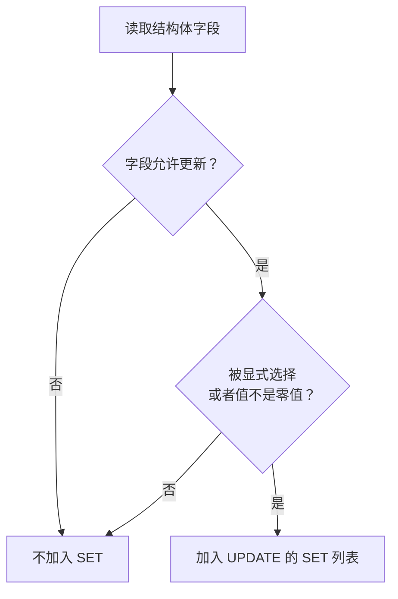

因此：

- 普通结构体更新中的零值会被默认省略。
- `Select` 可以明确要求包含某些零值字段。
- Map 的键已经表达了“本次需要更新这个字段”，因此可以保留零值。

对应实现位于 [callbacks/update.go：ConvertToAssignments](https://github.com/go-gorm/gorm/blob/v1.31.1/callbacks/update.go)。

### 2.7.4 如何理解 RowsAffected

更新后可以观察：

```go
result.RowsAffected
```

但不能简单地写成：

```go
if result.RowsAffected == 0 {
    return errors.New("用户不存在")
}
```

MySQL 中的影响行数受实际数据变化和驱动配置等因素影响。零行可能表示没有匹配记录，也可能表示匹配到了记录，但没有产生实际变化。

如果业务必须区分这两种情况，需要另外设计存在性检查或更新条件，并考虑并发修改带来的影响。

此外，GORM 默认会阻止没有有效条件的全表更新，返回 `gorm.ErrMissingWhereClause`。这项保护只能检查是否存在条件，不能判断条件是否符合业务预期。相关规则见[官方更新文档](https://gorm.io/zh_CN/docs/update.html)。

## 2.8 删除与软删除

### 2.8.1 为什么 Delete 可能执行 UPDATE

完整示例：[软删除与唯一约束实验（demo_crud.go）](https://github.com/zzxrepository/gocode-examples/blob/ce4ce672155053376c74ddb19bb61f1e94a6e88b/go/03-gorm-demo/demo_crud.go)。

本文的模型包含：

```go
DeletedAt gorm.DeletedAt `gorm:"index"`
```

因此：

```go
if err := db.Delete(&User{}, userID).Error; err != nil {
    return err
}
```

默认执行软删除，其语义类似：

```sql
UPDATE users
SET deleted_at = ?
WHERE id = ?
  AND deleted_at IS NULL;
```

记录仍然存在，只是被标记为已经删除。

此后的常规模型查询会自动添加：

```sql
deleted_at IS NULL
```

所以普通查询看不到这条记录。

### 2.8.2 软删除条件从哪里来

`gorm.DeletedAt` 不只是用于保存一个可空时间值。

这个类型还提供参与查询、更新和删除语句构造的规则。GORM 解析模型时会记录这些规则，在后续生成 SQL 时应用：

- 查询时，排除已经删除的记录。
- 删除时，将物理删除转换为更新时间字段。
- 常规模型更新时，避免更新已经软删除的记录。

相关实现位于 [soft_delete.go](https://github.com/go-gorm/gorm/blob/v1.31.1/soft_delete.go)。

因此，软删除是 GORM 在生成 SQL 时加入的行为，并不是 MySQL 自动赋予某个字段的能力。

### 2.8.3 查询已删除数据与永久删除

查询包含已软删除的数据：

```go
var users []User

if err := db.Unscoped().Find(&users).Error; err != nil {
    return err
}
```

永久删除指定记录：

```go
if err := db.
    Unscoped().
    Delete(&User{}, userID).
    Error; err != nil {
    return err
}
```

`Unscoped` 会关闭相应的软删除限制；与 `Delete` 配合时，会执行物理删除。详细行为见[官方删除文档](https://gorm.io/zh_CN/docs/delete.html)。

GORM 默认也会阻止没有有效条件的批量删除，并返回 `gorm.ErrMissingWhereClause`。

还有一个容易忽略的问题：本文的 `Email` 建立了唯一索引。

软删除不会移除这条数据库记录，因此该邮箱仍然占用唯一值。能否重新注册相同邮箱，需要结合账号恢复、历史保留等需求设计，不能仅凭“普通查询已经看不到用户”来判断。

## 2.9 错误处理与请求上下文

### 2.9.1 检查本次操作的返回值

传统 API 将错误保存在返回的操作句柄中：

```go
result := db.Where("email = ?", email).First(&user)

if result.Error != nil {
    return result.Error
}
```

应当检查 `result.Error`，或者直接读取本次方法调用返回值的 `.Error`。

不要在执行完查询后，转而检查最初根 `db` 上的 `Error`，因为本次操作可能使用了派生句柄。

错误也有不同来源：

| 来源 | 示例 |
| --- | --- |
| GORM | `ErrRecordNotFound`、`ErrMissingWhereClause` |
| Context | 取消或超过截止时间 |
| 数据库驱动、MySQL | 重复唯一键、连接失败、SQL 执行错误 |

例如，没有找到记录可以使用：

```go
errors.Is(err, gorm.ErrRecordNotFound)
```

默认配置下，MySQL 唯一键冲突等错误通常仍表现为驱动错误。GORM 也提供可选的错误翻译功能，但需要显式启用，不能假定所有数据库错误默认都已转换为 GORM 错误。详细说明见[官方错误处理文档](https://gorm.io/zh_CN/docs/error_handling.html)。

### 2.9.2 使用 WithContext

完整示例：[GetUser 与请求 Context（user.go）](https://github.com/zzxrepository/gocode-examples/blob/ce4ce672155053376c74ddb19bb61f1e94a6e88b/go/03-gorm-demo/user.go)。

业务函数应接收上层传入的 Context：

```go
func GetUser(
    ctx context.Context,
    db *gorm.DB,
    id uint,
) (User, error) {
    var user User

    if err := db.
        WithContext(ctx).
        First(&user, id).
        Error; err != nil {
        return User{}, fmt.Errorf("查询用户 %d：%w", id, err)
    }

    return user, nil
}
```

调用方可以设置超时：

```go
ctx, cancel := context.WithTimeout(parentCtx, 2*time.Second)
defer cancel()

user, err := GetUser(ctx, db, userID)
if err != nil {
    return err
}
```

`WithContext` 会创建相应会话，并将 Context 放入 `Statement`。执行查询时，它继续传给底层 `QueryContext`、`ExecContext` 等方法。

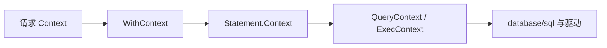

因此，超时可能发生在等待连接池连接时，也可能发生在数据库操作过程中，并不一定表示 SQL 本身执行缓慢。

取消信号可以传递到驱动，但不能据此保证服务端操作在同一时刻停止。尤其对于写操作，超时后需要谨慎判断执行结果，避免盲目重试造成重复写入。相关说明见[官方 Context 文档](https://gorm.io/zh_CN/docs/context.html)。

## 2.10 事务

### 2.10.1 默认写事务与业务事务

GORM 默认会为创建、更新、删除操作启用事务。

但两次独立调用，即使各自使用默认事务，也不能保证两步一起成功或一起失败。如果业务要求“扣减库存”和“创建订单”保持一致，就需要显式业务事务。参见[官方事务文档](https://gorm.io/zh_CN/docs/transactions.html)。

### 2.10.2 扣减库存并创建订单

完整示例：[CreateOrder 事务实现（order.go）](https://github.com/zzxrepository/gocode-examples/blob/ce4ce672155053376c74ddb19bb61f1e94a6e88b/go/03-gorm-demo/order.go)。

先定义商品和订单模型：

```go
type Product struct {
    ID    uint   `gorm:"primaryKey"`
    Name  string `gorm:"size:128;not null"`
    Stock int    `gorm:"not null"`
}

type Order struct {
    ID        uint `gorm:"primaryKey"`
    UserID    uint `gorm:"not null;index"`
    ProductID uint `gorm:"not null;index"`
    Quantity  int  `gorm:"not null"`
    CreatedAt time.Time
}
```

本地演示前创建相应数据表：

```go
if err := db.AutoMigrate(&Product{}, &Order{}); err != nil {
    return err
}
```

下面的函数演示已经完成用户身份校验后的下单过程：

```go
// ErrInsufficientStock 同时表示商品不存在或库存不足。
var ErrInsufficientStock = errors.New("商品不存在或库存不足")

// CreateOrder 在同一个事务中扣减库存并创建订单。调用方应先验证用户身份。
func CreateOrder(
	ctx context.Context,
	db *gorm.DB,
	userID uint,
	productID uint,
	quantity int,
) error {
	if userID == 0 || productID == 0 {
		return errors.New("用户 ID 和商品 ID 必须有效")
	}
	if quantity <= 0 {
		return errors.New("购买数量必须大于 0")
	}

	return db.WithContext(ctx).Transaction(func(tx *gorm.DB) error {
		// 将库存条件与扣减放在同一条 UPDATE 中，避免先读再写。
		result := tx.
			Model(&Product{}).
			Where("id = ? AND stock >= ?", productID, quantity).
			Update("stock", gorm.Expr("stock - ?", quantity))

		if result.Error != nil {
			return fmt.Errorf("扣减库存：%w", result.Error)
		}
		if result.RowsAffected == 0 {
			return ErrInsufficientStock
		}

		order := Order{
			UserID:    userID,
			ProductID: productID,
			Quantity:  quantity,
		}

		// 使用同一个 tx，让订单插入与库存扣减属于同一事务。
		if err := tx.Create(&order).Error; err != nil {
			return fmt.Errorf("创建订单：%w", err)
		}

		return nil
	})
}
```

这里将库存判断和扣减放在同一条语句中：

```sql
UPDATE products
SET stock = stock - ?
WHERE id = ?
  AND stock >= ?;
```

因为 `quantity` 必须大于零，成功匹配并执行扣减时，库存一定发生变化。这里才可以根据零行结果判断“商品不存在或库存不足”。

如果先查询库存，再在 Go 中计算新库存，最后更新，就可能出现多个请求读取到同一个旧值的问题。

### 2.10.3 为什么事务内必须使用 tx

普通操作通常通过连接池获取连接，事务开始后，则需要在同一条连接上依次执行相关语句：

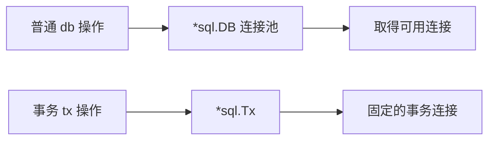

GORM 开始事务时，会调用底层的 `BeginTx`，并让事务句柄的执行入口指向返回的事务对象。

因此，`tx.Create(&order)` 会参与当前事务，而 `db.Create(&order)` 可能从外层连接池取得另一条连接，不受当前事务回滚控制。

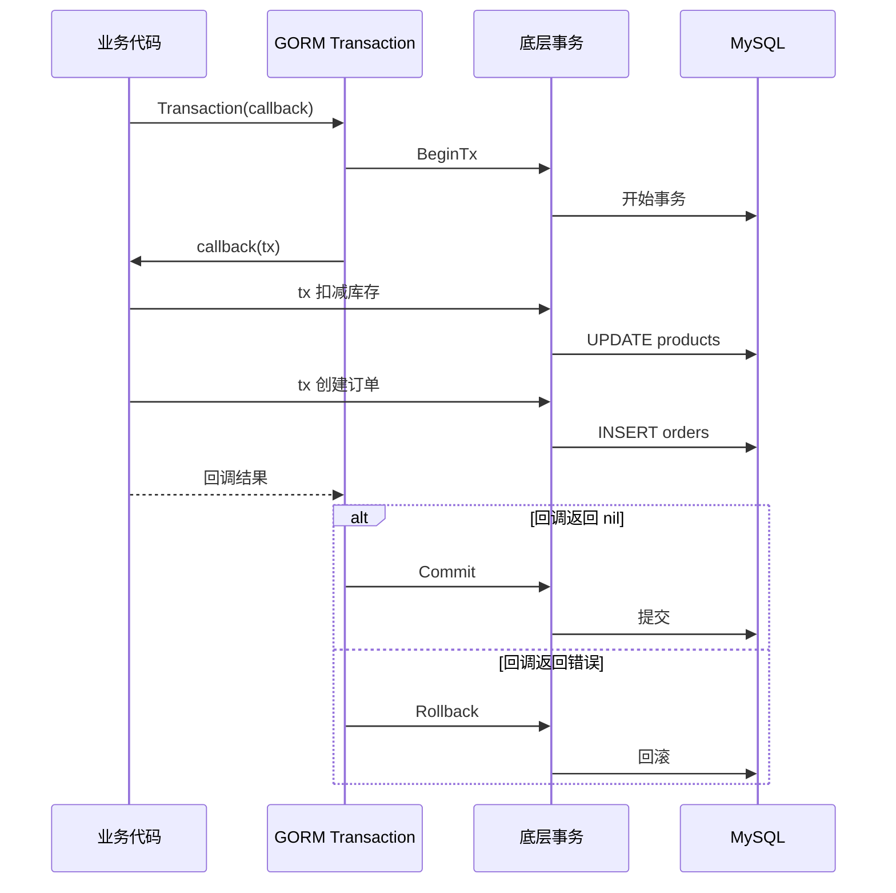

普通事务回调中：

- 返回 `nil`，GORM 尝试提交，并返回提交结果。
- 返回错误，GORM 执行回滚并返回错误。
- 发生 panic，会触发回滚处理，panic 继续向外传播。

具体实现可以阅读 [finisher_api.go：Transaction、Begin 和 Commit](https://github.com/go-gorm/gorm/blob/v1.31.1/finisher_api.go)。

事务能够约束数据库操作的一致性，但不会让事务中的 HTTP 请求或消息发送自动具备回滚能力。

## 2.11 关联查询

### 2.11.1 定义用户与订单的关系

前面的订单已经包含 `UserID`，表示订单所属用户。

如果希望查询用户时同时取得订单，可以在 `User` 模型中增加字段，原有字段保留：

```go
Orders []Order `gorm:"foreignKey:UserID"`
```

这里：

- `Orders` 表示一个用户关联多个订单。
- `foreignKey:UserID` 指定关联字段。
- 默认使用 `User.ID` 与 `Order.UserID` 建立对应关系。

`Orders` 不会被转换成 `users` 表中的一个普通列。GORM 会将它解析为关联信息，订单数据仍然存放在 `orders` 表中。

本地示例修改模型后，可以再次执行迁移：

```go
if err := db.AutoMigrate(&User{}, &Order{}); err != nil {
    return err
}
```

### 2.11.2 使用 Preload

完整示例：[订单提交、回滚与关联查询（demo_transaction.go）](https://github.com/zzxrepository/gocode-examples/blob/ce4ce672155053376c74ddb19bb61f1e94a6e88b/go/03-gorm-demo/demo_transaction.go)。

```go
var user User

if err := db.
    Preload("Orders").
    First(&user, userID).
    Error; err != nil {
    return err
}
for _, order := range user.Orders {
    fmt.Println(order.ID, order.ProductID, order.Quantity)
}
```

`Preload` 的参数 `"Orders"` 是模型中的关联字段名，并不是数据库表名。

普通 `First` 只查询用户；增加 `Preload("Orders")` 后，GORM 会加载对应订单并填写到 `user.Orders`。

### 2.11.3 Preload 如何加载关联数据

普通的一对多预加载，通常通过额外查询完成，而不是自动变成一条 Join。

例如，查询多个用户时：

```sql
SELECT *
FROM users
WHERE deleted_at IS NULL;
```

取得用户 ID 后，再查询订单：

```sql
SELECT *
FROM orders
WHERE user_id IN (?, ?, ?);
```

最后，根据 `Order.UserID` 将订单放回相应用户的 `Orders` 切片。

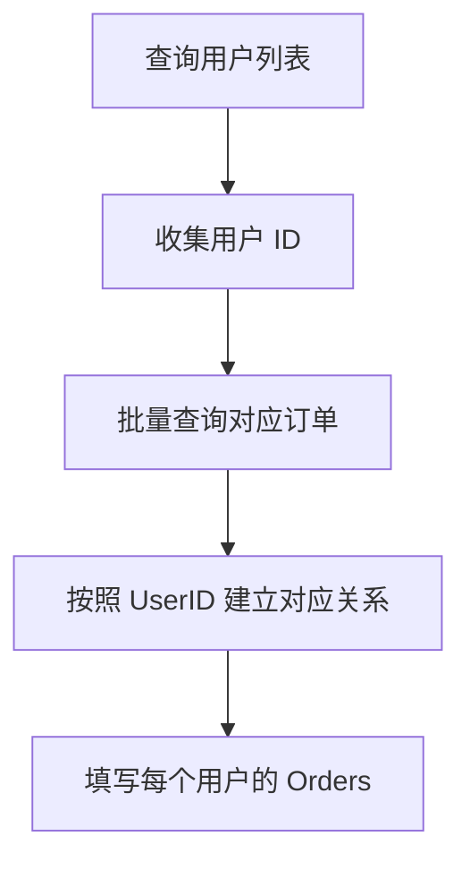

这可以避免在 Go 循环中为每个用户分别查询一次订单，即常见的 N+1 查询问题。详细用法见[官方预加载文档](https://gorm.io/zh_CN/docs/preload.html)。

不过，减少查询次数不等于减少结果数量。一次查询过多用户及其全部订单，仍然可能带来较大的数据库和内存开销。

此外，用户查询与订单查询是不同 SQL，默认不能保证它们观察到同一个数据库快照。需要严格一致性时，应结合事务和隔离级别设计。

具体实现可以阅读 [callbacks/preload.go](https://github.com/go-gorm/gorm/blob/v1.31.1/callbacks/preload.go)。

## 2.12 原生 SQL 与 SQL 注入

### 2.12.1 使用 Raw 查询

完整示例：[Raw 查询与 Exec 写入（demo_crud.go）](https://github.com/zzxrepository/gocode-examples/blob/ce4ce672155053376c74ddb19bb61f1e94a6e88b/go/03-gorm-demo/demo_crud.go)。

对于复杂统计或更适合直接表达的 SQL，可以使用原生查询：

```go
type UserSummary struct {
    Name string
    Age  int
}

var users []UserSummary

err := db.
    WithContext(ctx).
    Raw(
        `SELECT name, age
         FROM users
         WHERE age >= ?
           AND deleted_at IS NULL`,
        18,
    ).
    Scan(&users).
    Error

if err != nil {
    return fmt.Errorf("查询用户摘要：%w", err)
}
```

这里的 `Raw` 保存 SQL 和参数，后面的 `Scan` 才触发查询并扫描结果。

注意，**原生 SQL 不会自动补齐常规模型查询中的软删除条件**，所以示例明确写出了 `deleted_at IS NULL`。

使用原生 SQL 时，查询范围需要由 SQL 本身表达完整。

### 2.12.2 使用 Exec 执行写操作

```go
result := db.WithContext(ctx).Exec(
    `UPDATE users
     SET active = ?, updated_at = ?
     WHERE id = ?
       AND deleted_at IS NULL`,
    false,
    time.Now(),
    userID,
)

if result.Error != nil {
    return fmt.Errorf("更新用户状态：%w", result.Error)
}
```

`Exec` 会执行给定语句。

与常规模型更新相比，这里需要自己维护 `updated_at`，也不能依赖 GORM 自动添加模型更新钩子、软删除条件或全表操作保护。

如果多条原生 SQL 需要处于同一事务中，仍然应通过事务句柄调用 `tx.Exec(...)`。

原生查询与执行方式可以参考[官方 SQL 构建器文档](https://gorm.io/zh_CN/docs/sql_builder.html)。相关入口位于 [chainable_api.go 的 Raw](https://github.com/go-gorm/gorm/blob/v1.31.1/chainable_api.go)、[finisher_api.go 的 Exec](https://github.com/go-gorm/gorm/blob/v1.31.1/finisher_api.go)。

### 2.12.3 占位符保护的是参数值

下面的写法使用参数绑定：

```go
db.Where("name = ?", userInput).First(&user)
```

SQL 的结构由程序确定，`userInput` 作为独立的参数值传递。

下面的写法则把用户输入变成了 SQL 文本的一部分，会引入 SQL 注入风险：

```go
db.Where(
    fmt.Sprintf("name = '%s'", userInput),
).First(&user)
```

这两段代码用于比较参数传递方式，实际业务中还要检查查询返回的 `.Error`。

占位符也不能代替所有内容，例如排序字段和排序方向。动态排序可以使用白名单：

```go
allowedOrders := map[string]string{
    "newest":  "id DESC",
    "oldest":  "id ASC",
    "age_asc": "age ASC, id ASC",
}

order, ok := allowedOrders[userOrder]
if !ok {
    order = "id DESC"
}

if err := db.Order(order).Find(&users).Error; err != nil {
    return err
}
```

这里将外部选择映射为程序中固定的 SQL 片段。

可以记住：

- 参数值使用占位符。
- 动态表名、列名、排序方向等 SQL 结构使用受控映射。

GORM 日志中显示的 SQL 是调试表示，不应据此认定日志中的字符串已经按实际执行方式完成安全转义。详细说明见[官方安全文档](https://gorm.io/zh_CN/docs/security.html)。

## 2.13 项目实践建议

### 2.13.1 理解最终执行的 SQL

GORM 可以减少 CRUD 的重复代码，但数据库仍然按照 SQL、索引和事务规则工作。

查询性能出现问题时，应先确认：

- 实际生成了哪些条件。
- 是否查询了过多字段或记录。
- 关联查询执行了多少条 SQL。
- 执行计划是否使用了合适的索引。

### 2.13.2 复用初始化得到的操作句柄

应用启动时创建根 `*gorm.DB`，由底层连接池管理连接。

对于携带条件的句柄，应明确其复用范围，需要复用基础条件时使用合适的会话方式。

### 2.13.3 在请求链路中传递 Context

业务函数接收上层 Context，并通过 `WithContext` 传入数据库操作。

不要在请求已经有 Context 的情况下，重新创建一个无关的 `context.Background()`，使取消和超时信息中断。

### 2.13.4 用日志和统计定位不同层次的问题

针对本地某次查询，可以使用：

```go
result := db.
    Debug().
    Where("email = ?", email).
    First(&user)

if result.Error != nil {
    return result.Error
}
```

排查时，不同证据回答不同问题：

| 观察方式 | 主要用途 |
| --- | --- |
| GORM SQL 日志 | 查看生成的 SQL、参数和耗时 |
| `sqlDB.Stats()` | 查看连接占用及连接池等待 |
| MySQL 执行计划 | 查看访问方式、索引和扫描情况 |
| MySQL 锁等待信息 | 判断是否被其他事务阻塞 |

生产环境中的日志级别和参数输出范围，应结合流量及数据敏感程度配置。

### 2.13.5 将表结构变更纳入版本管理

模型变更不等于数据库已经变更。

生产环境应明确迁移脚本、执行顺序和历史数据处理方式，避免只修改结构体就假定数据库结构已经一致。

### 2.13.6 明确更新和删除的范围

更新前确认：

- 目标条件是否正确。
- 是否需要写入零值。
- 是否涉及软删除数据。
- 如何解释影响行数。

全表操作保护只能降低部分误操作风险，不能替代业务条件检查。

### 2.13.7 根据查询特点选择表达方式

模型清晰、结构稳定的 CRUD，可以使用 GORM API。

复杂统计、数据库特有能力，或者使用链式调用已经难以阅读的查询，可以采用参数化原生 SQL。

两种写法可以使用同一个连接池，也可以通过同一个事务句柄执行。

## 2.14 运行配套示例

### 2.14.1 项目位置与文件

完整项目：[go/03-gorm-demo](https://github.com/zzxrepository/gocode-examples/tree/ce4ce672155053376c74ddb19bb61f1e94a6e88b/go/03-gorm-demo)，运行说明：[README.md](https://github.com/zzxrepository/gocode-examples/blob/ce4ce672155053376c74ddb19bb61f1e94a6e88b/go/03-gorm-demo/README.md)。链接固定到本文验证过的提交版本，便于对照代码。

| 文件 | 对应内容 |
| --- | --- |
| [main.go](https://github.com/zzxrepository/gocode-examples/blob/ce4ce672155053376c74ddb19bb61f1e94a6e88b/go/03-gorm-demo/main.go) | 命令行入口、连接池状态和演示流程 |
| [mysql.go](https://github.com/zzxrepository/gocode-examples/blob/ce4ce672155053376c74ddb19bb61f1e94a6e88b/go/03-gorm-demo/mysql.go) | 本机连接配置与 GORM 初始化 |
| [model.go](https://github.com/zzxrepository/gocode-examples/blob/ce4ce672155053376c74ddb19bb61f1e94a6e88b/go/03-gorm-demo/model.go)、[schema.go](https://github.com/zzxrepository/gocode-examples/blob/ce4ce672155053376c74ddb19bb61f1e94a6e88b/go/03-gorm-demo/schema.go) | 用户、商品、订单模型与迁移 |
| [user.go](https://github.com/zzxrepository/gocode-examples/blob/ce4ce672155053376c74ddb19bb61f1e94a6e88b/go/03-gorm-demo/user.go) | 单行查询、分页与 Context |
| [order.go](https://github.com/zzxrepository/gocode-examples/blob/ce4ce672155053376c74ddb19bb61f1e94a6e88b/go/03-gorm-demo/order.go) | 同一事务中的库存扣减与订单创建 |
| [demo.go](https://github.com/zzxrepository/gocode-examples/blob/ce4ce672155053376c74ddb19bb61f1e94a6e88b/go/03-gorm-demo/demo.go) | 创建演示数据、按主键清理 |
| [demo_crud.go](https://github.com/zzxrepository/gocode-examples/blob/ce4ce672155053376c74ddb19bb61f1e94a6e88b/go/03-gorm-demo/demo_crud.go) | 查询、零值更新、原生 SQL 和软删除 |
| [demo_transaction.go](https://github.com/zzxrepository/gocode-examples/blob/ce4ce672155053376c74ddb19bb61f1e94a6e88b/go/03-gorm-demo/demo_transaction.go) | 提交、业务错误回滚和预加载 |

### 2.14.2 初始化与运行

准备 Go 1.26.5 和本机 MySQL，按照 2.1.2 创建 `gorm_demo` 数据库并设置 `MYSQL_DSN`。取得配套仓库后，进入项目目录：

```bash
cd gocode-examples/go/03-gorm-demo
make init
make run
```

`make init` 等同于 `go run . -init`，只迁移表。`make run` 等同于 `go run .`，也会检查表结构，再创建本次演示数据。

需要观察实际执行的 SQL 时运行：

```bash
make sql
```

该命令等同于 `go run . -sql`，会在演示期间启用 GORM 的 SQL 日志。Makefile 默认使用 PATH 中的 `go`；也可以通过 `make GO=/path/to/go` 指定 SDK，并使 `GOROOT` 与其一致。

程序先创建一名用户、批量创建另外两名用户和一个商品，随后按本文顺序执行查询、更新、下单、预加载和软删除。部分输出如下，已省略日志时间：

```text
Create: 主键已回填=true；批量创建=2 条
零值查询: struct=3 条 map=1 条
Session 条件隔离: 成年=2 未成年=1
结构体更新后: age=20 active=true
Map 更新后: age=0 active=false
Select 更新后: age=0 active=false
事务提交: 创建订单成功，剩余库存=3
库存不足: 拒绝下单，剩余库存仍为 3
事务回滚: INSERT 后返回错误，该记录未保留
Preload: 当前用户关联订单=1 条
软删除: 普通查询未找到；Unscoped 的 DeletedAt.Valid=true
软删除后复用邮箱: MySQL 1062，唯一值仍被原记录占用
清理完成: 仅删除本次演示创建的用户、订单和商品
```

邮箱包含动态后缀，不依赖固定自增编号。演示结束时先删除本次订单，再物理删除本次用户和商品，已有数据保留。强制终止进程或数据库不可达时，清理可能无法完成。

未找到记录和重复邮箱实验出现对应的 GORM 错误日志，是正在观察的预期结果。

### 2.14.3 测试与结果验证

不连接 MySQL 的配置和参数测试：

```bash
make test
```

沿用本机账号，执行真实数据库测试、竞态检查和覆盖率统计：

```bash
make test-integration
```

这相当于：

```bash
MYSQL_INTEGRATION=1 go test -count=1 -race -cover ./...
```

未设置 `MYSQL_INTEGRATION=1` 时，真实数据库测试会跳过。启用后，每个测试创建独立的 `gorm_demo_test_*` 临时库，结束后删除，不清空 DSN 指定的学习数据库；账号需要拥有创建和删除测试库的权限。

除了 CRUD，测试还验证两种容易只凭代码误判的结果：

- 库存已经扣减，但订单插入违反用户外键时，库存应恢复、失败订单不应保留。
- 8 个并发请求各购买 1 件商品，而库存只有 5 件时，最多成功 5 个订单，最终库存不能为负数。

完整演示会连续运行，并检查已有用户和商品是否保持原值，以及本次数据是否清理完成。

测试源码：[mysql_test.go](https://github.com/zzxrepository/gocode-examples/blob/ce4ce672155053376c74ddb19bb61f1e94a6e88b/go/03-gorm-demo/mysql_test.go)、[gorm_integration_test.go](https://github.com/zzxrepository/gocode-examples/blob/ce4ce672155053376c74ddb19bb61f1e94a6e88b/go/03-gorm-demo/gorm_integration_test.go)。

<span id="_2-14-本节小结"></span>

## 2.15 本节小结

GORM 在标准库数据库操作之上，增加了模型映射、SQL 构造、关联处理和常见操作约定。

理解一次查询时，可以沿着下面的过程分析：

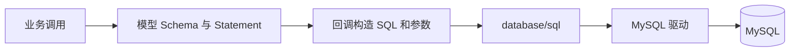

基础阶段需要掌握的重点包括：

- 分清 MySQL 方言、`*gorm.DB` 和 `*sql.DB`。
- 理解模型、标签与数据库实际结构之间的关系。
- 分清构造条件的方法和执行操作的方法。
- 理解结构体查询、结构体更新中的零值规则。
- 正确处理错误、影响行数和 Context。
- 区分软删除、物理删除与原生 SQL 的行为。
- 使用同一个事务句柄组织需要一起成功的操作。
- 理解预加载增加了哪些查询、返回了多少数据。

## 总结

GORM 把模型信息与操作条件组织为 SQL，最终仍然通过标准库连接池和 MySQL 驱动访问数据库。理解这些对象之间的关系，才能判断一个方法改变了哪些条件、何时发送 SQL，以及结果如何写回 Go 变量。

实际使用时，先写清目标记录、输入参数和结果处理，再根据需要阅读对应的模型解析、回调和驱动执行代码。这样既能使用 GORM 减少重复工作，也能解释程序的实际行为。

## 参考文档

1. [GORM 官方中文指南](https://gorm.io/zh_CN/docs/index.html)
2. [GORM：连接数据库](https://gorm.io/zh_CN/docs/connecting_to_the_database.html)
3. [GORM：配置](https://gorm.io/zh_CN/docs/gorm_config.html)
4. [GORM：模型定义](https://gorm.io/zh_CN/docs/models.html)
5. [GORM：迁移](https://gorm.io/zh_CN/docs/migration.html)
6. [GORM：链式方法](https://gorm.io/zh_CN/docs/method_chaining.html)
7. [GORM：创建](https://gorm.io/zh_CN/docs/create.html)、[查询](https://gorm.io/zh_CN/docs/query.html)、[更新](https://gorm.io/zh_CN/docs/update.html)、[删除](https://gorm.io/zh_CN/docs/delete.html)
8. [GORM：错误处理](https://gorm.io/zh_CN/docs/error_handling.html)、[Context](https://gorm.io/zh_CN/docs/context.html)
9. [GORM：事务](https://gorm.io/zh_CN/docs/transactions.html)
10. [GORM：预加载](https://gorm.io/zh_CN/docs/preload.html)
11. [GORM：SQL 构建器](https://gorm.io/zh_CN/docs/sql_builder.html)、[安全](https://gorm.io/zh_CN/docs/security.html)
12. [GORM v1.31.1 源码](https://github.com/go-gorm/gorm/tree/v1.31.1)
13. [GORM MySQL 方言 v1.6.0 源码](https://github.com/go-gorm/mysql/tree/v1.6.0)
14. [Go MySQL 协议驱动](https://github.com/go-sql-driver/mysql)
15. [LearnKu：GORM v2 中文文档](https://learnku.com/docs/gorm/v2)
16. [博客园参考文章](https://www.cnblogs.com/taoxiaoxin/p/17956555)
17. [TopGoer：GORM 介绍](https://www.topgoer.com/数据库操作/gorm/gorm介绍.html)——使用旧版 API，阅读时注意与本文版本区分。
18. [GORM 配套 Demo：固定版本源码与运行说明](https://github.com/zzxrepository/gocode-examples/tree/ce4ce672155053376c74ddb19bb61f1e94a6e88b/go/03-gorm-demo)
