# RocketMQ

# [RocketMQ 详解系列 ](https://www.cnblogs.com/mingyueyy/p/16564259.html)

## 什么是RocketMQ

RocketMQ作为一款纯java、分布式、队列模型的开源消息中间件，支持事务消息、顺序消息、批量消息、定时消息、消息回溯等。主要功能是异步解耦和流量削峰：。

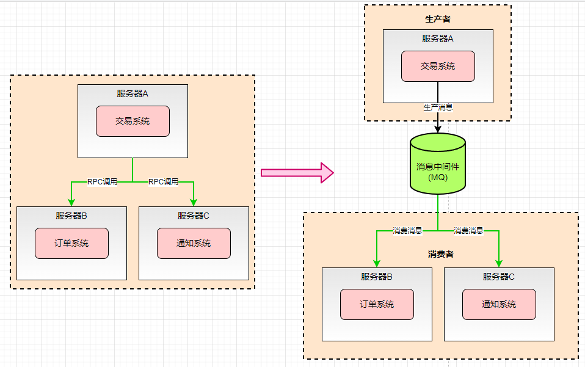

常见的MQ主要有：`ActiveMQ、RabbitMQ、Kafka、RocketMQ`

**四种消息中间件的基本介绍：**

|          特性           |                        ActiveMQ                        |                     RabbitMQ                     |                           RocketMQ                           |                            Kafka                             |
| :---------------------: | :----------------------------------------------------: | :----------------------------------------------: | :----------------------------------------------------------: | :----------------------------------------------------------: |
|       单机吞吐量        |           万级，比RocketMQ和Kafka第一个级别            |                    同ActiveMQ                    |                      10万级，支撑高吞吐                      | 10万级，高吞吐，一般配合大数据类的系统进行实时数据计算、日志采集等场景 |
| topic数量对吞吐量的影响 |                                                        |                                                  | topic可以达到几百/几千级别，吞吐量会有较小幅度的下降，这是RocketMQ的一大优势，在同等机器下，可以支撑大量的topic | topic从几十到几百时，吞吐量会大幅度下降，在同等机器下，kafka尽量保证topic数量不要过多，如果要支撑大规模的topic，需要增加更多的机器资源 |
|         时效性          |                          ms级                          |        微秒级别，RabbitMQ的特性，延迟最低        |                            ms级别                            |                       延迟在ms级别以内                       |
|         可用性          |               高，基于主从架构实现高可用               |                    同ActiveMQ                    |                      非常高，分布式架构                      | 非常高，分布式一个数据多个副本，少数机器宕机，不会丢失数据，不会导致不可用 |
|       消息可靠性        |                  有较低的概率丢失数据                  |                     基本不丢                     |               经过参数优化配置，可以做到0丢失                |               经过参数优化配置，可以做到0丢失                |
|        功能支持         |                  MQ领域的功能机器完备                  | 基于erlang开发，并发能力很强，性能极好，延时很低 |             MQ功能较为完善，基本分布式，扩展性好             | 功能较简单，主要支持简单的MQ功能，在大数据领域的实时计算以及日志采集被大规模使用 |
|          其他           | Apache开发，起步早，没有经过高吞吐场景验证，社区不活跃 |             开源、稳定、社区活跃度高             |              阿里开源，交给Apache，社区活跃度低              |           Apache开发，开源、高吞吐量、社区活跃度高           |

**消息中间件的使用场景：**

**异步与解耦：**

当我们下了一个订单之后，订单系统会进行RPC同步调用 支付系统、库存系统、物流系统等，那么系统之间就会有耦合性，耦合性越高的话，容错性就越低，比如我们的支付系统如果宕机了，就会导致我们整个交易的异常，从而影响用户的体验。

如果我们中间加入了消息中间件，不管是支付还是库存等系统，都是通过异步的方式进行调用的，如果其中一个系统宕机了，不会影响我们用户下单的使用。

本质上MQ第一步完成了 **异步** ，第二步完成了 **解耦** 。那么系统的容错性就越高。

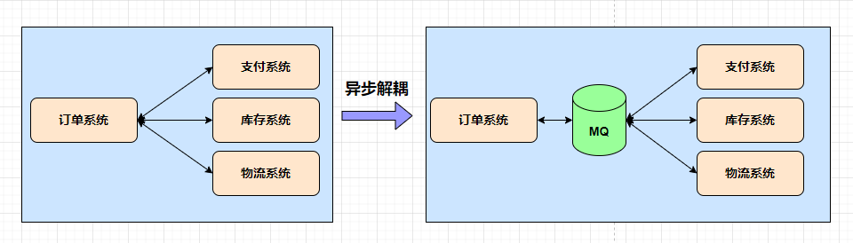

**流量削峰：**

流量削峰也可以叫削峰填谷，比如一些互联网公司大促场景，双十一、店庆或者秒杀活动，都会使用到消息中间件。

如果在不使用消息中间件或者没有流量削峰，每秒是很高的并发，这个时候如果我们的A系统，如果要将数据写入到我们的MYSQL中，受限于MYSQL本身服务的上限，最大我们只能每秒处理200请求，这个时候会有大量的消息进行堆积，从而导致A系统的奔溃。

这个时候我们可以将用户的请求消息通过MQ进行写入，因为消息中间件本身是对数据量处理比较高的一个系统，所以对于每秒2000请求，消息中间件可以处理，然后A系统作为消息中间件的一个消费者，以固定的速度从MQ中拉取200个消息，完成我们的业务操作，**用时间换空间** 从而确保我们A系统的稳定性。

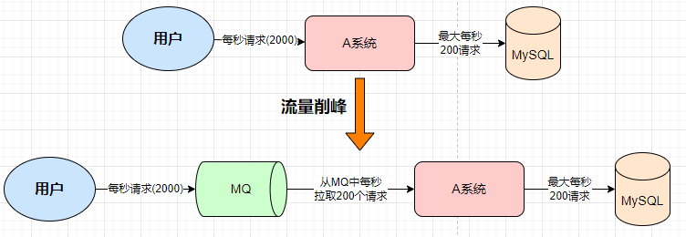

**数据分发：**

如果S系统，在对系统进行开发的时候，需要对接多个(A、B、C、D)系统，使用传统的接口调用，中间有改动就需要修改我们的代码，当新增了A系统，我们需要去修改代码去调用A系统来完成对应的业务逻辑，如果我们当中的D系统需要移除， 同样也需要修改代码删除对应的接口调用。

如果S系统使用了消息中间件，我们S系统只要将消息交给MQ，剩下的不论是新增还是移除，还是原有的，他们都只是消息中间件的一个消费者，这个时候我们就便于数据的分发。

比如我们新增一个系统，我们只需要新增一个MQ的消费者，直接从MQ里面拿消息就可以，当我们需要移除一个系统的时候，只需要取消对MQ消息的监听即可。对于我们原有的S系统不需要进行额外的修改。如果使用MQ作为数据分发，减少数据的修改，提高开发的效率。

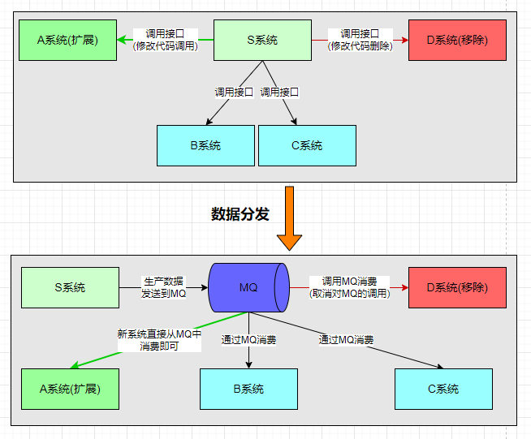

## RocketMQ 基本概念

RocketMQ主要有四大核心组成部分：`NameServer、Broker、Producer以及Consumer四部分`。这些角色通常以集群的方式存在，RocketMQ 基于纯Java开发，具有高吞吐量、高可用性、适合大规模分布式系统应用的特点。


对于 `RockerMQ` 而言，我们想要启动，必须首先启动 `NameServer`，在启动 `Brober` 主机， `Brober` 会向 NameServer 注册对应的路由和服务(Broker 地址、主体和)，Producer会进行路由的发现，向NameServer请求Broker路由信息，进行消息的发送。

作为Consumer要连通NameServer，获取到相关的路由信息，方便我们进行消息的订阅。

Broker 也是一个很重要的角色，主要负责消息的存储，不管是生产消息还是订阅消息，消息的来源都是 Broker，一般来说消息的发送(Producer)只会发到主节点，然后Broker会进行消息的同步，同步到从节点，作为消费者(Consumer)也只会优先从Master节点，获取消息，进行消费，除非主节点不可用或者非常繁忙，才会从从节点进行消费，Broker除了消息的中转，还负责消息的持久化以及主从数据之间的复制

**NameServer：**

`NameServer` 是一个服务与注册的发现中心。也是整个 RocketMQ 的“大脑”，所以 RocketMQ 需要先启动 `NameServer` 再启动 RocketMQ 中的 `Broker`

`NameServer` 是一个几乎无状态节点，可集群部署，节点之间无任何信息同步。`NameServer`底层由 Netty 实现，是内存式存储，所以 `NameServer` 中的 broker、topic不会持久化。

`NameServer` 其角色类似Dubbo和zookeeper，主要负责Broker的动态注册与发现。为什么不使用zookeeper？rocketmq主要是在分布式情况下使用追求性能，因为zookeeper最求最终一致性，所以在性能上会有所折扣。

**Broker：**

消息服务器（`Broker`）是消息存储中心，主要作用是接收来自 `Producer` 的消息并存储，`Consumer` 从这里取得消息。存储与消息相关的元数据，包括用户组、消费进度偏移量、队列信息等。从部署结构图中可以看出 `Broker` 有 `Master` 和 `Slave` 两种类型， **`Master` 既可以写又可以读，`Slave` 不可以写只可以读。**

**Producer：**

`Producer` 也称为消息发布者(生产者)，负责生产并发送消息至 `Topic`。生产者向 `broker` 发送由业务应用程序系统生成的消息。`RocketMQ` 提供了发送：同步、异步和单向（one-way）的多种范例。

**Consumer：**

也称为消息订阅者，负责从 Topic 接收并消费消息。消费者从 `brokers` 那里拉取信息并将其输入应用程序。从Master拿到消息，执行完成后，会发送一个消息给Broker进行确认，这个就是ACK确认

### RocketMQ 基本概念

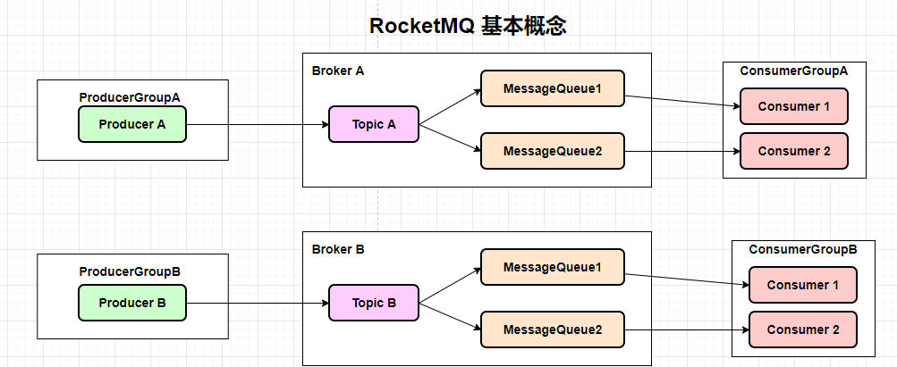

### 分组(Group)

Group 分为两个部分 生产者和消费者

- **生产者：** 表示发送同一类消息的 Producer，通常情况下发送逻辑是一致的。发送普通消息时，用于标识使用，没有特别的用处。

  主要用来作用于事务消息，当事务消息中某条消息一直处于等待状态并超时，Broker会回查同一个Group下的其他producer，确定该消息是 commit 还是 rollback

- **消费者：** 消费者的分组就非常有意义了，消费者是标识一类 `Consumer` 的集合名称，这类 `Consumer` 通常消费一类消息，且消费逻辑一致。同一个 `Consumer Group` 下的各个实例将共同消费 topic 的消息，起到负载均衡的作用。

  消费进度以 `Consumer Group` 为粒度管理，不同 `Consumer Group` 之间消费进度彼此不受影响，即消息 A 被 `Consumer Group1` 消费过，也会再给 `Consumer Group2` 消费。

### 主体(Topic)

用来区分消息的种类，表示一类消息的逻辑名字，消息的逻辑管理单位，无论生产还是消费消息，都需要执行Topic。

一个发送者可以发送消息给一个或者多个Topic;

一个消息接受者可以订阅一个或多个Topic消息；

### 消息队列(Message Queue)

消息队列 简称 Queue ，消息物理管理单位。用来并行发送和接收消息，相当于是Topic的分区。

一个Topic会有若干个Queue，消息的生产一般会比消息消费的速度要快，消息进行消费的时会有对应的业务逻辑进行处理，这个时候就会降低消息消费的速度。所有一般Topic会有若干个Queue。主要用来解决生产很快，消费很慢。

如果同一个Topic创建在不同的Broker，那么不同的Broker有不同的Queue，将物理存储在不同的Broker节点之上，具有水平扩展的能力。无论是生产者还是消费者，实际的操作都是针对Queue级别。

### 标签（Tag）

RocketMQ 支持在发送时给 topic 的消息设置 tag，用于同一主题下区分不同类型的消息。

来自同一业务单元的消息，可以根据不同业务目的在同一主题下设置不同标签。比如有一个 Topic 消息为水果，那么水果可以有其他的标签 可以是 香蕉、西瓜、草莓等等，我们可以把对应的消息，打上对应的标签(Tag)，这个就是方便我们在消费的时候做对应的筛选。

标签能够有效地保持代码的清晰度和连贯性，并优化 RocketMQ 提供的查询系统。消费者可以根据Tag实现对不同子主题的不同消费逻辑，实现更好的扩展性。

### 偏移量(Offset)

在 RocketMQ 中，有很多 offset 的概念。一般我们只关心暴露到客户端的 offset。不指定的话，一般指的是消费者消息的偏移量(ConsumerOffset)

`Message queue` 是无限长的数组。一条消息进来下标就会涨 1，而这个数组的下标就是 offset。

`Message queue` 中的 max offset 表示消息的最大 offset，`Consumer offset` 可以理解为标记 Consumer Group 在一条逻辑 `Message Queue` 上，消息消费到哪里即消费进度。

## RocketMQ 下载安装

下载地址：https://rocketmq.apache.org/dowloading/releases/

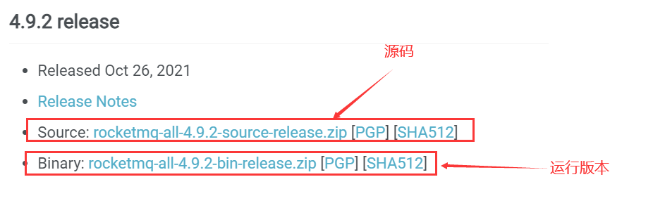

环境要求：

- Windows/Linux 64位系统
- JDK1.8(64位)
- 源码安装需要安装Maven 3.2.x

这里我们用 `rocketmq-4.9.2` 来做演示案例。
设置环境变量：

**变量名：** ROCKETMQ_HOME

**变量值：** MQ解压路径\MQ文件夹名
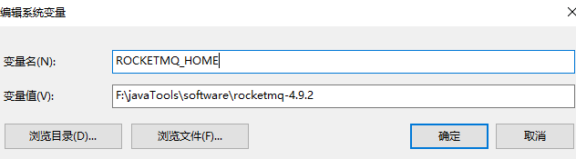

### 启动

在`rocketmq-4.9.2\bin`目录下，打开cmd窗口

先启动 nameServer，启动命令：`start mqnamesrv.cmd`

然后在启动 Broker，启动命令：`start mqbroker.cmd -n 127.0.0.1:7906 autoCreateTopicEnable=true`

管理端插件安装：

老版本地址下载：https://codeload.github.com/apache/rocketmq-externals/zip/master

新版本地址：https://github.com/apache/rocketmq-dashboard

启动完成之后，浏览器中输入‘127.0.0.1:8089’，成功后即可进行管理端查看。

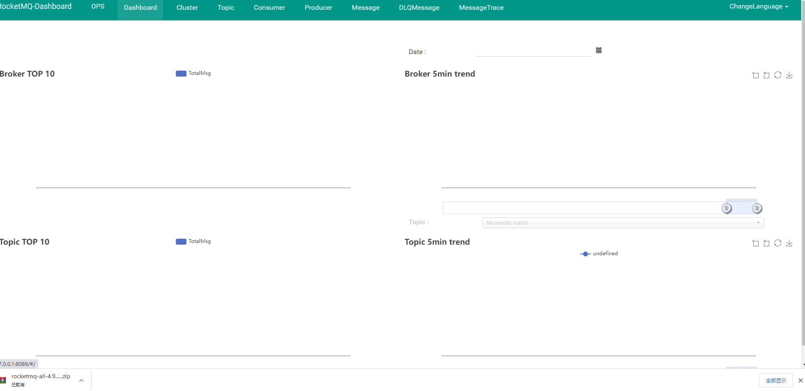

## 消息发送

RocketMQ提供的原生客户端的API，当然除了原生客户端外，SpringBoot、SpringCloudStream也进行了集成，但本质上这些也是基于原生API的封装，所以只需掌握原生API，其他的也会水到渠成。

**导入MQ客户端依赖**

```java
<dependency>
  <groupId>org.apache.rocketmq</groupId>
  <artifactId>rocketmq-client</artifactId>
  <version>4.9.2</version>
</dependency>
```

**消息发送：**

```java
/**
 * 同步发送
 */
public class SyncProducer {
    public static void main(String[] args) throws Exception{
        // 实例化消息生产者Producer
        DefaultMQProducer producer = new DefaultMQProducer("group_test");

        // 设置NameServer的地址
        producer.setNamesrvAddr("127.0.0.1:9876");
        //producer.setSendLatencyFaultEnable(true);

        // 启动Producer实例
        producer.start();


        for (int i = 0; i < 10; i++) {
            // 创建消息，并指定Topic，Tag和消息体
            Message msg = new Message("TopicTest" /* Topic */,
                    "TagA" /* Tag */,
                    ("Hello RocketMQ " + i).getBytes(RemotingHelper.DEFAULT_CHARSET) /* Message body */
            );
            // 发送消息到一个Broker
            SendResult sendResult = producer.send(msg);
            System.out.printf("%s%n", sendResult);
        }
        //如果不再发送消息，关闭Producer实例。
        producer.shutdown();
    }
}
```

## 总结

这篇主要是带大家了解RocketMQ的基本原理和介绍，在后面的章节中，会带大家深入了解和使用RocketMQ，如果觉得文章有帮助的，记得点赞关注，您的支持是我创作的最大动力。

怕什么真理无穷，进一步有进一步的欢喜，大家加油！


# [用RocketMQ这么久，才知道消息可以这样玩 ](https://www.cnblogs.com/mingyueyy/p/16609858.html)

在上一章节中，我们讲解了RocketMQ的基本介绍，作为MQ最重要的就是消息的使用了，今天我们就来带大家如何玩转MQ的消息。

消息中间件，英文Message Queue，简称MQ。它没有标准定义，一般认为：消息中间件属于分布式系统中一个子系统，关注于数据的发送和接收，利用高效可靠的异步消息传递机制对分布式系统中的其余各个子系统进行集成。

**高效：** 对于消息的处理处理速度快，RocketMQ可以达到单机10万+的并发。

**可靠：** 一般消息中间件都会有消息持久化机制和其他的机制确保消息不丢失。

**异步：** 指发送完一个请求，不需要等待返回，随时可以再发送下一个请求，既不需要等待。

**消息中间件不生产消息，只是消息的搬运工。**

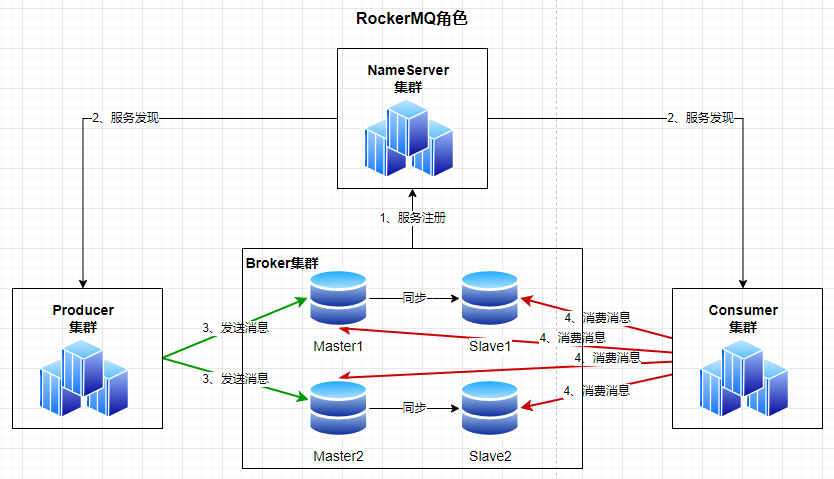

首先Message包含的内容主要有几个方面组成：id(MQ自动生成)、Topic、tag、proerties、内容。

消息的发送分为：

- 普通消息
- 顺序消息
- 延时消息
- 批量消息
- 分布式消息

## 普通消息

**普通消息的发送方式主要有三种：发送同步消息、发送异步消息、单向发送**

我们可以先使用 `RocketMQ` 提供的原生客户端的API，在 `SpringBoot、SpringCloudStream` 也进行了集成，但本质上这些也是基于原生API的封装，所以我们只需要掌握原生API的时候，其他的也就无师自通了。

想要使用 `RocketMQ`中的API，就需要先导入对应的客户端依赖

```java
<dependency>
    <groupId>org.apache.rocketmq</groupId>
    <artifactId>rocketmq-client</artifactId>
    <version>4.9.2</version>
</dependency>
```

**消息发送者的步骤分为：**

1. 创建消息生产者 producer，执行生产者组名
2. 指定Nameserver地址
3. 启动producer
4. 创建消息对象，指定Topic、Tag和消息体
5. 发送消息
6. 关闭生产者producer

**消息消费者的步骤分为：**

1. 创建消费者 Consumer，指定消费者组名
2. 指定Nameserver地址
3. 订阅主题Topic和Tag
4. 设置回调函数，处理消息
5. 启动消费者consumer

### 发送同步消息

发送同步消息是说消息发送方发出数据后，同步等待，一直等收到接收方发回响应之后才发下一个请求。这种可靠性同步地发送方式使用的比较广泛，比如：重要的消息通知，短信通知。

流程如下所示：
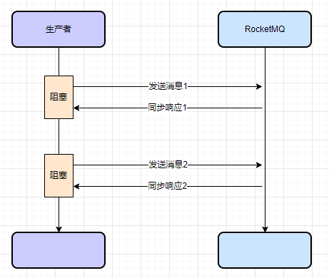

```java
package org.apache.rocketmq.example.quickstart;

import org.apache.rocketmq.client.producer.DefaultMQProducer;
import org.apache.rocketmq.client.producer.SendResult;
import org.apache.rocketmq.common.message.Message;
import org.apache.rocketmq.remoting.common.RemotingHelper;
/**
 * 同步发送
 */
public class SyncProducer {
    public static void main(String[] args) throws Exception{
        // 实例化消息生产者Producer
        DefaultMQProducer producer = new DefaultMQProducer("group_test");

        // 设置NameServer的地址
        producer.setNamesrvAddr("127.0.0.1:9876");
        //producer.setSendLatencyFaultEnable(true);

        // 启动Producer实例
        producer.start();


        for (int i = 0; i < 10; i++) {
            // 创建消息，并指定Topic，Tag和消息体
            Message msg = new Message("TopicTest" /* Topic */,
                    "TagA" /* Tag */,
                    ("Hello RocketMQ " + i).getBytes(RemotingHelper.DEFAULT_CHARSET) /* Message body */
            );
            // 发送消息到一个Broker
            SendResult sendResult = producer.send(msg);
            System.out.printf("%s%n", sendResult);
        }
        //如果不再发送消息，关闭Producer实例。
        producer.shutdown();
    }
}
```

响应结果如下所示：

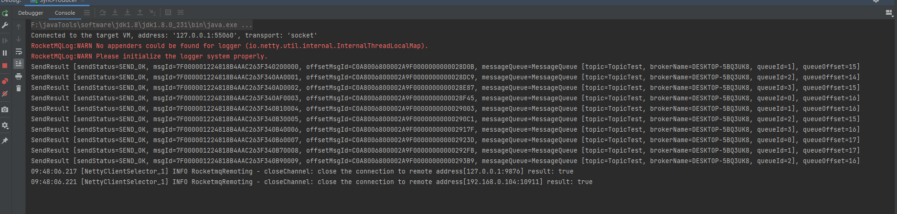

- **msgId：** 消息的全局唯一标识（RocketMQ的ID生成是使用机器IP和消息偏移量的组成），由消息队列 MQ 系统自动生成，唯一标识某条消息。
- **sendStatus：** 发送的标识：成功，失败等
- **queueId：** queueId是Topic的分区；Producer发送具体一条消息的时，对应选择的该Topic下的某一个Queue的标识ID。
- **queueOffset：** Message queue是无限长的数组。一条消息进来下标就会涨1,而这个数组的下标就是queueOffset，queueOffset是从0开始递增。

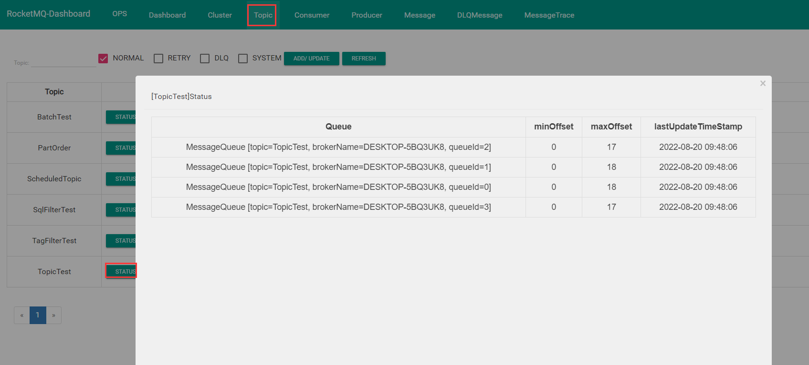

在上面代表的是四个queue，而maxOffset代表我们发送消息的数量，之前发送过消息，所以大家现在看到的数量是17、18...这种，当你在运行一次发送消息时，就会看到十条消息会分布在不同机器上

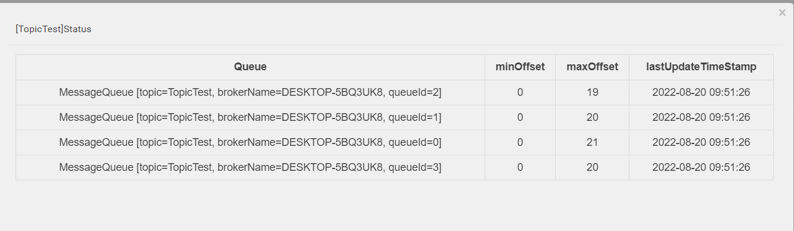

### 发送异步消息

异步消息通常用在对响应时间敏感的业务场景，即发送端不能容忍长时间地等待Broker的响应。消息发送方在发送了一条消息后，不等接收方发回响应，接着进行第二条消息发送。发送方通过回调接口的方式接收服务器响应，并对响应结果进行处理。

流程如下：
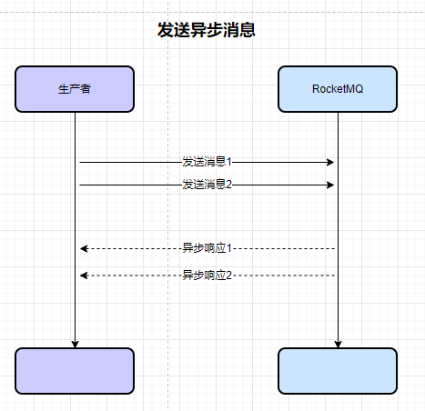

```java
package com.muxiaonong.normal;

import org.apache.rocketmq.client.producer.DefaultMQProducer;
import org.apache.rocketmq.client.producer.SendCallback;
import org.apache.rocketmq.client.producer.SendResult;
import org.apache.rocketmq.common.message.Message;
import org.apache.rocketmq.remoting.common.RemotingHelper;

/**
 * 异步发送--生产者
 */
public class AsyncProducer {
    public static void main(String[] args) throws Exception{
        // 实例化消息生产者Producer
        DefaultMQProducer producer = new DefaultMQProducer("group_test");
        // 设置NameServer的地址
        producer.setNamesrvAddr("127.0.0.1:9876");
        // 启动Producer实例
        producer.start();
        for (int i = 0; i < 10; i++) {
            final int index = i;
            // 创建消息，并指定Topic，Tag和消息体
            Message msg = new Message("TopicTest", "TagA", "OrderID888",
                    "Hello world".getBytes(RemotingHelper.DEFAULT_CHARSET));
            // SendCallback接收异步返回结果的回调
            producer.send(msg, new SendCallback() {
                //发送成功
                @Override
                public void onSuccess(SendResult sendResult) {
                    System.out.printf("%s%n", sendResult);
                }
                //发送异常
                @Override
                public void onException(Throwable e) {
                    System.out.printf("%-10d Exception %s %n", index, e);
                    e.printStackTrace();
                }
            });
        }
        Thread.sleep(10000);
        // 如果不再发送消息，关闭Producer实例。
        producer.shutdown();
    }
}
```

发送成功报文：

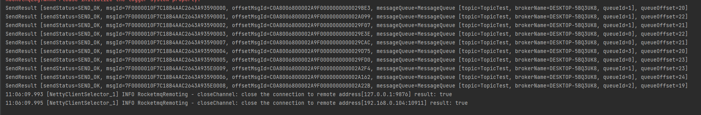

我们在dashbord下看到已经成功拿到消息了

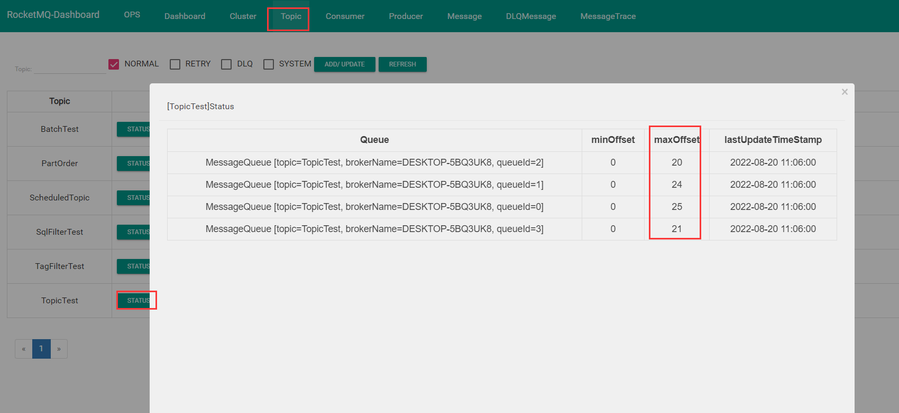

### 单向发送

这种方式不需要我们特别关心发送结果的场景，比如日志发送、单向发送特点是发送方只需要负责发送消息，不需要等待服务器回应且没有回调函数触发，发送请求不需要等待应答，只管发，这种放松方式过程耗时很短，一般在微妙级别。

流程如下：

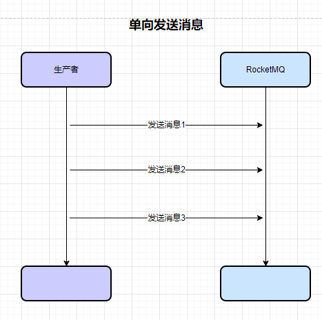

```java
package com.muxiaonong.normal;

import org.apache.rocketmq.client.producer.DefaultMQProducer;
import org.apache.rocketmq.common.message.Message;
import org.apache.rocketmq.remoting.common.RemotingHelper;

/**
 * 单向发送
 */
public class OnewayProducer {
    public static void main(String[] args) throws Exception{
        // 实例化消息生产者Producer对象
        DefaultMQProducer producer = new DefaultMQProducer("group_test");
        // 设置NameServer的地址
        producer.setNamesrvAddr("127.0.0.1:9876");
        // 启动Producer实例
        producer.start();
        for (int i = 0; i < 10; i++) {
            // 创建消息，并指定Topic，Tag和消息体
            Message msg = new Message("TopicTest" /* Topic */,
                    "TagA" /* Tag */,
                    ("Hello RocketMQ " + i).getBytes(RemotingHelper.DEFAULT_CHARSET) /* Message body */
            );
            // 发送单向消息，没有任何返回结果
            producer.sendOneway(msg);

        }
        // 如果不再发送消息，关闭Producer实例。
        producer.shutdown();
    }
}
```

返回报文：

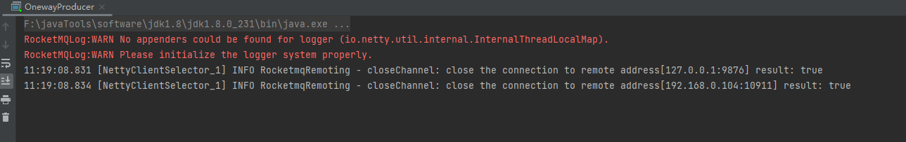
这种发送方式，我们客户端不会感受到发送结果，发送完成之后，我们并不知道到底有没有发送成功，我们只能在 top status 中去查看

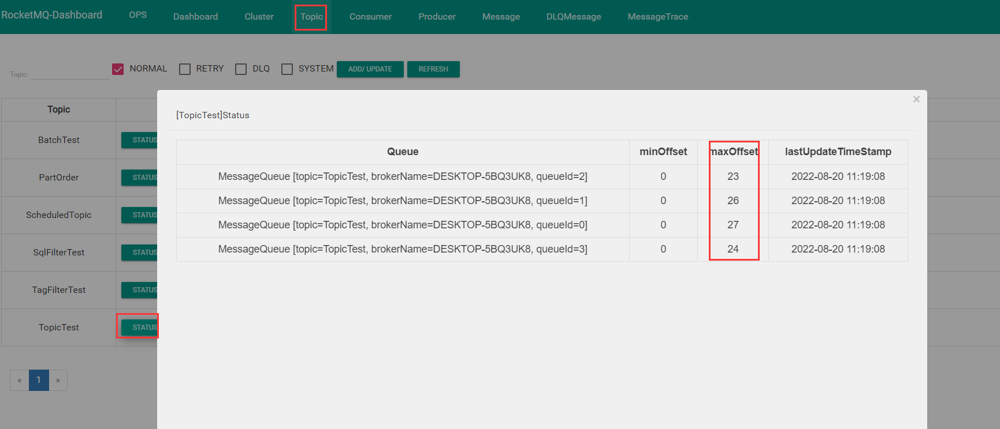

**普通消息发送对比：**

|   发送方式   | 发送TPS |  可靠性  | 结果反馈 |                           使用场景                           |
| :----------: | :-----: | :------: | :------: | :----------------------------------------------------------: |
| 同步消息发送 |   快    |  不丢失  |    有    |                重要通知（邮件、短信通知、）等                |
| 异步消息发送 |   快    |  不丢失  |    有    |          用户文件上传自动解析服务，完成后通知其结果          |
|   单向发送   |  超快   | 可能丢失 |    无    | 适用于 耗时非常短，但是对于可靠性要求不高的场景，比如日志收集 |

### 消息的消费方式

**普通消息的消费方式主要有三种：集群消费、广播消费**

**一、集群消费模式**

集群消费方式下，一个分组(Group) 下的多个消费者共同消费队列消息，每一个消费者出来处理的消息不一样，一个Consumer Group 中的各个Consumer 实例分摊去消费消息，一条消息只会投递到一个Consumer Group 下的一个实例，如果一个Topic有三个队列，其中一个 Consumer Group 有三个实例，那么每个实例只会消费其中一个队列，集群消费模式是消费者默认的消费方式。

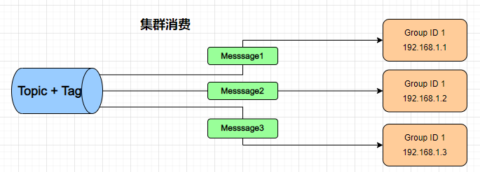

实例代码：

```java
package com.muxiaonong.normal.consumer;

import org.apache.rocketmq.client.consumer.DefaultMQPushConsumer;
import org.apache.rocketmq.client.consumer.listener.ConsumeConcurrentlyContext;
import org.apache.rocketmq.client.consumer.listener.ConsumeConcurrentlyStatus;
import org.apache.rocketmq.client.consumer.listener.MessageListenerConcurrently;
import org.apache.rocketmq.common.message.MessageExt;
import org.apache.rocketmq.common.protocol.heartbeat.MessageModel;

import java.util.List;


/**
 * 集群消费模式
 */
public class BalanceConsumer {
    public static void main(String[] args) throws Exception {
        // 实例化消费者,指定组名:  TopicTest  10条消息 group_consumer  ，  lijin 8(2)
        DefaultMQPushConsumer consumer = new DefaultMQPushConsumer("group_consumer");
        // 指定Namesrv地址信息.
        consumer.setNamesrvAddr("127.0.0.1:9876");
        // 订阅Topic
        consumer.subscribe("TopicTest", "*"); //tag  tagA|TagB|TagC
        //consumer.setConsumeFromWhere();

        //集群模式消费
        consumer.setMessageModel(MessageModel.CLUSTERING);

        //取消
        consumer.unsubscribe("TopicTest");
        //再次订阅Topic即可
        consumer.subscribe("TopicTest", "*"); //tag  tagA|TagB|TagC

        // 注册回调函数，处理消息
        consumer.registerMessageListener(new MessageListenerConcurrently() {
            @Override
            public ConsumeConcurrentlyStatus consumeMessage(List<MessageExt> msgs,
                                                            ConsumeConcurrentlyContext context) {
                try {
                    for(MessageExt msg : msgs) {
                        String topic = msg.getTopic();
                        String msgBody = new String(msg.getBody(), "utf-8");
                        String tags = msg.getTags();
                        Thread.sleep(1000);
                        System.out.println("收到消息：" + " topic :" + topic + " ,tags : " + tags + " ,msg : " + msgBody);
                    }
                } catch (Exception e) {
                    e.printStackTrace();
                    return ConsumeConcurrentlyStatus.RECONSUME_LATER;

                }
                return ConsumeConcurrentlyStatus.CONSUME_SUCCESS;
            }
        });

        //启动消息者
        consumer.start();
        //注销Consumer
        //consumer.shutdown();
        System.out.printf("Consumer Started.%n");
    }
}
```

我们启动两个实例对象，分别为`BalanceConsumer2和BalanceConsumer`，我们再去生产者生产十条消息后，我们再去看consumer，分别均摊了这十条消息
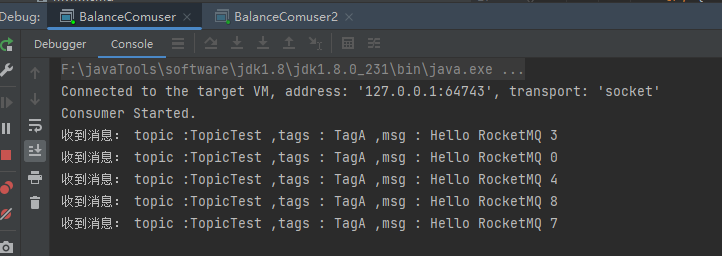

**二、广播消费模式**

广播消费模式中消息将对一个Consumer Group下的各个Consumer实例都投递一遍。即使这些 Consumer属于同一个Consumer Group，消息也会被Consumer Group 中的每个Consumer都消费一次。因为一个消费组下的每个消费者实例都获取到了topic下面的每个Message Queue去拉取消费。所以消息会投递到每个消费者实例。每一个消费者下面的消费实例，都会去拿到我们Topic下的每一条消息，但是这种消费进度的保存，不会放在broker里面，而是持久化到我们的本地实例

流程图如下：

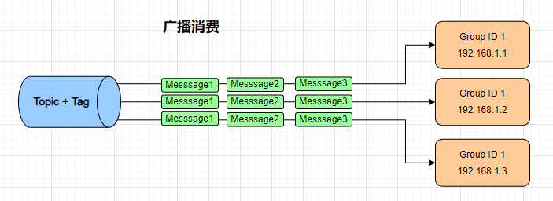

具体代码

```java
package com.muxiaonong.normal.consumer;

import org.apache.rocketmq.client.consumer.DefaultMQPushConsumer;
import org.apache.rocketmq.client.consumer.listener.ConsumeConcurrentlyContext;
import org.apache.rocketmq.client.consumer.listener.ConsumeConcurrentlyStatus;
import org.apache.rocketmq.client.consumer.listener.MessageListenerConcurrently;
import org.apache.rocketmq.common.message.MessageExt;
import org.apache.rocketmq.common.protocol.heartbeat.MessageModel;

import java.util.List;


/**
 * 广播消费模式
 */
public class BroadcastConsumer {
    public static void main(String[] args) throws Exception {
        // 实例化消费者,指定组名:  TopicTest  10条消息 group_consumer  ，  lijin 8(2)
        DefaultMQPushConsumer consumer = new DefaultMQPushConsumer("group_consumer");
        // 指定Namesrv地址信息.
        consumer.setNamesrvAddr("127.0.0.1:9876");
        // 订阅Topic
        consumer.subscribe("TopicTest", "*"); //tag  tagA|TagB|TagC
        //consumer.setConsumeFromWhere();

        //广播模式消费
        consumer.setMessageModel(MessageModel.BROADCASTING);

        //取消
        consumer.unsubscribe("TopicTest");
        //再次订阅Topic即可
        consumer.subscribe("TopicTest", "*"); //tag  tagA|TagB|TagC

        // 注册回调函数，处理消息
        consumer.registerMessageListener(new MessageListenerConcurrently() {
            @Override
            public ConsumeConcurrentlyStatus consumeMessage(List<MessageExt> msgs,
                                                            ConsumeConcurrentlyContext context) {
                try {
                    for(MessageExt msg : msgs) {
                        String topic = msg.getTopic();
                        String msgBody = new String(msg.getBody(), "utf-8");
                        String tags = msg.getTags();
                        Thread.sleep(1000);
                        System.out.println("收到消息：" + " topic :" + topic + " ,tags : " + tags + " ,msg : " + msgBody);
                    }
                } catch (Exception e) {
                    e.printStackTrace();
                    return ConsumeConcurrentlyStatus.RECONSUME_LATER;

                }
                return ConsumeConcurrentlyStatus.CONSUME_SUCCESS;
            }
        });

        //启动消息者
        consumer.start();
        //注销Consumer
        //consumer.shutdown();
        System.out.printf("Consumer Started.%n");
    }
}
```

我们先启动 `BroadcastConsumer和BroadcastConsumer2`，生产十条消息以后，我们会看到不管是哪个消费者，都会接收到十条消息，这个就是广播消费模式

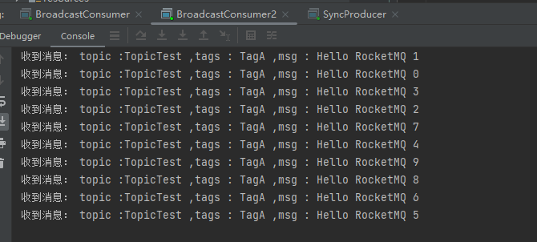

消息消费的权衡

**负载均衡模式：** 消费端集群化部署，每条消息只需要被处理一次，由于消费进度在服务端维护，可靠性更高。

集群消费模式下，不能保证每一次失败重投的消息路由到同一台机器上，因此处理消息时不应该做任何确定性假设。每一条消息都只会被分发到一台机器上处理，如果需要被集群下的每一台机器都处理，只能使用广播模式。

**广播模式：** 每条消息都需要被相同逻辑的多台机器处理，消费进度在客户端维护，出现重复的概率稍大于集群模式。

广播模式下，消息队列 RocketMQ 保证每条消息至少被每台客户端消费一次，但是并不会对消费失败的消息进行失败重投，因此需要关注消费失败的情况，客户端每一次重启都会从最新消息消费。客户端在被停止期间发送至服务端的消息会被自动跳过，这一点是需要注意的地方

每条消息都会被大量的客户端重复处理，因此推荐尽可能使用集群模式。目前仅 Java 客户端支持广播模式，不支持顺序消息且服务端不维护消费进度，所以消息队列 RocketMQ 控制台不支持消息堆积查询、消息堆积报警和订阅关系查询功能。

## 顺序消息

顺序消息指的是可以按照消息的发送顺序来消费(FIFO)。`RocketMQ` 可以严格的保证消息有序，可以分为 **分区有序** 或者 **全局有序。**

生产消息时在默认的情况下消息发送会采取 `Round Robin` 轮询方式把消息发送到不同的 **queue** ( 分区队列)；而消费消息的时候从多个 **queue** 上拉取消息，这种情况发送和消费是不能保证顺序。但是如果控制发送的顺序消息只依次发送到同一个 **queue** 中，消费的时候只从这个 **queue** 上依次拉取，则就保证了顺序。当发送和消费参与的 **queue** 只有一个，则是全局有序；如果多个 **queue** 参与，则为分区有序，即相对每个 **queue** ，消息都是有序的。

**全局有序**

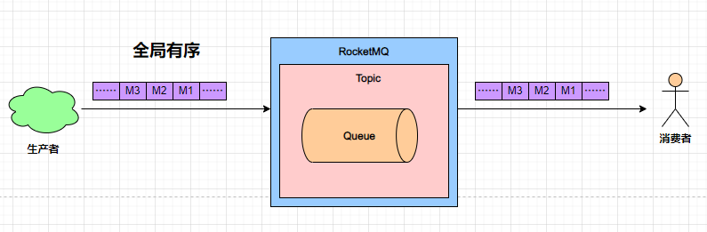

全局有序主要控制在于创建Topic指定只有一个队列，同步确保生产者与消费者都只有一个实例进行即可

**分区有序**

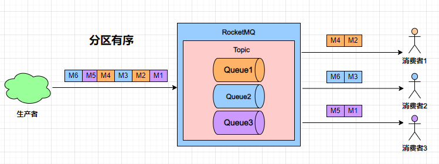

在电商业务场景中，订单的流程是：**创建、付款、推送、完成。** 在加入 `RocketMQ` 后，一个订单会分别产生对于这个订单的创建、付款、推送、完成等消息，如果我们把所有消息全部送入到 `RocketMQ` 中的一个主题中，如何实现针对一个订单的消息顺序性呢！如下图：

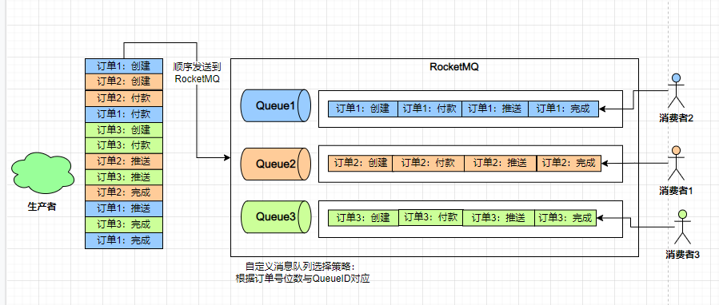

要完成分区有序性，在生产者环节使用自定义的消息队列选择策略，确保订单号尾数相同的消息会被先后发送到同一个队列中(案例中主题有3个队列，生产环境中可设定成10个满足全部尾数的需求)，然后再消费端开启负载均衡模式，最终确保一个消费者拿到的消息对于一个订单来说是有序的。

```java
/** @Author 牧小农
 * @Description // 订单消息生产
 * @Date 16:47 2022/8/20
 * @Param 
 * @return 
 **/
public class OrderProducer {

    public static void main(String[] args) throws Exception {
        DefaultMQProducer producer = new DefaultMQProducer("OrderProducer");
        producer.setNamesrvAddr("127.0.0.1:9876");
        producer.start();
        // 订单列表
        List<Order> orderList = new OrderProducer().buildOrders();
        for (int i = 0; i < orderList.size(); i++) {
            String body = orderList.get(i).toString();
            Message msg = new Message("PartOrder", null, "KEY" + i, body.getBytes());
            SendResult sendResult = producer.send(msg, new MessageQueueSelector() {
                @Override
                public MessageQueue select(List<MessageQueue> mqs, Message msg, Object arg) {
                    Long id = (Long) arg;  //根据订单id选择发送queue
                    long index = id % mqs.size();
                    return mqs.get((int) index);
                }
            }, orderList.get(i).getOrderId());//订单id
            System.out.println(String.format("SendResult status:%s, queueId:%d, body:%s",
                    sendResult.getSendStatus(),
                    sendResult.getMessageQueue().getQueueId(),
                    body));
        }
        producer.shutdown();
    }

    /**
     * 订单
     */
    private static class Order {
        private long orderId;
        private String desc;
        .....
    }

    /**
     * 生成模拟订单数据  3个订单   每个订单4个状态
     * 每个订单 创建->付款->推送->完成
     */
    private List<Order> buildOrders() {
        List<Order> orderList = new ArrayList<Order>();
        Order orderDemo = new Order();
        orderDemo.setOrderId(001);
        orderDemo.setDesc("创建");
        orderList.add(orderDemo);

       //...............
        return orderList;
    }
}
```

订单消费者

```java
/** @Author 牧小农
 * @Description // 订单消息消费
 * @Date 16:46 2022/8/20
 * @Param
 * @return
 **/
public class OrderConsumer {

    public static void main(String[] args) throws Exception {
        DefaultMQPushConsumer consumer = new DefaultMQPushConsumer("OrderConsumer2");
        consumer.setNamesrvAddr("127.0.0.1:9876");
        consumer.setConsumeFromWhere(ConsumeFromWhere.CONSUME_FROM_LAST_OFFSET);
        consumer.subscribe("PartOrder", "*");
        consumer.registerMessageListener(new MessageListenerOrderly() {
            Random random = new Random();
            @Override
            public ConsumeOrderlyStatus consumeMessage(List<MessageExt> msgs, ConsumeOrderlyContext context) {
                context.setAutoCommit(true);
                for (MessageExt msg : msgs) {
                    // 可以看到每个queue有唯一的consume线程来消费, 订单对每个queue(分区)有序
                    System.out.println("consumeThread=" + Thread.currentThread().getName()
                            + ",queueId=" + msg.getQueueId() + ", content:" + new String(msg.getBody()));
                }
                try {
                    //模拟业务逻辑处理中...
                    TimeUnit.MILLISECONDS.sleep(random.nextInt(300));
                } catch (Exception e) {
                    e.printStackTrace();
                    //一会再处理这批消息，而不是放到重试队列里
                    return ConsumeOrderlyStatus.SUSPEND_CURRENT_QUEUE_A_MOMENT;
                }
                return ConsumeOrderlyStatus.SUCCESS;
            }
        });
        consumer.start();
        System.out.println("Consumer Started.");
    }

}
```

消息生产者

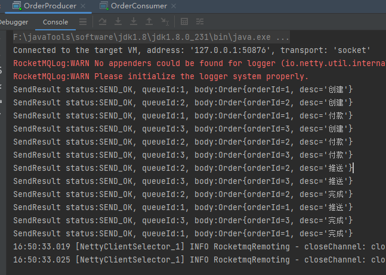

消息消费者：

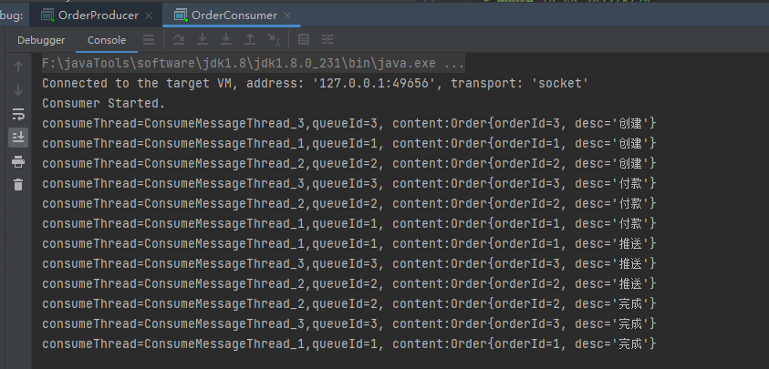

我们可以看到消息按照顺序进行了消费。使用顺序消息：首先要保证消息是有序进入MQ的，消息放入MQ之前，对id等关键字进行取模，放入指定 `messageQueue` ，同时 `consumer` 消费消息失败时，不能返回 `reconsume——later` ，这样会导致乱序，所以应该返回 `suspend_current_queue_a_moment` ,意思是先等一会，一会儿再处理这批消息，而不是放到重试队列里。

## 延时消息

Producer 将消息发送到消息队列 `RocketMQ` 服务端，但并不期望这条消息立马投递（被消费者消费），而是延迟一定时间后才投递到 Consumer 进行消费，该消息即延时消息。

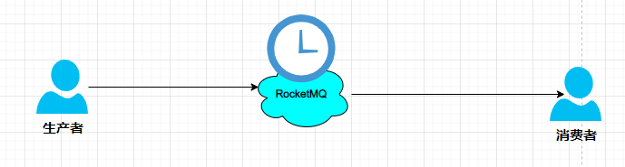

消息生产和消费有时间窗口要求的场景下，比如在电商交易中超时未支付关闭订单的场景，在订单创建时向 `RocketMQ` 发送一条延时消息。这条消息将会在30分钟以后投递给消费者，消费者收到此消息后需要判断对应的订单是否已完成支付。如支付未完成，则取消订单、释放库存。如已完成支付则忽略。

`Apache RocketMQ` 目前只支持固定精度(MQ自己规定的时间段)的定时消息，因为如果要支持任意的时间精度，在 Broker 层面，必须要做消息排序，如果再涉及到持久化，消息排序不可避免的产生巨大性能开销。（`RocketMQ` 的商业版本 `Aliware MQ` 提供了任意时刻的定时消息功能，Apache的 `RocketMQ` 并没有,阿里并没有开源）

`Apache RocketMQ` 发送延时消息是设置在每一个消息体上的，在创建消息时设定一个延时时间长度，消息将从当前发送时间点开始延迟固定时间之后才开始投递。

`RocketMQ` 延时消息的延迟时长不支持随意时长的延迟，是通过特定的延迟等级来指定的。默认支持18个等级的延迟消息，延时等级定义在 `RocketMQ` 服务端的 `MessageStoreConfig` 类中。

具体如下所示：

| Level | 延迟时间 | Level | 延迟时间 |
| :---- | :------: | :---- | :------: |
| 1     |    1S    | 10    |    6m    |
| 2     |    5S    | 11    |    7m    |
| 3     |   10S    | 12    |    8m    |
| 4     |   30S    | 13    |    9m    |
| 5     |    1m    | 14    |   10m    |
| 6     |    2m    | 15    |   20m    |
| 7     |    3m    | 16    |   30m    |
| 8     |    4m    | 17    |    1h    |
| 9     |    5m    | 18    |    2h    |

延时消息生产者：

```java
/** @Author 牧小农
 * @Description // 延时消息-生产者
 * @Date 10:00 2022/8/21
 * @Param 
 * @return 
 **/
public class ScheduledProducer {
    public static void main(String[] args) throws Exception {
        // 实例化一个生产者来产生延时消息
        DefaultMQProducer producer = new DefaultMQProducer("ScheduledProducer");
        // 设置NameServer的地址
        producer.setNamesrvAddr("127.0.0.1:9876");
        // 启动Producer实例
        producer.start();
        int totalMessagesToSend = 10;
        for (int i = 0; i < totalMessagesToSend; i++) {
            Message message = new Message("ScheduledTopic", ("Hello scheduled message " + i).getBytes());
            // 设置延时等级4,这个消息将在10s之后投递给消费者(详看delayTimeLevel)
            // delayTimeLevel：(1~18个等级)"1s 5s 10s 30s 1m 2m 3m 4m 5m 6m 7m 8m 9m 10m 20m 30m 1h 2h"
            message.setDelayTimeLevel(3);
            // 发送消息
            producer.send(message);
        }
        // 关闭生产者
        producer.shutdown();
    }
}
```

延时消息消费者：

```java
/** @Author 牧小农
 * @Description // 延时消息-消费者
 * @Date 10:00 2022/8/21
 * @Param 
 * @return 
 **/
public class ScheduledConsumer {
    public static void main(String[] args) throws Exception {
        // 实例化消费者
        DefaultMQPushConsumer consumer = new DefaultMQPushConsumer("ScheduledConsumer");
        // 指定Namesrv地址信息.
        consumer.setNamesrvAddr("127.0.0.1:9876");
        // 订阅Topics
        consumer.subscribe("ScheduledTopic", "*");
        // 注册消息监听者
        consumer.registerMessageListener(new MessageListenerConcurrently() {
            @Override
            public ConsumeConcurrentlyStatus consumeMessage(List<MessageExt> messages, ConsumeConcurrentlyContext context) {
                for (MessageExt message : messages) {
                    System.out.println("Receive message[msgId=" + message.getMsgId() + "] "
                            + (message.getStoreTimestamp()-message.getBornTimestamp()) + "ms later");
                }
                return ConsumeConcurrentlyStatus.CONSUME_SUCCESS;
            }
        });
        // 启动消费者
        consumer.start();
    }
}
```

当我们生产消息后，查看消费者信息，延时10秒后，消息才发送完成后，之后进行了消息的消费

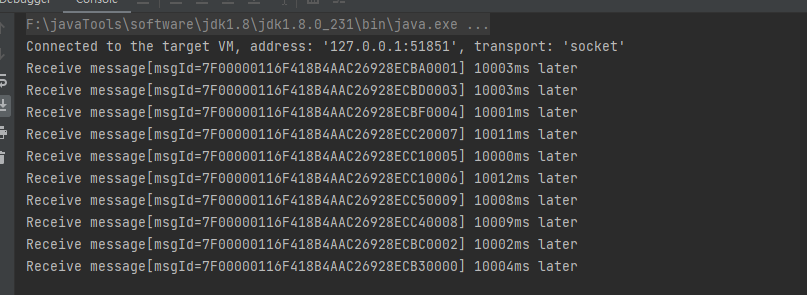

## 批量消息

**批量消息发送：** 能显著提高传递小消息的性能。限制是这些批量消息有相同的 topic，相同的 waitStoreMsgOK，而且不能是延时消息。此外，这一批消息的总大小不应超过 4MB。批量消息是一个 `Collection`集合，所以送入消息只要是集合就行。

**批量接收消息：** 能提高传递小消息的性能，同时与顺序消息配合的情况下，还能根据业务主键对顺序消息进行去重（是否可去重，需要业务来决定），减少消费者对消息的处理。

如果我们需要发送10万元素的数组，怎么快速发送完？这里可以使用批量发送，同时每一批控制在1M左右确保不超过消息大小限制。批量切分发送.

批量消息生产者：

```java
/** @Author 牧小农
 * @Description // 批量消息-生产者  list不要超过4m
 * @Date 10:38 2022/8/21
 * @Param 
 * @return 
 **/
public class BatchProducer {

    public static void main(String[] args) throws Exception {
        // 实例化消息生产者Producer
        DefaultMQProducer producer = new DefaultMQProducer("BatchProducer");
        // 设置NameServer的地址
        producer.setNamesrvAddr("127.0.0.1:9876");
        // 启动Producer实例
        producer.start();

        String topic = "BatchTest";
        List<Message> messages = new ArrayList<>();
        messages.add(new Message(topic, "Tag", "OrderID001", "Hello world 1".getBytes()));
        messages.add(new Message(topic, "Tag", "OrderID002", "Hello world 2".getBytes()));
        messages.add(new Message(topic, "Tag", "OrderID003", "Hello world 3".getBytes()));
        messages.add(new Message(topic, "Tag", "OrderID004", "Hello world 4".getBytes()));
        messages.add(new Message(topic, "Tag", "OrderID005", "Hello world 5".getBytes()));
        messages.add(new Message(topic, "Tag", "OrderID006", "Hello world 6".getBytes()));
        try {
            producer.send(messages);
        } catch (Exception e) {
            producer.shutdown();
            e.printStackTrace();
        }
        // 如果不再发送消息，关闭Producer实例。
        producer.shutdown();
    }
}
```

批量消息消费者

```java
/** @Author 牧小农
 * @Description // 批量消息-消费者
 * @Date 10:38 2022/8/21
 * @Param 
 * @return 
 **/
public class BatchComuser {
    public static void main(String[] args) throws Exception {
        // 实例化消息生产者,指定组名
        DefaultMQPushConsumer consumer = new DefaultMQPushConsumer("BatchComsuer");
        // 指定Namesrv地址信息.
        consumer.setNamesrvAddr("127.0.0.1:9876");
        // 订阅Topic
        consumer.subscribe("BatchTest", "*");
        //负载均衡模式消费
        consumer.setMessageModel(MessageModel.CLUSTERING);
        // 注册回调函数，处理消息
        consumer.registerMessageListener(new MessageListenerConcurrently() {
            @Override
            public ConsumeConcurrentlyStatus consumeMessage(List<MessageExt> msgs,
                                                            ConsumeConcurrentlyContext context) {
                System.out.printf("%s Receive New Messages: %s %n",
                        Thread.currentThread().getName(), msgs);
                return ConsumeConcurrentlyStatus.CONSUME_SUCCESS;
            }
        });
        //启动消息者
        consumer.start();
        System.out.printf("Consumer Started.%n");
    }
}
```

这样我们就实现了批量消息的发送，如果我们消息超过了，4M的时候，这个时候可以考虑消息的分割，具体代码如下：

```java
public class ListSplitter implements Iterator<List<Message>> {
    private int sizeLimit = 1000 * 1000;//1M
    private final List<Message> messages;
    private int currIndex;
    public ListSplitter(List<Message> messages) { this.messages = messages; }
    @Override
    public boolean hasNext() { return currIndex < messages.size(); }
    @Override
    public List<Message> next() {
        int nextIndex = currIndex;
        int totalSize = 0;
        for (; nextIndex < messages.size(); nextIndex++) {
            Message message = messages.get(nextIndex);
            int tmpSize = message.getTopic().length() + message.getBody().length;
            Map<String, String> properties = message.getProperties();
            for (Map.Entry<String, String> entry : properties.entrySet()) {
                tmpSize += entry.getKey().length() + entry.getValue().length();
            }
            tmpSize = tmpSize + 20; // 增加日志的开销20字节
            if (tmpSize > sizeLimit) {
                if (nextIndex - currIndex == 0) {//单个消息超过了最大的限制（1M），否则会阻塞进程
                    nextIndex++; //假如下一个子列表没有元素,则添加这个子列表然后退出循环,否则退出循环
                }
                break;
            }
            if (tmpSize + totalSize > sizeLimit) { break; }
            else { totalSize += tmpSize; }
        }
        List<Message> subList = messages.subList(currIndex, nextIndex);
        currIndex = nextIndex;
        return subList;
    }
}
```

## 消息的过滤

效率的过滤主要分为两种： **Tag过滤和SQL语法过滤**

在实际的开发应用中，对于一类消息尽可能使用一个Topic进行存储，但在消费时需要选择想要的消息，这时可以使用 `RocketMQ` 的消息过滤功能，具体实现是利用消息的Tag和Key。

**Key** 一般用于消息在业务层面的唯一标识。对发送的消息设置好 Key，根据这个 Key 来查找消息。比如消息异常，消息丢失，进行查找会很方便。`RocketMQ` 会创建专门的索引文件，用来存储 Key与消息的映射，由于底层实现是 Hash 索引，应尽量使 Key唯一，避免潜在的哈希冲突。

**Tag：** 可以理解为是二级分类。以电商交易平台为例，订单消息和支付消息属于不同业务类型的消息，分别创建 `OrderTopic 和PayTopic` ，其中订单消息根据不同的商品品类以不同的 Tag 再进行细分，如手机类、家电类、男装类、女装类、化妆品类，最后它们都被各个不同的系统所接收。通过合理的使用 Topic 和 Tag，可以让业务结构清晰，更可以提高效率。

Key和Tag的主要差别是使用场景不同，Key主要用于通过命令行命令查询消息，而Tag用于在消息端的代码中，用来进行服务端消息过滤。

### Tag过滤

使用Tag过滤的方式是在消息生产时传入感兴趣的Tag标签，然后在消费端就可以根据Tag来选择您想要的消息。具体的操作是在创建Message的时候添加，一个Message只能有一个Tag。

使用案例：

```java
/** @Author 牧小农
 * @Description // tag过滤-生产者
 * @Date 10:51 2022/8/21
 * @Param 
 * @return 
 **/
public class TagFilterProducer {

    public static void main(String[] args) throws Exception {
        DefaultMQProducer producer = new DefaultMQProducer("TagFilterProducer");

        producer.setNamesrvAddr("127.0.0.1:9876");
        producer.start();
        // 设定三种标签
        String[] tags = new String[] {"TagA", "TagB", "TagC"};

        for (int i = 0; i < 3; i++) {
            Message msg = new Message("TagFilterTest",
                tags[i % tags.length],
                "Hello world".getBytes(RemotingHelper.DEFAULT_CHARSET));
            SendResult sendResult = producer.send(msg);
            System.out.printf("%s%n", sendResult);
        }
        producer.shutdown();
    }
}
```

消费者

```java
/** @Author 牧小农
 * @Description // tag过滤-消费者
 * @Date 10:51 2022/8/21
 * @Param 
 * @return 
 **/
public class TagFilterConsumer {

    public static void main(String[] args) throws InterruptedException, MQClientException, IOException {

        DefaultMQPushConsumer consumer = new DefaultMQPushConsumer("TagFilterComsumer");
        //指定Namesrv地址信息.
        consumer.setNamesrvAddr("127.0.0.1:9876");
        //只有TagA 或者TagB 的消息
        consumer.subscribe("TagFilterTest", "TagA || TagB");
        consumer.registerMessageListener(new MessageListenerConcurrently() {
            @Override
            public ConsumeConcurrentlyStatus consumeMessage(List<MessageExt> msgs,
                                                            ConsumeConcurrentlyContext context) {
                try {
                    for(MessageExt msg : msgs) {
                        String topic = msg.getTopic();
                        String msgBody = new String(msg.getBody(), "utf-8");
                        String msgPro = msg.getProperty("a");
                        String tags = msg.getTags();
                        System.out.println("收到消息：" + " topic :" + topic + " ,tags : " + tags +  " ,a : "
                                + msgPro +" ,msg : " + msgBody);
                    }
                } catch (Exception e) {
                    e.printStackTrace();
                    return ConsumeConcurrentlyStatus.RECONSUME_LATER;
                }
                return ConsumeConcurrentlyStatus.CONSUME_SUCCESS;
            }
        });
        consumer.start();
        System.out.printf("Consumer Started.%n");
    }
}
```

我们生成了 TagA\b\c 三条消息，但是消费者只想接收 TagA或B， 那么我们可以在消费者端进行消息过滤

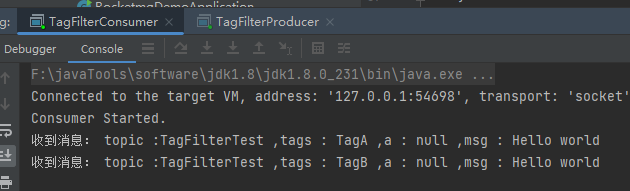

Tag过滤的形式非常简单。

```
|| 代表或 * 代表所有
```

因此Tag过滤对于复杂的场景可能不能进行覆盖。在这种情况下，可以使用SQL表达式筛选消息。

### SQL语法

SQL基本语法：

- **数值比较：** >，>=，<，<=，BETWEEN，=
- **字符比较：** =，<>，IN
- **非空比较：** IS NULL 或者 IS NOT NULL
- **逻辑符号：** AND，OR，NOT
- **常量支持类型为：** 数值（123，3.1415）、字符（'abc'）单引号包裹起来、NULL、布尔值(TRUE 或 FALSE)

Sql过滤需要 `Broker` 开启这项功能，需要修改Broker.conf配置文件。加入enablePropertyFilter=true 然后重启Broker服务。

消息生产者，发送消息时加入消息属性，通过 `putUserProperty` 来设置消息的属性，生产者发送10条消息，

生产者:

```java
/** @Author 牧小农
 * @Description // sql过滤 -消息生产者（加入消息属性)
 * @Date 11:04 2022/8/21
 * @Param 
 * @return 
 **/
public class SqlFilterProducer {

    public static void main(String[] args) throws Exception {
        DefaultMQProducer producer = new DefaultMQProducer("SqlFilterProducer");
        producer.setNamesrvAddr("127.0.0.1:9876");
        producer.start();

        String[] tags = new String[] {"TagA", "TagB", "TagC"};

        for (int i = 0; i < 10; i++) {
            Message msg = new Message("SqlFilterTest",
                tags[i % tags.length],
                ("Hello RocketMQ " + i).getBytes(RemotingHelper.DEFAULT_CHARSET)
            );
            // 设置SQL过滤的属性
            msg.putUserProperty("a", String.valueOf(i));
            SendResult sendResult = producer.send(msg);
            System.out.printf("%s%n", sendResult);
        }
        producer.shutdown();
    }
}
```

消费者：

```java
/** @Author 牧小农
 * @Description // sql过滤-消费者
 * @Date 11:04 2022/8/21
 * @Param 
 * @return 
 **/
public class SqlFilterConsumer {

    public static void main(String[] args) throws Exception {
        DefaultMQPushConsumer consumer = new DefaultMQPushConsumer("SqlFilterConsumer");
        consumer.setNamesrvAddr("127.0.0.1:9876");
        consumer.subscribe("SqlFilterTest",
            //bySql：通过 SQL过滤
            // 1. TAGS不为空且TAGS 在('TagA', 'TagB')
            // 2. 同时 a 不等于空并且a在0-3之间
            MessageSelector.bySql("(TAGS is not null and TAGS in ('TagA', 'TagB'))" +
                "and (a is not null and a between 0 and 3)"));
        consumer.registerMessageListener(new MessageListenerConcurrently() {
            @Override
            public ConsumeConcurrentlyStatus consumeMessage(List<MessageExt> msgs,
                ConsumeConcurrentlyContext context) {
                try {
                    for(MessageExt msg : msgs) {
                        String topic = msg.getTopic();
                        String msgBody = new String(msg.getBody(), "utf-8");
                        String msgPro = msg.getProperty("a");
                        String tags = msg.getTags();
                        System.out.println("收到消息：" + " topic :" + topic + " ,tags : " + tags +  " ,a : " + msgPro +" ,msg : " + msgBody);
                    }
                } catch (Exception e) {
                    e.printStackTrace();
                    return ConsumeConcurrentlyStatus.RECONSUME_LATER;
                }
                return ConsumeConcurrentlyStatus.CONSUME_SUCCESS;
            }
        });
        consumer.start();
        System.out.printf("Consumer Started.%n");
    }
}
```

消费结果：按照Tag和SQL过滤消费3条消息。

第一个消息是TagA ,消息的属性(a)是3

第一个消息是TagB ,消息的属性(a)是1

第一个消息是TagA ,消息的属性(a)是0

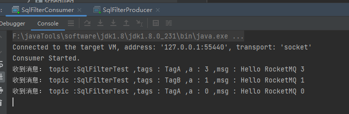

**注意哦！**

> 公众号后台回复：rocketMQ 获取案例源码

到这里有关于RocketMQ基本消息的讲解，就结束了，虽然不舍，但是可以关注我，我们下期见。你是不怕被打吗？(手动狗头)

在上面的消息类型讲述中，可以满足绝大部分业务场景，同学们可以根据自己实际的业务场景，去选择合适的消息类型方式进行学习和了解，关注我，后续精彩内容第一时间收到，下期，小农会带大家了解关于分布式事务消息和 `Request-Reply` 消息以及后续RocketMQ集群架构方面的知识。本篇点赞过百，就是中暑，也出下篇。

我是牧小农怕什么无穷，进一步有进一步的欢喜，大家加油！

关注我，下期更精彩。

# 参考文献

- https://www.cnblogs.com/mingyueyy/p/16564259.html
