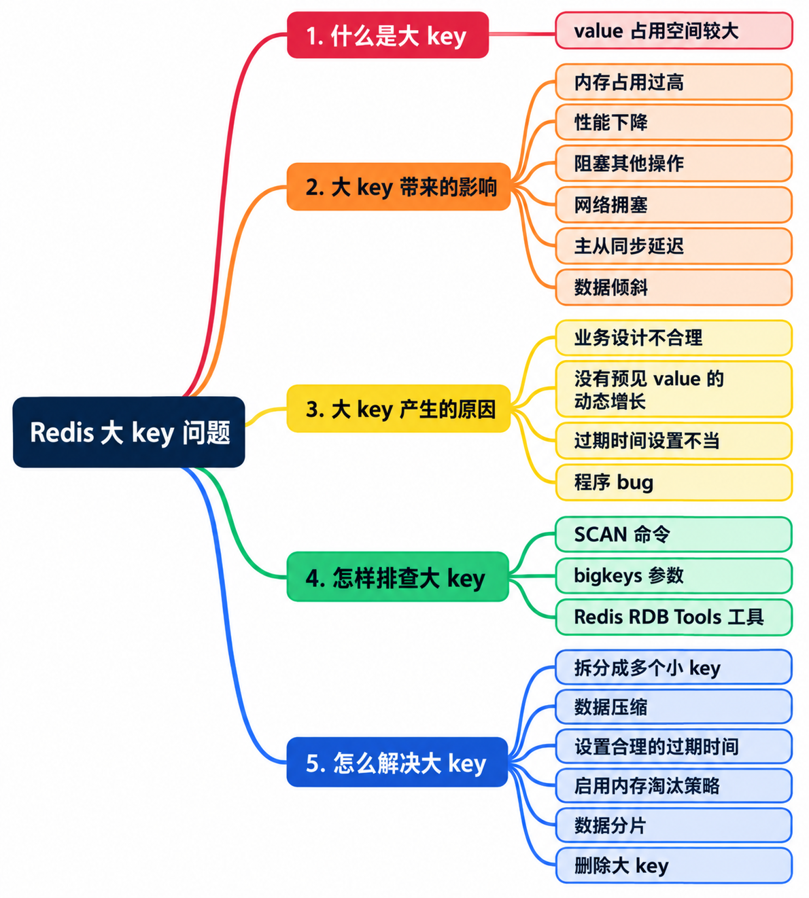

# Redis 如何优化大 key 问题？



## 1. 什么是 Redis 大 key 问题

Redis 大 key 通常指一个 key 对应的 **value 占用内存过大，或者集合中的元素过多**。这里关注的是 value 及其数据结构，并不是 key 名称很长。

典型场景包括：用一个 String 保存很大的 JSON；用一个 Hash 保存全部用户资料；把不断增长的粉丝关系、评论或排行榜放进一个 Set、List 或 ZSet。

### 1.1 多大才算大 key

**Redis 没有统一的大 key 判定阈值。** 资料中常见的 String 超过 10 KB、1 MB，或者集合超过 5,000、10,000 个元素，都是不同场景下的排查经验，不能当作 Redis 的硬性标准。

判断时至少要看三个方面：

| 维度 | 关注的问题 | 示例 |
| --- | --- | --- |
| 内存占用 | 单个 key 实际占用了多少内存 | Hash 只有几百个字段，但每个字段都存放长文本，总体仍可能很大 |
| 元素数量 | 一次遍历、删除或聚合需要处理多少元素 | Set 中每个成员很短，但几百万个成员仍会增加操作成本 |
| 访问方式 | 每次返回多少数据、执行多复杂的操作、访问多频繁 | 同一个 Hash，读取一个字段与读取全部字段的开销差别很大 |

阈值应结合实例容量、网络带宽、延迟目标和业务访问方式设定。可以先用较低阈值筛选候选，再根据实际内存与操作成本决定治理优先级。监控工具的默认阈值也需要按实际环境调整。

### 1.2 大 key 和热 key 的区别

大 key 关注**数据规模**，热 key 关注**访问频率**。一个只有几十字节的 key 也可能因访问集中成为热 key；一个几乎不访问的大 key 则主要造成容量和维护压力。

两者可能同时出现。对于“又大又热”的 key，需要同时减少数据规模、单次访问成本和集中访问压力，不能只靠扩容解决。

## 2. 大 key 带来的影响

### 2.1 内存压力与数据倾斜

大 key 可能挤占实例内存，使其他缓存更容易被淘汰。达到 `maxmemory` 后的行为取决于淘汰策略：使用 `noeviction` 时，需要新增内存的写入可能被拒绝，并不意味着 Redis 一定崩溃；机器实际内存不足则还可能引发系统层面的 OOM。

在 Redis Cluster 中，一个 key 通常属于一个哈希槽，并由一个主节点负责存储和处理。单个超大 key 会使所在分片的内存或负载明显偏高，其他节点即使有空闲资源也无法自动分担它。即使各节点分配的 slot 数量接近，内存和访问负载仍可能不均衡；节点 QPS 是否偏高还取决于访问频率，大 key 并不必然是热 key。增加分片不会自动把这个 key 的内部元素拆开。

### 2.2 命令耗时增加，影响其他请求

Redis 的常规命令执行主要在主线程上完成。对大集合执行 `HGETALL`、大范围 `LRANGE`、大量元素删除等操作时，需要处理的数据更多，可能拖慢同一节点上的其他请求。客户端会表现为等待响应时间变长，超过设置的等待时限后出现请求超时。

具体开销取决于数据类型、命令复杂度和本次处理的数据量。例如，读取 Hash 中一个普通大小的字段，与遍历整个 Hash 的成本不同；`DEL` 删除 String 和删除包含大量元素的集合，时间复杂度也不同。

### 2.3 网络与客户端处理压力

大 value 的完整读取会增加网络传输、客户端内存分配和反序列化成本。例如，每次实际返回 1 MB、每秒读取 1,000 次，仅响应数据就约为 1 GB/s，还没有计算协议开销和其他流量。

因此，服务端执行时间不长，也可能出现业务端延迟很高的情况。Redis 慢日志主要记录命令执行时间，不包含与客户端通信的耗时，不能仅凭“没有慢日志”排除大 key 的影响。

### 2.4 复制、持久化与恢复压力

大对象的高频写入可能增加主从复制流量和副本执行开销。例如，反复 `SET` 一个大 JSON 会重复传输整个值；修改 Hash 的一个字段通常传播对应的写命令，并不是每次都复制整个 Hash。

数据量增长还会增加快照、AOF 重写、全量同步与恢复的资源消耗。不过，这些成本也受**总数据量、写入频率和持久化方式**影响，不能全部归因于单个 key 大。把相同数据拆成多个 key，并不会自动减少备份体积。

### 2.5 删除、过期与淘汰时的延迟

大集合需要释放大量内部对象，同步释放可能带来延迟；集中到期或集中淘汰会进一步放大这一问题。应通过合理生命周期、分批清理和异步释放减轻压力，而不是因此不给大 key 设置过期时间。异步释放的配置也需要结合部署版本确认。

## 3. 大 key 产生的原因

- **存储范围过大。** 把全部用户、全国数据或所有历史记录放在一个 key 中，缺少业务分组、时间分桶或容量边界。
- **只增加，不清理。** 粉丝、评论、事件和排行榜持续增长，未设置保留窗口、归档规则或数量上限。
- **生命周期设计不当。** key 长期不过期，或每次写入都重新延长 TTL，使旧数据一直无法退出。
- **程序异常。** 重复写入、错误聚合、消费者停滞、清理任务失败等，导致集合大小超出预期。
- **数据表示不合适。** 把本可按字段访问的数据序列化成巨大字符串，或把文件、图片正文等直接当作缓存 value 保存。

排查时要追到写入和清理逻辑。只删除一次异常 key，通常无法阻止它重新长大。

## 4. 怎样排查大 key

先通过内存、延迟、网络流量、分片差异等指标缩小范围，再定位具体 key。生产排查需要控制频率、批量和返回量，避免排查过程本身造成额外压力。

### 4.1 使用 SCAN 渐进遍历

不宜在生产大库中直接执行 `KEYS *`。可以用 `SCAN` 分批遍历 key，再按数据类型获取长度或元素数量。

```bash
# 从游标 0 开始，COUNT 是扫描工作量提示
redis-cli SCAN 0 MATCH 'order:*' COUNT 100

# 假设上一条返回的游标是 736，就使用 736 继续扫描
redis-cli SCAN 736 MATCH 'order:*' COUNT 100
```

使用时有几个容易出错的地方：

- **必须使用 Redis 返回的游标继续扫描，不能自行递增游标。** 返回游标为 `0` 时，本轮遍历才结束。
- `COUNT 100` 不保证恰好返回 100 个 key，也不限制返回数据的字节数。某一批可能为空，但游标仍不为 `0`。
- 遍历过程中可能返回重复 key，也不是某个时刻的一致性快照；持续变化的数据需要按业务要求去重和复核。
- `SCAN` 将工作拆成多次调用，但完整遍历仍有成本。应限速，并观察业务延迟，不能理解成“完全不阻塞、没有影响”。
- `SCAN` 遍历键空间；遍历 Hash、Set、ZSet 内部元素分别使用 `HSCAN`、`SSCAN`、`ZSCAN`。普通 Redis List 没有对应的 `LSCAN` 命令。

在 Cluster 中，需要覆盖各主节点。`redis-cli -c` 支持跟随重定向，不会把一次 `SCAN` 自动变成全集群扫描。

### 4.2 根据类型检查规模与内存

先用 `TYPE key` 确认类型，再选择对应命令。以下命令分别针对匹配类型的 key 使用，不应对同一个未知类型的 key 全部执行。

| 类型 | 检查命令 | 返回的主要信息 |
| --- | --- | --- |
| String | `STRLEN key` | value 的字节长度 |
| Hash | `HLEN key` | 字段数量 |
| List | `LLEN key` | 元素数量 |
| Set | `SCARD key` | 成员数量 |
| ZSet | `ZCARD key` | 成员数量 |
| Stream | `XLEN key` | 当前条目数量 |

这些指标适合初筛，但**元素少不代表内存小**，字符串长度也不等于整个 key 的实际内存分配。

Redis 4.0 及以上可以进一步使用 `MEMORY USAGE`：

```bash
# 对已定位的候选 key 估算内存占用，结果单位为字节
redis-cli MEMORY USAGE 'order:123:items' SAMPLES 5

# 辅助观察内部编码，不直接代表 key 的大小
redis-cli OBJECT ENCODING 'order:123:items'
```

`MEMORY USAGE` 包含 key、value 及相关管理开销。对需要采样的聚合类型，默认采样数为 5；`SAMPLES 0` 会检查全部嵌套元素，不适合不加限制地用于大集合扫描。其结果也不等于进程 RSS。

生产排查时，应优先对少量候选 key 做受控采样；云服务已有分析能力时，优先使用平台工具。`OBJECT ENCODING` 只说明内部编码，返回 `raw` 等结果并不能单独证明它是大 key。

### 4.3 使用 redis-cli 的扫描选项

`--bigkeys` 是 `redis-cli` 自带的客户端选项，不需要安装扩展，也不存在一个对应的 Redis 服务端 `BIGKEYS` 命令。

```bash
# 按类型统计较大的 key；扫描期间引入休眠，具体限速参数按环境调整
redis-cli -h 127.0.0.1 -p 6379 --bigkeys -i 0.1

# 支持该选项的客户端可按内存占用分析
redis-cli -h 127.0.0.1 -p 6379 --memkeys -i 0.1
```

两者的侧重点不同：

- `--bigkeys` 对 String 关注字节长度，对集合主要关注元素数量，并输出分类统计。它不是所有类型按实际内存排序的完整榜单，可能漏掉“元素少、单个元素很大”的集合。
- `--memkeys` 使用内存统计能力，更适合比较内存占用，但同样有扫描和采样成本。
- 新版客户端还可能提供 `--keystats`，实际支持情况以本机 `redis-cli --help` 为准，不应假定所有服务器配套客户端都有相同选项。

这些模式都需要注意扫描范围、执行时段和 Cluster 的节点覆盖。休眠只能降低持续扫描压力，不能保证任何一次调用都没有延迟。

### 4.4 离线分析 RDB 文件

离线分析适合检查整个数据集，包括很少被访问的 key。可以使用已有备份，在独立机器上解析 RDB，统计内存、类型和 key 分布。

以 `redis-rdb-tools` 为例，下面是其上游 CLI 支持的写法：

```bash
# 从快照中筛选估算内存至少为 10 KiB 的 key，输出最大的 20 个候选
rdb -c memory /path/to/dump.rdb --bytes 10240 --largest 20 -f big-keys.csv
```

需要注意：

- 报告反映的是**快照时刻**的数据，内存大小是工具估算值，不保证与当前 Redis 中的值完全一致。
- 解析工具需要支持当前 RDB 格式、数据编码和模块类型；旧工具不一定兼容新版 Redis，使用前应检查版本和 `rdb --help`。
- 离线解析可以减少对线上查询的干扰，但获取快照并非零成本。优先使用已有备份；不要为排查随意在生产执行阻塞式 `SAVE`，`BGSAVE` 也有 fork、写时复制和磁盘开销。

### 4.5 确认真正需要治理的 key

定位候选后，把以下信息放在一起判断：

- key 的类型、内存、元素数量、TTL，以及最近的增长速度。
- 业务实际执行的命令、单次返回字节数、访问频率和客户端延迟。
- 所在分片的内存与流量、慢日志、复制延迟，以及过期或删除时的延迟变化。
- 负责写入、读取、归档和删除的业务代码，是否存在异常增长路径。

优先处理影响延迟、复制或分片容量的 key，而不是只按元素数量机械排序。

## 5. 怎么解决大 key

### 5.1 缩小单个 key 的存储范围

按业务边界拆分，是治理持续增长数据的常用办法：

| 拆分方式 | 示例 | 注意事项 |
| --- | --- | --- |
| 按业务维度 | 全部地区数据拆为省份、城市或业务分组 | 分组之间可能仍然不均衡，需要观察最大分组 |
| 按时间分桶 | 历史事件拆为按天、小时保存的 key | 配合保留窗口和归档，避免单个时间桶仍然过大 |
| 按稳定规则分桶 | 按用户 ID 的稳定哈希映射到多个桶 | 桶数变化涉及数据迁移，不能直接改取模规则就认为完成扩容 |
| 按访问字段拆分 | 大 JSON 拆成按需访问的字段或子对象 | 不要为了读取一个字段而获取整个对象 |

拆分的主要收益是降低单次操作的数据量，并为分片分布创造条件；**总内存不一定下降**，更多 key 还可能增加管理开销。

在 Cluster 中，拆出的 key 需要落到由不同主节点负责的槽，才能分担节点压力。如果全部使用相同的哈希标签，例如 `{user:123}`，它们仍会落到同一槽。原生多 key 命令、事务和脚本也有槽位约束，不能假定拆分后可以跨槽原子操作。

对象拆成多个 String key 后，可以使用 Redis 原生命令 `MGET key1 key2 ...` 批量读取。

原生 Redis Cluster 的 `MGET` 要求所有 key 位于同一槽；跨槽读取需要客户端支持拆成多个请求、分别路由并汇总结果，具体行为取决于客户端实现，不能理解成一条 `MGET` 自动分摊到多个实例。如果每次仍读取全部拆分数据，总传输量也不会因此减少。

拆分还会改变一致性边界。例如订单信息、明细、支付状态分成多个 key 后，部分写入失败可能产生不一致。需要按业务选择同槽事务或脚本、版本校验配合重试与重建，或以数据库为准的缓存失效机制。版本号可以帮助发现不一致，本身不能让多次写入自动变成原子操作。

读取侧也可能因某个子 key 独立过期、被淘汰，或某个分片请求超时而无法拼出完整对象；请求涉及更多节点时，还需要等待较慢的响应。因此应区分缓存未命中与请求失败，并设计超时、有限重试和必要的整体回源或重建逻辑。

### 5.2 减少每次操作的数据量

有些 key 暂时无法拆分，也可以先降低访问成本：

- Hash 按需使用 `HGET`、`HMGET`，避免为了少数字段执行 `HGETALL`。
- List、ZSet 只返回业务需要的有限范围，避免反复获取完整集合。
- 遍历 Hash、Set、ZSet 时使用相应的扫描命令，控制每批工作量；注意扫描结果不是稳定快照。
- 写入和清理同样控制批量，避免一个请求处理过多元素。List 的深偏移访问、大范围裁剪也有成本，不能只限制返回条数就认为开销很小。

Pipeline 可以减少往返次数，但不会减少命令总工作量或总传输字节数。批量过大会增加缓冲区和内存压力，应同时控制命令数量与字节量。

### 5.3 选择合适的数据结构与数据表示

选择数据结构应先满足访问语义，再结合元素大小、数量和内部编码，比较实际内存占用与执行成本。

例如，需要独立读取和更新字段时，可以考虑用 Hash 替代整个 JSON 字符串。小型集合可能使用紧凑编码节省空间，但超过对应阈值后会转换编码；这与使用通用压缩算法压缩 value 是两回事，最终收益需要实测。

对于密集整数 ID 的布尔状态，例如某个用户是否签到，可以考虑 Bitmap。100 万个状态理论上需要 100 万 bit，即 125,000 字节，约 122 KiB，尚未计入 Redis 对象开销。

Bitmap 按最大偏移分配空间，稀疏且很大的 ID 可能反而浪费内存；将 URL 等字符串简单哈希到 bit 位会有碰撞，不能直接当作精确去重方案。

如果业务允许一定误判，可以评估 Bloom Filter、Cuckoo Filter 等概率型结构，但它们不能无条件替代要求精确成员判断的 Set，并且需要确认部署环境支持相应功能。

### 5.4 压缩、精简或迁移大 value

对于必须整体读写、重复内容较多的字符串，可以在应用写入前压缩、读取后解压，例如采用 Gzip、Snappy 等算法。压缩能否带来收益，需要同时测量压缩率、CPU 消耗和端到端延迟。

使用时还需要处理压缩格式标识、版本兼容和异常解压；如果原本只需要更新少量字段，压缩成整个二进制块也可能让局部更新变得更贵。二进制序列化有时可以降低体积，但序列化与压缩不是同一件事。

Redis 的 `rdbcompression` 主要控制 RDB 文件中字符串的压缩，并不表示普通 String 在内存中会自动按相同比例压缩。

对于图片、文件、大段冷历史等数据，通常可以评估迁移到对象存储、数据库或其他适合的存储中，Redis 只保留必要的索引、摘要或访问地址。需要保留的数据应先完成持久化与读取路径调整，再清理缓存。

**迁移到独立 Redis 服务可以隔离对其他业务的影响。** 将大 key 及其读写流量迁到资源充足的独立实例，可以减轻原实例的负载。单个 key 本身的处理成本仍然存在，还需要承担额外的实例费用、路由和运维成本。

迁移时需要处理增量写入、TTL、数据校验及读写切换。例如直接使用 `MIGRATE` 时，传输期间会阻塞源、目标实例，大 key 尤其需要评估迁移开销。

### 5.5 设置合理的生命周期与容量边界

TTL 用于控制生命周期，但**有 TTL 不代表不会产生大 key**。在到期之前，集合仍可能迅速增长；反复续期也可能让历史数据长期保留。

可以组合使用：

- 按业务设置过期时间，并适当错开到期时刻，降低集中到期与集中重建压力。
- 为集合设计数量上限或时间窗口，按业务规则归档和清理旧数据。
- 对队列积压、清理任务失败等情况告警，修复生产与消费失衡，而不是仅截断数据掩盖问题。
- 对写入 payload、字段长度、批次大小设置明确约束，在写入前阻止异常增长。

普通 key 级 TTL 会作用于整个 key。Hash 字段是否能单独过期需要看版本：Redis 从 **7.4** 起提供 `HEXPIRE` 等字段过期命令；旧版本或不支持该能力的产品，需要采用分桶、业务清理等方式。即使可以设置字段过期，也仍要控制单个 Hash 的规模。

### 5.6 安全地删除或缩小大 key

删除前先确认数据可以丢弃或已归档，并停止异常写入。缓存 key 被删后还可能触发集中回源，需要配合业务的缓存重建逻辑。

**Redis 4.0 及以上，可以评估使用 `UNLINK` 删除不再需要的大 key：**

```bash
# 示例：使不再需要的缓存 key 立即从键空间移除
redis-cli UNLINK 'cache:obsolete:example'
```

`UNLINK` 返回后，旧 key 已从键空间移除，无法再访问其原值；大对象的内存回收可以交给后台完成，进程 RSS 可能不会立刻下降。

批量清理仍要限速，观察延迟、内存和 `lazyfree_pending_objects` 等指标。异步释放解决的是部分释放成本，不会让无限量删除变得没有代价。

默认同步删除路径下，`DEL` 删除 String 的复杂度与删除大集合不同；后者可能需要释放大量成员，不能把所有 `DEL` 都一概写成相同开销。如果部署启用了相应的 lazy-free 配置，实际释放路径还会改变。

如果版本不支持 `UNLINK`，或者只需要缩小集合而不是删除整个 key，可以按类型分批清理：

- Hash、Set、ZSet 可结合 `HSCAN`、`SSCAN`、`ZSCAN`，使用有限批量的 `HDEL`、`SREM`、`ZREM`。
- List 可以按业务语义分批弹出或裁剪，避免一次移除海量元素；需要保留的数据先归档。
- 清理期间有并发写入时，需要协调写入范围并复核结果，不能假定扫描就是静态快照。
- 不要把完整遍历和全部删除塞进一个长时间运行的 Lua 脚本，否则仍会长时间占用命令执行线程。

### 5.7 将淘汰策略与扩容作为容量保障

合理设置 `maxmemory` 和淘汰策略，可以控制容量风险，但不能替代大 key 治理：

- LRU、LFU 分别侧重近期访问、访问频率，并不是优先淘汰“体积最大的 key”。
- 内存淘汰不能修复某个 key 的无限增长逻辑，还可能使其他有价值的缓存频繁失效。
- 扩容可以增加资源余量，但单个 key 的完整读取、遍历、删除以及 Cluster 单槽限制仍然存在。

实际方案通常需要同时控制单 key 规模、访问批量与总容量，并持续监控增长趋势。

## 6. 总结

大 key 治理需要同时回答三个问题：**为什么会长大、哪些操作受影响、怎样限制后续增长。**

排查时，用平台分析或受控扫描找到候选，再结合实际内存、元素数量、访问方式和增长速度确认影响。优化时，优先调整存储范围和访问粒度，再按业务选择压缩、归档、生命周期管理及异步清理；最后通过写入约束和监控，防止问题反复出现。

拆分、压缩、TTL、淘汰和扩容各自解决的问题不同，没有一个单独的开关可以覆盖所有大 key 场景。

## 参考文档

### 社区文章

- [Redis 大 key 相关讨论（知乎）](https://zhuanlan.zhihu.com/p/622474134)
- [聊一聊 Redis 大 key：是什么、怎么处理、如何优化（CSDN）](https://blog.csdn.net/qq_63815371/article/details/137602525)
- [Redis 大 Key 问题的解决方案（CSDN）](https://blog.csdn.net/m0_64469199/article/details/139664087)
- [Redis 大 Key 问题如何排查？如何解决？（阿里云开发者社区）](https://developer.aliyun.com/article/1639806)
- [Redis 大 Key 问题：标准、原因、查找（阿里云开发者社区）](https://developer.aliyun.com/article/1538329)

### 官方文档与工具

- [阿里云：大 Key 和热 Key](https://help.aliyun.com/zh/redis/user-guide/identify-and-handle-large-keys-and-hotkeys/)
- [阿里云：使用实时 Key 统计功能](https://help.aliyun.com/zh/redis/user-guide/use-the-real-time-key-statistics-feature)
- [Redis CLI](https://redis.io/docs/latest/develop/tools/cli/)、[SCAN](https://redis.io/docs/latest/commands/scan/)、[MEMORY USAGE](https://redis.io/docs/latest/commands/memory-usage/)、[OBJECT ENCODING](https://redis.io/docs/latest/commands/object-encoding/)
- [SLOWLOG GET](https://redis.io/docs/latest/commands/slowlog-get/)、[INFO](https://redis.io/docs/latest/commands/info/)
- [MGET](https://redis.io/docs/latest/commands/mget/)、[HMGET](https://redis.io/docs/latest/commands/hmget/)、[HGETALL](https://redis.io/docs/latest/commands/hgetall/)
- [LRANGE](https://redis.io/docs/latest/commands/lrange/)、[LTRIM](https://redis.io/docs/latest/commands/ltrim/)
- [DEL](https://redis.io/docs/latest/commands/del/)、[UNLINK](https://redis.io/docs/latest/commands/unlink/)、[HEXPIRE](https://redis.io/docs/latest/commands/hexpire/)、[MIGRATE](https://redis.io/docs/latest/commands/migrate/)
- [Redis：内存优化](https://redis.io/docs/latest/operate/oss_and_stack/management/optimization/memory-optimization/)、[内存淘汰](https://redis.io/docs/latest/develop/reference/eviction/)
- [Redis Cluster 规范](https://redis.io/docs/latest/operate/oss_and_stack/reference/cluster-spec/)
- [Redis：复制](https://redis.io/docs/latest/operate/oss_and_stack/management/replication/)、[持久化](https://redis.io/docs/latest/operate/oss_and_stack/management/persistence/)
- [Redis：流水线](https://redis.io/docs/latest/develop/using-commands/pipelining/)
- [SETBIT](https://redis.io/docs/latest/commands/setbit/)、[Cuckoo Filter](https://redis.io/docs/latest/develop/data-types/probabilistic/cuckoo-filter/)
- [Redis 7.2 配置说明：RDB 压缩与异步释放](https://github.com/redis/redis/blob/7.2/redis.conf)
- [redis-rdb-tools](https://github.com/sripathikrishnan/redis-rdb-tools)、[CLI 参数定义](https://github.com/sripathikrishnan/redis-rdb-tools/blob/master/rdbtools/cli/rdb.py)
- [Spring Data Redis：跨槽批量读取](https://docs.spring.io/spring-data/redis/reference/redis/cluster.html)
